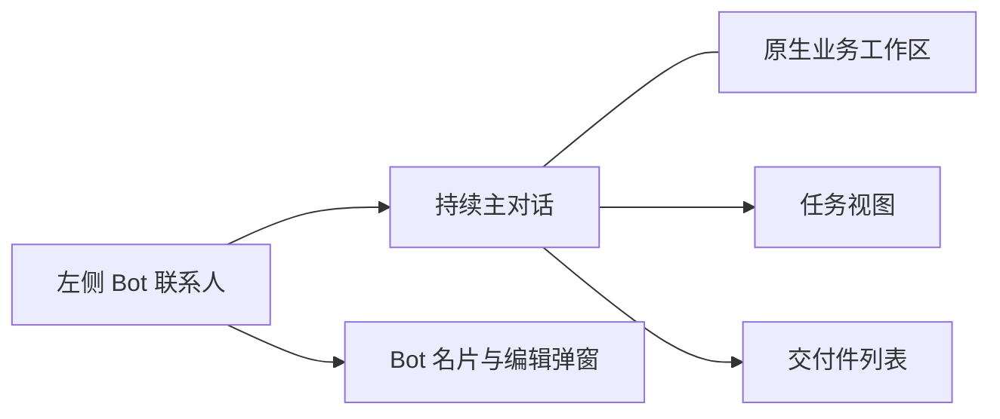
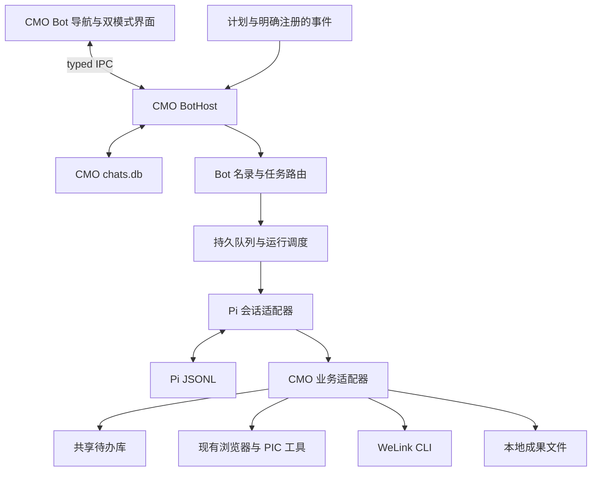

# CMO Workbench 本地 Bot 工作台改造实施方案

2026-11-15 建立，2026-11-18 更新。CMO 已完成 Bot 核心迁移，并在本地桌面程序验证了协作回执和回复顺序。聊天历史管理及其余待同步的界面细节列入 M9。实施状态见第 2.1 节及 [CMO 实施记录](C:/Myself/vibe_coding/cmo_workbench/docs/requirements/shared/ai-assistant/bot-workbench-implementation-2026-11-18.md)。

本文依据当前 CMO 源码、[通用 Bot 架构](../requirements/shared/ai-assistant/bot-workbench-architecture.md)、[会话、协作与通信完整方案](../requirements/shared/ai-assistant/bot-collaboration-and-sync-plan-2026-11-17.md)及已确认的[双方连续对话整窗高保真 v4](../../design/bot-collaboration-ui-2026-11-17/README.md)编写。本文提供 CMO 的具体接入、迁移与验收安排；OnO 已完成的功能和测试结果不自动成为 CMO 的实现状态。

交付文档保存在 OnO 的设计目录，源码链接均指向 CMO。图稿作为布局参考；实际使用的资源纳入 CMO 自己的工程，正式应用不依赖 OnO 的绝对路径。第 2 节保留迁移前证据，第 2.1 节记录当前实现；后文类型、表和 IPC 表达设计契约，具体字段与方法以 CMO 当前共享契约为准，不按旧清单重复建表或新增第二套接口。

本次以截至 2026-11-18 确认的行为为准，覆盖旧版的共享草稿租约、每次发送固定新建业务工作、按任务限定双方记录、资料信息按钮与旧对话页头，以及工作进度／交付件自动占满工作区的行为。通用文档中的 `bot-workbench/v2` 是历史契约基线。OnO 与 CMO 当前使用 v9 通信契约和版本 6 的 AI 数据库。分入口草稿遵循通用第 10.7 节，消息、补充和确认遵循本文第 6、7、9 节。

迁移仍以当前六个业务领域为起点，不照搬 OnO 的 Bot 数量、命理／阅读拆分、签到应用或用户数据。CMO 的[办公材料与 Bot 工作台草案](C:/Myself/vibe_coding/cmo_workbench/docs/requirements/shared/ai-assistant/office-materials-and-bot-workspaces.md)另有未来办公助理与会议规划，保持 pending；本轮不据此新增第七个默认 Bot 或变更导航。

### Bot 对话布局（2026-11-18 已实施）

主窗口并排模式先显示当前 Bot 的对话。顶部悬浮名片始终在对话正文这一列居中。名片右侧的箭头朝右时可展开资料侧栏，展开后箭头朝左，再点一次即可收起。侧栏与对话共用一张卡片，中间以细线分隔。侧栏沿卡片右缘滑入、滑出，和对话平移共用 240ms 的缓动。连续点击时从当前位置折返。系统开启「减少动态效果」时立即切换。点击左侧联系人切换对话，右键、菜单键或 Shift+F10 打开只有「编辑 Bot」的菜单，选择后进入该 Bot 的详情。

Bot 回复靠左，用户消息靠右。短消息随内容收宽，主对话长气泡最宽 560px。开合左侧联系人或右侧资料栏时，两侧气泡随留白水平移动，同一条消息保持原来的断行和阅读位置。宽表格和代码在气泡内横向滚动。

在主窗口的「详情」或「资料库」中，单击头像下方的名称或简介即可原位编辑。按 Enter 或点击文字下方的「保存修改」提交当前资料草稿，简介用 Shift+Enter 换行。Esc 撤销本次聚焦以来的编辑，「取消修改」撤销整份资料草稿。保存后同步更新联系人与对话名片。如果另一窗口已更新资料，侧栏显示最新版本，用户确认后只合并本地改过的字段。点击顶部头像，在头像正下方的浮层切换角色、图形和颜色。「重置」恢复当前 Bot 的默认头像预览，「保存修改」提交资料草稿。点击浮层外或按 Esc 可收起并继续浏览当前页。「详情」可以选择模型，也可打开记忆、定时任务和「工作与对话」。「资料库」在原侧栏切换为当前 Bot 的交付件，支持预览、查看来源任务和打开可用原件。

「工作与对话」在同一侧栏查看工作记录、普通对话和迁移前的对话，可按「全部」「工作」「对话」筛选。浮动模式从更多菜单进入，窄对话卡片保留输入框上方的有限空间。记录详情返回时恢复所选条目的焦点。迁移历史只读，可加入当前草稿的引用。

点击「工作台」收起资料侧栏，并在对话卡片外的右侧展开这个 Bot 对应的业务工作区。之后仍可从名片查看资料库或进度。关闭工作台后继续原对话。侧栏在宽窗中占 280–340px，卡片宽度不超过 800px 时，资料栏在卡片内覆盖正文，顶部名片仍可收起侧栏并返回原来的阅读位置。草稿和已打开的工作区继续可用。

各 Bot 从共用的供应商和模型列表中选择自己的模型。侧栏显示模型名和供应商，展开分组后用勾号标记已选模型。底部的「模型配置」直达设置里的对应页面。普通对话、委派、只读询问和后台执行使用执行 Bot 保存的模型。未选择模型或已选模型被删除时，Bot 等待选择。升级时，原来跟随默认的 Bot 会保存此前所用的模型。Host 通信版本为 v9，AI 数据库版本为 6。

### 本次刷新结论

| 主题 | 原方案的问题 | 本次采用的决定 |
| --- | --- | --- |
| 连续对话 | 一次发送、任务和独立模型上下文容易混为一体 | 消息、业务工作、运行、模型会话分开；普通连续交流沿用主会话，补充关联原工作 |
| Bot 通信 | 交接路径总是创建子任务并等待 | 联系已有 Bot；询问、通知、回复可无业务工作关联，正式委派保留依赖及真实回执 |
| 双方消息显示 | 旧图可能被实现成第三列或当前工作记录 | 已确认 v4：原对话区临时阅读双方持续往来，按原消息定位，工作区几何不变 |
| 用户参与 | 子任务的问题与批准缺少发起对话投影 | 原地澄清、紧凑确认、补充、取消和结果；多个入口指向同一原操作 |
| 输入与可靠性 | 跨窗口编辑权交接；恢复依赖整份快照 | 分入口草稿；稳定请求 ID、发送核对、自动恢复，再增加记录增量和批次保存 |
| 执行与性能 | 普通排队、尚未明确忙碌输入和缓存生命周期 | queue／安全边界 steer／受控 redirect；有限闲置缓存须先证明收益 |
| CMO 业务事实 | 旧版称 WeLink 确认未接线，且未覆盖新增办公材料草案 | 校正为当前已接线；保留通用网页写入缺口、材料权限及未开发领域边界 |
| 消息与布局收敛 | 发送／接收样式不同、回传重复、工具与工作完成混淆、子视图挤占业务区 | 单行可点击收发事件、按时序追加回复、日期与时间；三类子视图只替换对话卡片，详见第 4.5 节 |
| 长对话与性能 | 隐藏历史、重置上下文、删除数据容易混同；增量同步不能减少全部历史的渲染 | M9 分开收起历史、新对话、历史阅读与删除；分页和有限渲染独立解决展示成本，见第 4.6、6.6 节 |
| 实施状态 | 原文仍把整个 CMO Bot 系统标为待实施 | 按 CMO 自有实施记录校正；已迁移核心不重复开发，原生 steer、缓存及新增历史管理仍单列 |

## 1 目标与本轮边界

将 CMO 从「按工作台归类的多条 AI 聊天」改为「一个总 Bot + 每个业务工作台一个长期 Bot」。左侧选择负责人，Bot 默认有一条持续主对话，任务可以独立执行，原生业务页面保留在工作区。

本次沿用已经确定的决定：

1. 本机运行 Host、数据库、调度和工具，不需要云端电脑；模型继续使用 CMO 已配置的服务。
2. 首页作为总台；日程待办独立。CMO 当前已完成这两个导航入口的分离，不再次搬迁待办数据。
3. 设置由人操作，打开设置不创建 Bot、调用模型或注入设置上下文。
4. 一个 Bot 默认一个主对话入口；旧聊天保留历史。消息和工作不一一对应，耗时／委派工作按明确绑定使用独立上下文，普通连续问答不按每条消息隔离。
5. 同时提供并排和浮动两种助手模式，首次选择、记住上次、随时切换。
6. 主区域不再单列 Bot 身份行，对话与工作区直接排在全局顶栏下；Bot 名称、职责和提示词从左侧联系人名片进入。
7. 对话顶部悬浮名片打开 Bot 侧栏。「详情」包含工作进度，「资料库」展示交付件。助手模式仍由全局按钮切换。
8. Bot 可直接向其他已有 Bot 发送消息，由 Host 校验、持久化、投递和恢复；正式委派记录工作依赖，总 Bot 不必转发每条消息。
9. 第一阶段扩展现有 Electron 托盘；后续阶段再拆独立本地 Host。明确退出、窗口隐藏、系统休眠分别处理。
10. CMO 的账号、聊天、记忆和模型配置保持独立，复用架构不等于与 OnO 共享数据。
11. 灵动岛 AI 对话直接进入 CMO 总助理，与首页总台共用同一主对话、任务与交付件；不跟随主窗口所选领域，也不另建灵动岛 Bot。

完整路线见第 12 节：M0–M5 及 M7 核心已有独立实施记录，M6 已有安全边界停止后续接，不能称为 Pi 原生 steer；M8 缓存仍按测量决定。M9 新增长对话管理和界面补齐。交付件管理、DTS 的真实业务系统接入以及完整总台首页视觉重构另行实施；保留现有首页日程、待办、额度等可用入口。

## 2 迁移前 CMO 基线（历史记录）

以下为 2026-11-15 建立、11-17 复核的迁移前基线，当时 `package.json` 为 `cmo-workbench 1.6.1`，Pi SDK 为 `@earendil-works/pi-coding-agent 0.85.1`，新 Bot Host 尚未接入。保留这些证据用于理解改造原因；源码链接行位可能随迁移变化，不能将表中的旧执行路径当作当前主路径。当前状态以第 2.1 节为准。

| 迁移前实现与证据 | 当时的改造决定 |
| --- | --- |
| [导航](C:/Myself/vibe_coding/cmo_workbench/src/nav.ts:26)已有首页、日程和待办、权限、交付件、PBI、DTS，设置另行打开 | 六个现有业务入口映射六个 Bot；子页继续在工作区组织 |
| [AiScope](C:/Myself/vibe_coding/cmo_workbench/shared/ai-scope.ts:51)已经区分 `home` 与 `todo`，仍允许 `workspace:settings` | 保持已有首页/待办归属，移除设置的新任务能力；旧设置聊天归档 |
| [灵动岛助手](C:/Myself/vibe_coding/cmo_workbench/src/views/IslandAssistant.tsx:71)筛选 todo 聊天，以 `wb.island.ai.chat.v1` 记住选择，发送也固定使用 todo scope | 改接总助理唯一主对话；旧待办历史和草稿保持归属，不能只把“待办助手”标题改名 |
| [App 当前路由](C:/Myself/vibe_coding/cmo_workbench/src/App.tsx:662)使用 `BrowserPageHost` 承载权限与 PBI | 修改实际 Host 与共享外壳；不把同名旧组件当作当前页面入口 |
| [BrowserPageHost](C:/Myself/vibe_coding/cmo_workbench/src/views/BrowserPageHost.tsx:7)切换后隐藏已进入的浏览器页面 | Bot 与模式切换继续保留挂载、标签、表单和登录分区 |
| [交付件页面](C:/Myself/vibe_coding/cmo_workbench/modules/delivery/ui/DeliveryProjects.tsx:4)与 [DTS 页面](C:/Myself/vibe_coding/cmo_workbench/modules/dts/ui/DtsQuery.tsx:4)显示「页面建设中」 | 可有领域 Bot 身份和讨论入口，但能力名片必须显示业务连接尚未接入 |
| [通用工作台贡献](C:/Myself/vibe_coding/cmo_workbench/modules/workbench-ai.ts:41)没有业务工具 | 注册 Bot 不自动获得业务读写能力；按实际适配器生成能力名录 |
| [Pi 执行层](C:/Myself/vibe_coding/cmo_workbench/electron/ai-core.ts:129)每轮创建临时目录、`SessionManager.inMemory`，结束后销毁 | 替换为稳定会话文件关联；不能只给现有聊天增加头像 |
| [AI 编排](C:/Myself/vibe_coding/cmo_workbench/electron/ai-ipc.ts:84)以 Map 保存运行请求和待确认项，每轮重放最近 12 条有效消息 | 将运行、等待、结果和确认状态迁入 Host 的持久记录；IPC 退回输入输出适配层 |
| [AiStore](C:/Myself/vibe_coding/cmo_workbench/electron/ai-store.ts:28)保存 `chats(id,payload)` 与 `settings`；启动会将流式回复标为中断、pending 建议过期，并固定写 `user_version=1` | 保留旧聊天格式，新增版本迁移及 Bot 表；恢复逻辑按新旧记录分别处理 |
| [草稿 IPC](C:/Myself/vibe_coding/cmo_workbench/electron/ai-ipc.ts:341)仅接收 id/text，[主面板](C:/Myself/vibe_coding/cmo_workbench/src/views/AiPanel.tsx:462)与[灵动岛](C:/Myself/vibe_coding/cmo_workbench/src/views/IslandAssistant.tsx:104)分别防抖保存 | 两入口改为独立草稿和版本；主窗口并排／浮动沿用同一份；不引入编辑租约和手动接管 |
| [流式处理](C:/Myself/vibe_coding/cmo_workbench/electron/ai-ipc.ts:480)已有约 50ms 的文本合并，但 flush 仍保存和广播完整聊天，工具状态也走整份更新 | 保留已有合并收益，测量后改为记录增量与提交批次；不能把 CMO 描述成每个 token 都立即写库 |
| [main.ts](C:/Myself/vibe_coding/cmo_workbench/electron/main.ts:40)已使用 `%APPDATA%/CMOWorkbench`，有单实例锁、自启、托盘和默认关闭隐藏 | 在既有生命周期内接入 Host；保持已保存的关闭行为选择 |
| [浏览器任务](C:/Myself/vibe_coding/cmo_workbench/electron/browser/tasks.ts:14)绑定 `WebContents`，窗口销毁会中止；[任务记录](C:/Myself/vibe_coding/cmo_workbench/electron/browser/store.ts)只保留最近 40 条 | 浏览器运行身份与 Bot 任务身份分开；不能用最近 40 条浏览记录充当持久任务与交付件库 |
| [PIC 群组工具](C:/Myself/vibe_coding/cmo_workbench/modules/permission/group-tools.ts:16)已有 `group_fill / group_inspect / group_submit`，提交入口内部确认 | 保留原有确认、参数核对与未知结果处理，Host 只接入其回执，不叠加同一次操作的重复确认 |
| [WeLink 注入](C:/Myself/vibe_coding/cmo_workbench/electron/ai-ipc.ts:451)已传入 `confirmWrite, welinkAgenda`；[工具实现](C:/Myself/vibe_coding/cmo_workbench/modules/welink/ai-tools.ts:56)在非读取白名单命令缺少确认通道时拒绝执行 | 保留已修复链路；M1 将内存等待接到持久 action、参数版本和真实回执，不能重做一次重复确认 |
| [办公材料规划](C:/Myself/vibe_coding/cmo_workbench/docs/requirements/shared/ai-assistant/office-materials-and-bot-workspaces.md)将证据、账号、来源采集作为共用服务，办公助理与多 Agent 仍 pending | 为消息资源引用预留材料来源和版本；不借本次 Bot 改造宣布简报、会议伴侣、手机渠道或办公 Bot 已接入 |
| [CodeAI Hook](C:/Myself/vibe_coding/cmo_workbench/electron/agent-hooks.ts)与 [事件契约](C:/Myself/vibe_coding/cmo_workbench/shared/agent-message-contracts.ts)接收外部 `reply / failed` | 继续作为外部通知来源，不映射成内部 Bot 的完成或确认事件 |
| [待办同步约束](C:/Myself/vibe_coding/cmo_workbench/modules/todo/SYNC.md)要求共享 `%APPDATA%/To-Do-List/tasks.db` 的业务表 | Bot 数据落在 CMO 自有库，不修改共享库的聊天、设置或 schema |

### 2.1 2026-11-18 当前状态与剩余边界

协作回执与对话顺序已在 CMO 的独立 Electron 窗口、模拟模型和隔离数据库中验收。其余界面条目的状态依据源码及此前的 CMO 实施记录。

| 范围 | 当前状态与后续工作 |
| --- | --- |
| 核心运行 | 六个长期 Bot、独立 Host、认证命名管道、持久队列、Pi 会话、原地确认与补充、双方持续记录、可靠发送、增量同步和分入口草稿已有实现。协议 v8，数据库 6 |
| 协作回执与续答 | 发出提示跟在交接段之后。助理回信时先显示可点击的来源提示，总管在下方开始新的思考和回复。回执与新回复一起保存，实时、刷新及重开顺序一致。完成状态依据实际业务结果，工具调用失败单独计数。 |
| 执行中补充 | 已实现关联原工作、旧建议失效、安全边界停止后续接；不是 SDK 原生 steer／redirect。Pi 会话文件持久保存，运行实例仍每轮释放，没有启用闲置 Agent 缓存 |
| 消息与面板 | 已接入统一收发事件、Bot 回复日期时间、工作进度／交付件仅替换对话卡片、折叠过程按需挂载；保留现有工作区页面实例。完整视觉与性能矩阵仍须使用 CMO 实机验证 |
| 语音定位 | CMO 的 `SpeechInput` 仍按输入框右边缘定位；OnO 已改为与输入框横向居中。CMO 居中、窄窗及菜单边界验收列入 M9，不把 OnO 的结果当成已同步 |
| 聊天历史 | 「工作与对话」已支持只读查看普通对话和迁移前的对话。主聊天仍读取并渲染完整消息，收起历史、新主对话和分页渲染仍属 M9 计划 |
| 验证证据 | 本次 CMO 专项 92/92 通过，正式构建通过。原生窗口中两次往来形成三段总管回复，刷新和重启后消息 ID、内容、次序一致，测试待办只写入一次。此前核心迁移另有专项 82/82 和原生流程 14/14 的记录，最近一次全量统计为 935/980。 |
| 业务边界 | 保留 CMO 既有 WeLink、PIC、PBI、SSO 与待办约束；没有据此证明真实企业写入验收。通用网页写入识别仍有依赖声明的缺口；DTS／项目交付系统、动态 Bot 和用户群聊未因此完成 |

实施证据与局限统一引用 [CMO 2026-11-18 实施记录](C:/Myself/vibe_coding/cmo_workbench/docs/requirements/shared/ai-assistant/bot-workbench-implementation-2026-11-18.md)。独立 Host 已有系统托管路径，也不等于已替用户注册任务计划或验证实际登录启动。

## 3 Bot、工作区与能力映射

以下名称与当前 CMO `shared/bot-contracts.ts` 默认配置对齐；显示名称可以修改，不覆盖用户已有改名。首次迁移生成稳定 UUID `botId`，以固定 `seedKey` 唯一识别，改名不改变寻址。下文保留的“总助理／日程助理”等称呼表示职责；实际 UI 读取档案名称，当前对应“总管／助理”。

| seedKey | 默认名称／职责标签 | workspaceId 与现有页面 | 首期实际能力 |
| --- | --- | --- | --- |
| `coordinator` | 总管／CMO 总台 | `home` → `home` | 接收目标、查询名录、委派、汇总任务与交付件；按需读取获准摘要 |
| `schedule` | 助理／日程和待办 | `todo` → `todo` | 现有待办查询与建议确认；WeLink 日程保持第 8 节的实际接入与确认约束 |
| `permission` | 权限管家／权限管理 | `permission` → `permission-query`、`permission-groups` | 已授权浏览器任务；PIC 专用工具沿用现有流程 |
| `delivery` | 交付件管家／交付件管理 | `delivery` → `delivery-projects` | 讨论、整理用户提供内容及生成本地成果；项目交付系统状态为未接入 |
| `pbi` | PBI系统管家／PBI 管理 | `pbi` → `pbi-features`、`pbi-modules` | 当前已授权页面的浏览器操作与结果核验；没有专用结构化 PBI API |
| `dts` | DTS系统管家／DTS 管理 | `dts` → `dts-query` | 讨论、整理用户提供问题及生成本地成果；DTS 查询系统状态为未接入 |

`settings` 不创建 Bot。契约中保留但当前一级导航未展示的 `life / reading / web / browser` 不因迁移新增默认联系人；其历史聊天和原入口继续可读取，不能自动并入总助理的全部上下文。

职责只描述业务分工。例如「权限助理」负责权限管理业务，不拥有修改其他 Bot 权限的管理特权。公开名片由档案与实际工具能力生成，至少区分可用、需要登录/窗口资源、尚未接入；不可用能力不出现在可执行工具清单里。

未来工作台与 Bot 数量不强制一一对应；会议页、会议室预约、单场会议、简报或文件不自动新建长期 Bot。若后续确认办公助理，再为其分配稳定身份和材料权限；当前六 Bot 迁移无需等待这项业务规划。

公开名录使用字段白名单：稳定 ID、名称、职责、实际能力、允许公开的忙闲与等待状态。工作说明、私人记忆、其他用户私聊、凭据不进入 `list_bots`。能力保持“待办管理／权限管理／网页操作”等大类，不拆成大量微标签；“定时任务”统一用词。模型从全局已配置模型中选择，每个 Bot 独立保存引用。

### 3.1 两种“交付件”的关系

| 名称与入口 | 范围 | 数据来源 |
| --- | --- | --- |
| 对话顶部「交付件」 | 当前 Bot 承担任务产生的报告、文档、表格、图片、文件及结果引用 | CMO Bot 产物索引、实际已保存文件或业务资源引用 |
| 左侧「交付助理／交付件管理」 | 项目交付件管理这一业务领域 | 当前是占位页；将来接入项目系统后由对应业务适配器提供 |

总助理、权限助理、PBI 助理等都可以产生自己的交付件，无需全部转给交付助理。跨 Bot 汇总保留产物原始来源和负责人；同一份文件用引用关联，不复制成多个权威副本。

参考材料仍由输入附件或业务资源读取；只有确实保存或登记成功的成果进入交付件列表。业务申请回执可以作为成果引用，但「已提交」必须保留其原始状态，不能标成「审批已生效」。

## 4 界面实施规格

### 4.1 布局与入口

采用 [并排 v3 参考图](../requirements/shared/ai-assistant/design/bot-parallel-windowlight-afternoon-2026-11-15-v3.png)的结构，将示例联系人、文章编辑器替换为 CMO 的 Bot 与真实页面。图中 OnO 业务文案、日期和内容不是 CMO 的实际数据。

经典与悬浮导航分别参考[经典 v2 · 双长胶囊](../requirements/shared/ai-assistant/design/bot-parallel-classic-windowlight-afternoon-2026-11-15-v2.png)和[悬浮新增稿](../requirements/shared/ai-assistant/design/bot-parallel-floating-windowlight-afternoon-2026-11-15-v1.png)。经典采用留边且互不相连的横向长胶囊顶栏与近全高纵向胶囊侧栏，设置在侧栏内底部；悬浮采用分组顶栏、较短联系人胶囊及独立设置。两张均为并排助手的导航对照，具体比例仍待视觉反馈；不改变第 4.2 节的共享几何约束，两套导航都保留。



1. 左侧联系人显示头像、名字、职责和状态。左键切换对话，右键或 Shift+F10 打开「编辑 Bot」菜单。设置仍位于左下。
2. 对话与工作区顶边对齐到全局顶栏下，不新增整行 Bot 头像、名称和说明。现有业务页标题、页签、地址栏保留在工作区内部。
3. 顶部居中的 Bot 名片打开卡片内侧栏。详情、资料库与单独展开工作台的交互以本文「Bot 对话布局」为准。
4. 交付件列表至少显示名称、类型、来源任务和更新时间，支持打开/预览及返回来源对话；空态、不可访问和文件已不存在分别表达。列表查询受 Bot 和任务授权范围约束。
5. Bot 名片显示名称、职责、工作说明摘要和实际能力；完整工作说明与记忆管理从编辑入口进入。查看或编辑资料本身不运行模型。
6. 首次启动助手选择并排或浮动，之后读取 CMO 自有偏好。全局下拉提供并排／浮动／收起，前两项用小示意图且不撑宽菜单。浮动初始小输入入口按整个应用视口横向居中，轻流光提示；点击后展开输入，可触发短暂的全局边缘流光与冲击波。收起助手时小入口也隐藏，不能残留“继续聊天”胶囊。
7. 收起答复、收起输入和隐藏助手不停止任务。主窗口并排／浮动是同一个编辑入口，保留 Bot、草稿、回复目标及业务对象；主窗口与灵动岛各自保存草稿，无编辑权申请、续约或手动交接。隐藏前保存本入口，见第 6.4 节。
8. 对运行中的任务保留停止/取消入口；已有结果或待确认到达时标未读，不抢焦点或自动展开。

### 4.2 与 CMO 外观方案及现有页面共存

外观按 [CMO 外观实施方案](cmo-appearance-system-implementation-2026-11-15.md)落地，Bot 显示模式与导航、材质、主题独立。具体主题与材质以 CMO 当前组件为准；本次不重新调整外观默认值，也不把设计文档当作所有视觉状态已验收的证据。

该外观方案的新版本已调整标题卡、材质档位和窗影时段规则。Bot 方案只要求取消额外的 Bot 身份行，不删除业务页自己的标题卡或重设外观默认值；标题在已有工作区外壳内时共享该外壳，避免重复套卡。玻璃和菜单覆盖规则以实际 CMO 外观实施结果为准。

修改 `App.tsx` 的布局组合与 `AiPanel` 呈现，不复制一个独立聊天状态机。保留 `BrowserPageHost` 已进入后只隐藏的机制、`defaultTabs`、`activeWorkspace` 和回调。模式切换不能通过更换 key、重新创建 webview 或重建浏览器分区实现。

现有 AI 宽度为 340–480、默认 380；首期保留拖动偏好，并在新并排位置验证可用宽度。窄窗可按需切换主对话/工作区，不能靠压扁浏览器或裁掉按钮满足布局。现有语音、模型选择、建议卡、浏览器授权卡、接管和历史查看能力继续由同一控制器提供。

侧栏收缩／展开时，并排模式由相邻对话区承接宽度变化，保持右侧工作区边界；无并排对话区时才由工作区承接。浮动／收起切换到并排时，工作区向右收窄腾出空间，对话区淡入；反向切换平滑恢复。展开与折叠联系人使用同一头像尺寸、行位和悬停圆角，只改变横向可用宽度，不重做已确认外框。

工作区沿用独立的业务页头。总台、日程单页省略“我的看板／日程待办”重复小页签；其他工作区的内容导航与“工作区”同排，采用最新主题短下划线规则。缩小标题到首张内容卡的空隙，保留原生业务标题卡。具体尺寸和三档材质按 CMO 外观方案，不把高保真像素硬编码成所有窗口的唯一尺寸。

### 4.3 灵动岛直接对总助理说话

灵动岛 AI 对话固定连接本 CMO 实例中 `seedKey=coordinator` 的 Bot，由 Host 解析其稳定 `botId + mainChatId`。这是总台主对话的小窗入口；工作台内的浮动助手仍跟随所选领域 Bot。

1. 小窗标题、头像、无障碍名称及空态读取总助理档案，职责标为总 Bot；复用现有显示、置顶、隐藏操作，不额外增加一层选择 Bot 的流程。
2. 打开后读取总助理主对话快照，提交走 `workbench.bot.submit`，使用既有 `clientRequestId` 去重和 `onChanged` 订阅。小窗与总台共享消息、任务、交付件及等待状态，不创建另一条聊天或另一套执行链。
3. 两处显示同一主对话时，按第 6.4 节分别读取 `main / island` 草稿，均可直接输入；仅同步已发送内容、工作进度和成果。主窗口正在编辑其他领域 Bot 时不自动切换其工作区，发送回执不得清空另一个入口或后续新输入。
4. 提供“打开完整对话”，恢复 `home` 总台内同一聊天和任务位置，并保持原并排／浮动偏好。关闭小窗只隐藏，待确认事项仍保留；打开或恢复窗口不自动发消息或批准操作。
5. 新需求由总助理直接接收，再按实际能力委派日程、权限、PBI 等 Bot。现有消息页、日程提醒和 CodeAI 通知保持原来源；点击具体 Bot 任务通知按其 `botId / botTaskId` 定位，不能全部改成总助理的新请求。
6. 灵动岛仅是请求来源。需要浏览器操作时，由 Host 解析明确资源并使用已有业务 Browser Runtime；没有可用页面则等待资源，不把 `IslandAssistant` 的 `WebContents` 当作业务浏览器载体。

迁移时停止用 `wb.island.ai.chat.v1` 选择新对话；该键原来指向的 todo 聊天和草稿仍按第 11 节归日程助理，不拼入总助理。小窗与主窗口的对话同步、确认和取消都经过同一 Host；主窗口未显示也应能发起具备执行资源的任务。

### 4.4 名片、交付件与浮动状态的补充规格

按通用第 10.8 节实现以下状态，使用 CMO 已有弹层和控件；本节是行为规格，不冒充新高保真或已完成的 UI。

| 状态 | CMO 的落地要求 | 验收点 |
| --- | --- | --- |
| Bot 名片及编辑 | 联系人右键／键盘菜单打开；顶部固定头像、名称、职责和编辑／关闭，同一面板内切换“资料／记忆／定时任务”，列表和表单不跳工作区。显示真实能力及未接入状态；保存携带 profile revision | 查看不切页面/不调用模型；切页保留未保存输入，失败或版本冲突保留编辑；能力不可通过改文案提升 |
| 交付件展开 | 当前 Bot 可访问的成果列表，带生产者及来源任务；打开原文件/业务对象，返回来源对话 | 空态、加载失败、文件不存在、无权限各有明确状态；不将该列表重定向到交付件管理占位页 |
| 浮动输入与答复 | 小入口展开输入，答复在上方使用有高度上限的可滚动区域；优先展示当前轮，完整历史按需进入；工作进度／成果在原面板内切换 | 不随流式输出无限撑高；用户上翻后不强制跟随；收起不取消，沿用 chatId 与本入口草稿；不重建权限/PBI webview |

11-16 的[主要状态稿](../requirements/shared/ai-assistant/design/bot-state-review-2026-11-16.md)保留为历史参考；发生冲突时，以本次确认及 CMO 外观方案的 11-17 修订为准。CMO 的权限/PBI 等专属图尚未另绘，联系人仍按本文六 Bot 映射。M3 留下实机证据，不能以旧图恢复身份行、信息角标或“资料”按钮。

### 4.5 已确认的双方记录与紧凑交互

采用[整窗高保真 v4](../../design/bot-collaboration-ui-2026-11-17/pair-conversation-full-window-v4.png)：在左侧原对话区查看“总管 ⇄ 助理”等双方持续往来，按实际档案名显示；右侧工作区位置、宽度及页面实例保持，返回后继续主对话。顶部只有返回与双方身份，不加“小墨／日程”等对象切换条，不显示“本次工作 · N 条消息”。工作关联用于定位与追踪，不分割双方消息流。

点击某次交接定位原 messageId，可向前后分页；正文、头像、发送者、时间来自同源原消息，不改写成摘要。只读查看，不提供第二输入框或另一套批准按钮。双方往来、工作进度和交付件统一在原对话卡片内切换，旧版临时扩大阅读并隐藏工作区的规则取消；浮动使用原浮动面板，返回恢复草稿、阅读位置、确认版本和焦点。具体权限见第 9 节。

其他已确认细节一并纳入 CMO 适配：

| 区域 | 要求 |
| --- | --- |
| 主消息流 | 普通聊天不额外挂“已完成任务”；交接一行事件，协作进度只显示一份；工具调用完成不能冒充工作完成 |
| 收发事件 | 居中透明单行：“已发消息给 → 对方头像 → Bot 名称 → 小箭头”“消息来自 → 来源头像 → Bot 名称 → 小箭头”；头像 22px、文字 13px、点击区域至少 32px、间距 6px、悬停圆角 8px。两者均可点击／键盘打开对应双方往来，不显示“日程 · 已完成”作为发送回执 |
| 回复时序 | 已发正文保持原位，交接事件位于实际发送处；回传后另起当前 Bot 的新回复，不合并改写旧正文，也不在其汇总后追加整份对方报告。对方原文保留在双方记录及执行 Bot 的来源明确的记录中 |
| 回复时间 | 每条 Bot 回复在名称旁显示日期＋时间，使用记录真实时间及本地格式；历史缺值明确回退，不以渲染／刷新时间冒充发送时间 |
| 问题与选择 | 问题直接出现在发起对话；选项扁平紧凑、能一行不两行；“其他 + 输入框”直接可见，不用“补充回答”折叠入口 |
| 修改确认 | 已有值只显示实际变化的“旧值 → 新值”；新增只显示建议值；未设置／未变字段默认收起，长内容必要时才换行 |
| 输入操作 | 发送、附件、语音统一圆角矩形和垂直对齐；去掉输入底部常驻“草稿已保存／历史对话”，草稿失败才提示，历史保留在独立入口 |
| 语音听写 | 以当前输入框的水平中点定位语音卡片，随并排／浮动、侧栏及窗口尺寸更新，窄窗再做视口约束；下拉菜单左右不超出语音卡片。CMO 当前右对齐实现待补齐，不改变录音／预览／插入流程 |
| 联系人紧凑布局 | 展开和折叠同步使用 58px 行距基线、4px 行间距，头像和纵向位置一致；沿用已确认圆角悬停外框及右键资料，设置左对齐，不因头像或历史功能重做外框 |
| 资料、记忆、定时任务 | 入口点击区、关闭、悬停一致；保存记忆不能显示“确认删除”；创建／保存主按钮、取消次按钮；启停状态与真实计划一致 |
| 工作进度与成果 | 普通聊天记录折叠，突出进行中、待确认、受阻；“查看任务”统一“查看进度”，详情不重复返回／继续入口；成果卡与目录共用 artifact 身份 |
| 头像与动效性能 | 复用头像系统，头像与颜色分开选；静态图形按稳定配置缓存，不因消息流／鼠标悬停反复构建。保留已确认悬停外框，不扩大重绘到整个应用 |
| 小窗与主题 | “对话／消息”可双向切换且保留状态；深色气泡和文字使用成对主题 token；弹层不被卡片裁切或被后续表面遮挡 |

流光／冲击波只在指定展开动作短暂触发；回复流不反复触发全屏特效。头像运行反馈、窗口不可见暂停和减少动态效果遵循 CMO 外观方案。以按钮悬停、连续输入、长历史和切栏响应验收，不以静态图或打包成功替代流畅度证明。

OnO 各次界面修改的完整合并清单见[完整方案第 5.5 节](../requirements/shared/ai-assistant/bot-collaboration-and-sync-plan-2026-11-17.md#55-2026-11-18-归并的界面与消息修订)。CMO 仅吸收共用交互；命理、阅读、签到账号和分布概览等 OnO 业务改动不迁入 CMO。

### 4.6 长对话与历史入口（M9，待实施）

历史管理后续从 Bot 详情扩展，规划中的操作包括“收起历史消息”“开始新对话”“历史对话”，浮动与灵动岛也能进入。它们的作用必须明确：

| 操作 | 界面与上下文语义 |
| --- | --- |
| 收起历史消息 | 设置当前聊天的显示边界，清爽呈现后续消息；历史仍可展开，Bot 当前上下文和记忆不重置，任务继续运行 |
| 开始新对话 | 当前聊天进入历史，新建该 Bot 的空主对话及新的 Pi 会话；保留 Bot 身份、长期记忆、任务、成果、定时任务和业务数据。菜单说明“旧对话保留在历史中” |
| 历史对话 | 在原对话卡片内分页阅读、搜索和定位旧记录；不把所有历史加载到当前画面，也不自动重新注入模型或开始执行 |
| 删除历史 | 在历史管理内单独提供，明确范围并确认；不是默认清屏方式。与进行中工作有关的记录须先解决依赖；不会连带删除业务申请、待办、文件或长期记忆 |
| 压缩上下文 | 属于模型输入管理，优先使用 Pi 已有能力；不等于收起画面、删除记录或新建主对话，不另做一套摘要执行引擎 |

旧工作正在运行或等待确认时，继续显示可返回的工作入口；开始新对话不取消、不批准，也不把旧工作回执发到新话题。历史聊天对用户禁止任意续发，但原工作仍可合法写入自己的结果／确认状态。主窗口、灵动岛的草稿独立保存，新旧聊天切换不得丢失未发内容。底层约束见第 6.6 节。

性能另用分页和有限消息渲染处理；收起历史不能只是隐藏 DOM 后仍挂载全部 Markdown／表格。长正文、工具详情按需展开，问题和确认不能因截断失去操作入口。外部产品依据及差异见 [OnO 完整方案第 15.6 节](../requirements/shared/ai-assistant/bot-collaboration-and-sync-plan-2026-11-17.md#156-长对话管理的参考核对2026-11-18)，不照搬名称而改变数据语义。

## 5 Host 与 Pi 的职责



Host 负责稳定身份、发现、授权、持久任务、消息、交付件、调度及恢复；Pi 负责推理和受控工具调用。现有 `ai-ipc.ts` 的模型配置接口可保留，任务执行逐步转交 Host。

早期迁移阶段的 Host 曾规划为 Electron 主进程内服务；当前 CMO 已接独立本地 Host，不回退到旧装配，也不为每个 Bot 启动进程。界面经类型化 IPC 和认证桥提交命令、订阅状态；内部 Bot 通信直接经 Host，不通过页面、模拟输入或桌面通知转发。

首期并发建议：同一 Bot 的普通执行串行，同一 Pi 会话一次一个写入者，全局最多两个活跃执行，同一浏览器标签一次一个任务。等待用户、协作者或窗口资源时保存状态并释放调度名额，不占住线程等待 Promise 跨重启恢复。恢复原工作与新请求仍由同一调度器核对依赖和顺序，消息输入不额外开一条并发执行通道。具体并发上限先作为内部常量，无需增加设置项。

## 6 数据与接口契约

### 6.1 身份与运行记录

在 CMO 新增 `shared/bot-contracts.ts`，通过 Zod 定义校验和 TS 类型，不向同步自上游的待办契约塞入整个 Bot 模型。以下字段是实现所需的最小集合，状态和值须在 Host 和 UI 共用：

```typescript
type BotTaskStatus =
  | 'queued' | 'running' | 'waiting_user' | 'waiting_bot'
  | 'waiting_resource' | 'interrupted'
  | 'completed' | 'failed' | 'cancelled';

interface BotProfile {
  id: string; seedKey: string; workspaceId: string;
  name: string; avatar: string; description: string; instructions: string;
  mainChatId: string; enabled: boolean; revision: number; updatedAt: string;
}

interface BotResourceRef {
  kind: string; id: string; version?: string; label?: string;
}

interface DraftSnapshot {
  chatId: string; surface: 'main' | 'island'; revision: number; text: string;
  replyToTaskId: string | null; resources: BotResourceRef[];
  target?: { rootTaskId: string; actionId?: string; expectedActionRevision?: number };
}

interface BotTask {
  id: string; botId: string; chatId: string;
  rootTaskId: string; parentTaskId?: string;
  sourceMessageId: string; replyToEntryId?: string;
  kind: 'chat' | 'work' | 'delegated' | 'routine';
  contextMode: 'main' | 'isolated';
  requirementsRevision: number; runGeneration: number;
  status: BotTaskStatus; reason?: string;
  resources: BotResourceRef[];
  piSessionId?: string; piSessionPath?: string;
  browserTaskId?: string; browserWorkspace?: string;
  revision: number; updatedAt: string;
}

interface BotMessage {
  id: string; fromBotId: string; toBotId: string;
  taskId?: string; rootTaskId?: string; parentTaskId?: string;
  kind: 'request' | 'question' | 'result' | 'notify' | 'correction' | 'cancel';
  replyTo?: string; content: string; references: BotResourceRef[];
  origin: 'user' | 'bot' | 'schedule'; sourceUserMessageId?: string;
  createdAt: string; deliveryState: 'pending' | 'accepted' | 'delivered' | 'rejected' | 'uncertain';
}

interface BotArtifact {
  id: string; producerBotId: string; taskId: string;
  rootTaskId: string; chatId: string; title: string; mediaType: string;
  resource: BotResourceRef; createdAt: string;
}
```

`workspaceId` 表示业务领域；`viewId / browserWorkspace / tabId / resourceRef` 表示具体页面与对象，不得用页面切换改写已提交任务的目标。`taskId` 是 Bot 任务，和现有待办事项 ID、浏览器任务 ID、CodeAI sessionId 分开命名。

每次发送保留自己的 `clientRequestId` 和用户消息。Host 根据已核验的关联决定新工作、补充原工作、回答原问题或取消；回执说明接到哪里，不要求每次发送都新建根工作。`replyToTaskId` 的引用语义不能被偷偷改成批准或补充，新的 `target / intent` 须显式声明能力。

| 概念 | CMO 目标关系 |
| --- | --- |
| 主对话 | 长期用户与该 Bot 的消息视图，包含多轮问答及多项工作 |
| 双方往来 | 以两个稳定 Bot ID 查询已投递消息，跨不同工作持续排列；没有业务工作也可存在 |
| 业务工作 | 为目标、依赖、确认和成果保留关联；补充同一目标不重复建另一份业务 |
| 单次运行 | 某次调度的执行及代际，可暂停、恢复、终止；不等于用户看见的新工作 |
| Pi 会话 | 主会话或明确隔离的工作上下文；持久保存，可重开，与进程内缓存分开 |

普通问答可以有内部 `kind=chat` 执行记录，不额外挂“已完成任务”。用户不选择“聊天／工作”模式；待确认、协作、异常和成果才进入工作展示。`kind` 用于来源与历史兼容，`contextMode` 明确上下文绑定，不靠“是否带附件”或待办工具被调用就判定必须隔离。

以上是设计类型示意，当前字段以 CMO `shared/bot-contracts.ts` 及数据库迁移为准；已有功能沿用同一接口，剩余能力按版本增加。消息来源、工作关联和执行代际由 Host 生成／校验，模型不能伪造来源、填另一条私聊目标或通过填写 `deliveryState` 宣布成功。

档案中的工作说明是私有执行指导，公开名片只暴露职责、领域和当前能力。工具授权来自 Host 的适配器与用户许可，不接受模型提交的任意权限列表。首版沿用 CMO 当前全局模型配置，暂不增加每个 Bot 一套供应商配置。

### 6.2 存储介质与新增表

扩展现有 `%APPDATA%/CMOWorkbench/chats.db`。保留 `chats` 与 `settings`，新增以下表；字段可采用可索引的身份/状态列与 JSON payload 组合，避免为嵌套工具数据建立大量拆分表。

| 新增表 | 关键列／唯一约束 | 保存内容 |
| --- | --- | --- |
| `bots` | `id` 主键；`seed_key`、`workspace_id` 唯一 | 档案及 revision、唯一主对话关联、启用状态；主对话创建后与 main 关联同事务维护 |
| `bot_chat_links` | `chat_id` 主键；`bot_id` 索引；main 角色对每 Bot 唯一 | 原聊天归属、main/history、准确的 Pi 主会话关联；不存跨窗口共享草稿 |
| `bot_drafts` | `(chat_id, surface)` 唯一 | 本入口 revision、正文、附件、回复与可选补充目标；消息流更新不写此表 |
| `bot_submissions` | `client_request_id` 唯一；聊天与来源入口索引 | 冻结载荷摘要、数据代际、接纳回执、原 messageId 及可选工作／操作关联；支持多次补充关联同一工作 |
| `bot_tasks` | `id` 主键；`status / bot_id / root_task_id` 索引 | 任务、父子关系、资源目标、上下文绑定、等待关系、要求版本、运行代际、执行认领和版本；不把 requestId 强制一对一绑定业务根工作 |
| `bot_messages` | `id` 主键；收件方与投递状态索引；双方 ID 与稳定时间／ID 排序索引 | 原消息、来源、回复关系、投递及回送状态、重试时间、可选工作关联；逻辑收发箱与双方阅读共用此表 |
| `bot_actions` | `operation_id` 主键；`task_id` 索引 | 工具操作、参数摘要/哈希、目标版本、确认状态、执行状态与真实回执 |
| `bot_artifacts` | `id` 主键；`task_id + idempotency_key` 唯一 | 产物元数据、来源任务、实际资源引用，不存业务库副本 |
| `bot_memories` | `id` 主键；`scope + owner_id` 索引 | Bot 私有、任务或显式共享的记忆及来源，可更正/删除 |
| `bot_schedules` | `id` 主键；`enabled + next_run_at` 索引 | 所属 Bot、时区、触发规则、目标资源、下次运行及错过执行策略 |
| `bot_schedule_firings` | `schedule_id + scheduled_at` 唯一 | 每次触发关联的任务、是否合并补跑及处理结果 |

主对话历史首期沿用 `chats.payload`，新任务与消息不复制整条主对话。新草稿只写 `bot_drafts`；旧 `chats.payload.draft` 保留迁移备份后停止写入。`settings` 保存 CMO instanceId、数据代际、迁移标记及界面偏好，不再保存第二份草稿。没有跨窗口草稿编辑租约。

M1 的主进程发件记录只保存待核对的冻结发送意图，取得权威接纳回执后结束；它不能作为第二份聊天或业务执行库。M7 需要重放时增加有保留上限的事件日志／提交水位，和聊天、工作变更同事务提交；持久历史不随事件日志过期删除。不要从 DS-Bot 同时搬入 state.json 和多套消息文件。

Pi 原生记录放在 `userData/bot-sessions/<botId>/`，由数据库保存 SDK 返回的准确文件路径和 sessionId；执行 cwd 放在 CMO 自有 `bot-runtime/<botId>/`。不能落到 OnO、默认用户全局 Pi 会话目录或临时目录。

生成文件放在 `userData/bot-artifacts/<taskId>/`；已存在的业务对象只登记受控引用。Host 验证文件名和实际资源可访问性，先完成文件写入，再登记产物；索引失败不得报告交付成功，重启核对未完成登记。模型不能通过产物工具指定任意本机写入路径。

`ai-config.json`、`app-settings.json`、W3 凭据、浏览器分区、`browser-state.json`、CodeAI 消息存储保持原归属。供应商密钥继续使用现有 `safeStorage` 路径；密钥和登录凭据不进入名片、记忆、Pi 上下文或产物。

### 6.3 主进程与 UI API

在 [workbench-api.ts](C:/Myself/vibe_coding/cmo_workbench/shared/workbench-api.ts) 和 [preload.ts](C:/Myself/vibe_coding/cmo_workbench/electron/preload.ts)增加 `workbench.bot`，继续使用现有隔离桥，不向 renderer 暴露原始 Electron 或数据库对象。

| 建议方法／IPC | 行为 |
| --- | --- |
| `list` / `bot:list` | 档案摘要、能力状态、未读与待处理数量 |
| `open` / `bot:open` | 打开唯一主对话，返回聊天、工作进度、交付件、本入口 DraftSnapshot 及界面位置；不执行模型 |
| `updateProfile` / `bot:profile:update` | 编辑名字、头像、职责和工作说明，携带 expectedRevision；成功加一，冲突返回当前档案；不接受权限提升字段 |
| `submit` / `bot:submit` | 接收 botId、chatId、expectedDraftRevision、clientRequestId、文本、引用、pageContext 及可选 intent／target／expectedActionRevision；回执区分新工作、接到原工作、待澄清及待核对，只处理本入口发送快照 |
| `getDraft` / `bot:draft:get` | 读取当前受信入口的草稿；入口身份由 Host 解析，不申请编辑权 |
| `saveDraft` / `bot:draft:save` | chatId、expectedRevision 与完整草稿；只更新本入口版本，不启动执行 |
| `getSubmissionStatus` | clientRequestId、chatId、inputHash、dataEpoch；查询已接纳／待核对／明确拒绝／在有效去重范围内未找到，不以连接超时判定失败 |
| `getCollaboration` | 按 rootTaskId 聚合这项工作的状态、原 action 引用、负责人和真实回执；不承担双方完整历史 |
| `getBotExchange` | botAId、botBId、可选 anchorMessageId／cursor；按双方读取有权查看的持续记录及前后分页，无固定 rootTaskId 过滤 |
| `listTasks`、`getTask`、`cancelTask`、`retryTask` | 查询状态与协作过程；明确取消，或先核对原操作后恢复指定任务 |
| `listArtifacts`、`openArtifact` | 按当前授权查询；由 Host 解析资源并交给现有预览或打开能力 |
| `answerAction` / `bot:action:answer` | 对指定操作提交回答/确认，绑定 operationId 与所见版本；复用已有确认 UI |
| `listMemories`、`updateMemory`、`removeMemory` | 按归属管理记忆与来源 |
| `listSchedules`、`saveSchedule`、`setScheduleEnabled` | 查看、注册或停用例行计划；保存成功才称已安排 |
| `getHostState` / `bot:host:state` | 当前连接、运行阶段、暂停原因和后台状态 |
| `onChanged` / `bot:changed` | 首期发出对象及 revision 变化，UI 按需读快照；草稿事件含入口，不能覆盖其他入口或未保存新输入 |
| `getChatSnapshot`、`subscribeChat` | M7 返回一致快照与水位、重放／订阅记录级增量；序号与游标仅在对应数据代际和记录流内有效 |

所有新 IPC 校验来源窗口和输入：由主进程登记受信主窗口及灵动岛助手窗口，网页 guest 不得直接调用 Host。灵动岛的总 Bot 绑定由 Host 解析，不能由旧 todo scope 或主窗口选择覆盖；请求来源与浏览器执行资源分开。UI 事件是通知而非唯一事实来源：订阅建立或重连时读取快照，以 revision 忽略旧更新；界面隐藏时未读与任务状态仍由 Host 保存。

迁移期间保留现有 `workbench.ai` 配置、建议应用与历史读取接口。进入新模式的 Bot 只走一条执行链；不要同时调用旧 `ai:ask` 和新 `bot:submit`。需要兼容的旧入口转发到同一 Host，缺少新提交字段时要求客户端升级，不能绕过校验。对 Bot 聊天，旧 `ai:chat:draft(id,text)` 返回 `DRAFT_PROTOCOL_REQUIRED`；历史记录只读，返回 `HISTORY_READ_ONLY`，不能以兼容为由保留无版本写入。

### 6.4 分入口草稿与可靠发送

采用通用第 10.7 节的独立草稿原则，并结合本次补充关联和发送核对要求：

1. 以 `(chatId, main | island)` 保存草稿。Host 根据受信窗口解析入口；主窗口并排／浮动沿用 main，灵动岛为 island。两个入口均可输入，互不覆盖；重开窗口不依赖旧临时窗口 ID。
2. 控制器防抖串行保存，携带 expectedRevision。流式回复、消息事件和另一入口发送不得修改当前草稿。切 Bot、隐藏或正常关闭保存本入口；中文输入法组合期间 Enter 不发送，组合结束后保存。
3. 保存失败或版本冲突保留本地输入；先核对本入口快照，再重试。Host 断连不锁本地输入，只说明尚未保存／发送；禁止用整份聊天快照无条件恢复输入。没有“编辑权过期”“在此继续输入”或跨窗口草稿接管。
4. 发送冻结文本、来源入口、Bot/chat、资源、pageContext、intent、引用及补充目标，并持久保存原 clientRequestId。首次接纳核对草稿版本和真实权限；一笔事务保存用户消息、提交回执及其工作关联，只清理本次已提交的来源草稿快照，再由同一调度器安排。失败不清空，后续新按键另存且不能被迟到回执清除。
5. 同 ID 同载荷返回同一接纳结果，同 ID 不同载荷拒绝；草稿 revision 不进入业务载荷摘要。恢复或重试不生成新 ID，不能通过关闭窗口逃过去重。
6. 主进程保留待核对发件记录，先落盘再转交 Host；窗口重开、主进程重启后仍可核对。接纳状态与模型完成、业务成功分别显示。数据代际变更或去重窗口外的未找到记录属于待核对，不能直接重发。
7. 只有同一数据代际、明确保留范围内确认未接纳，才用原 ID 和原载荷重投。超时／未知期间允许继续写新草稿，但不把原请求当失败自动新建一项；恢复后先核对提交，再恢复订阅和原待确认状态。
8. 灵动岛只使用显式提供的材料，不继承主窗口当前权限/PBI 页面。点击“打开完整对话”只定位同一聊天，不将 island 草稿强行覆盖 main；未来手机入口若获批准，也应登记独立入口，不能复用这两个草稿键。

操作确认始终绑定原 actionId、参数、对象版本和要求版本；独立草稿不放宽业务授权。同一个 Bot 的已发送请求仍由同一后台顺序调度。

### 6.5 记录增量、合并保存与自动恢复

迁移前 CMO 已有约 50ms 文本合并，但仍广播完整聊天；当前 Bot 主路径已加入记录增量、合并保存和恢复。下面保留 M7 的行为与验收要求，新增历史分页须兼容这套水位和去重机制，不另建同步链：

- 用记录新增／更新／删除事件传变化，带 streamId、dataEpoch、sequence、recordId、revision；界面按原 ID 合并，拒绝旧版本与重复事件。会话、双方消息、工作和 action 各用明确流范围，不能拿一个全局游标代表所有权限域。
- 快照和水位必须来自一致读取；订阅从水位之后重放。缺口补齐、游标过期或代际变化回退到一致快照；大快照分页／分片，不能以 IPC 上限截掉完整历史。
- 普通流式文字和展示性过程可按短批次合并；提交接纳、用户回答／批准、写入意图、业务回执、终态立即持久化并通知。向 UI 承诺的可恢复水位只能推进到已提交位置；需要低延迟的暂态预览与持久事件明确区分。
- 正常退出先 flush 再关库；异常退出可能丢失最后未提交文字批次，但不能丢已接纳消息、批准或业务回执。记录实际批次间隔与损失边界，不承诺零损失或固定提速倍数。
- 窗口恢复／系统唤醒先核对未确认发送，再重读当前聊天、协作和动作；随后续接事件。退避与重连由共用连接管理，避免每个窗口反复拉起 Host 或全量刷新；草稿、滚动和焦点保留。

M1 快照恢复与 M7 游标补齐属于原迁移顺序，当前不重复实施；剩余异常恢复矩阵按 CMO 证据补验。重连恢复状态，不重放已完成业务；记录增量也不代表初次打开已具备历史分页或有限渲染。

### 6.6 新对话、显示边界与历史数据约束（M9）

通用语义与详细约束见 [OnO 完整方案第 12.7 节](../requirements/shared/ai-assistant/bot-collaboration-and-sync-plan-2026-11-17.md#127-聊天历史管理与长对话已纳入方案待实施)，CMO 在自己的 Host 和库内实现：

1. 收起历史使用稳定 entry ID／提交水位作为显示边界，不用数组下标或本机当前时间；偏好绑定 Bot、chat 和入口。main 的并排／浮动共用，island 保留自己的阅读位置；恢复历史不触发模型，也不隐藏待确认、失败和进行中的工作入口。
2. 开始新对话由 Host 接收稳定请求 ID 与所见 mainChatId／版本，同库事务切换唯一主对话绑定；并发点击或重试返回同一结果。新的 Pi 文件按持久绑定创建，不复用旧会话上下文；SQLite 与文件写入分步核对恢复，不伪称跨介质原子事务。
3. 原 rootTask、chat、action、Pi 上下文和业务对象绑定不随主对话指针改变。迟到回复仍回原对话；新界面保留可定位旧工作的待处理入口。旧批准、取消和补充核验原版本，不能把按钮重新绑定到新话题。
4. 切换前保存本入口草稿；旧未发送草稿留在原聊天并可恢复，不自动发送或注入新上下文。其他入口的草稿和迟到发送回执分别核对原 chat／revision。语音录制或预览未结束时先完成、保留或由用户取消，不因切换丢失识别文本。
5. 历史列表、搜索和聊天页使用稳定游标分页，保持上翻锚点；增量到达未加载页时记录版本／失效范围，后续读取仍可得到最新状态。界面只挂载有限消息；大表格和过程详情按需展开。搜索结果及工作通知能定位未加载的原消息。
6. 用户与 Bot 的新旧主对话不切断两个 Bot 的持续通信记录；双方原文和 replyTo 保留真实来源，权限仍按原消息与资源核验。禁止为了新对话而复制整个双方消息流。
7. 删除另设操作及确认，先核查运行和审计依赖，再处理聊天正文、Pi 文件、搜索索引、摘要缓存与关联引用；受保留约束的工作回执不能静默删除。明确告知长期记忆和业务对象的保留范围，防止“界面删了但搜索／模型仍无说明地读取”。
8. Bot 元数据、历史偏好和索引仍在 CMO 自有存储；不得修改共享 `%APPDATA%/To-Do-List/tasks.db` 的 schema、设置或其他产品数据。企业申请／审批回执、既有业务审计和源文件不因删除聊天被删除或重新执行。

历史归档允许原工作继续写回状态，用户任意续聊与系统回写分别校验。初期采用回到原工作处理确认，不通过“重新打开历史”隐式切回主会话；若后续增加续聊旧话题，需单独定义主绑定及草稿迁移规则。

## 7 Pi 持久会话与任务恢复

### 7.1 持久会话契约与原迁移要求

CMO 当前已使用持久 Pi 绑定；下面保留接入约束。新对话增加新绑定，不恢复临时会话路径，也不把实例每轮释放误认为每轮丢失历史。

本机 SDK 已提供 [SessionManager 的持久方法](C:/Myself/vibe_coding/cmo_workbench/node_modules/@earendil-works/pi-coding-agent/dist/core/session-manager.d.ts:319)，可直接使用；不需要替换 Pi 或引入新的 Agent 框架。

```typescript
// 实施骨架：binding 来自 CMO 数据库，路径由 Host 生成和校验。
const sessionManager = binding.piSessionPath
  ? SessionManager.open(binding.piSessionPath, sessionDir, cwd)
  : SessionManager.create(cwd, sessionDir);

const { session } = await createAgentSession({
  cwd, agentDir, model, modelRuntime, settingsManager, resourceLoader,
  sessionManager,
  noTools: 'builtin',
  customTools: contribution.buildTools(),
  tools: contribution.toolNames,
});

// 保存 getSessionId() / getSessionFile() 与 chatId 或 taskId 的关联。
// 同一会话按队列串行 prompt；返回后处理状态与真实工具回执。
```

上述是接入骨架，不是可直接替换 `runAgentLoop` 的完整补丁。具体要求：

1. 首次创建主对话/任务时登记 Pi 关联，之后明确 `open` 同一个文件；不使用 `continueRecent` 猜测属于哪个 Bot，也不在每次请求开新临时会话。
2. 删除现有每轮 `session.state.messages = historyMessages(...)` 覆盖路径。历史迁移只导入一次并留导入标记；正常继续使用 Pi 已保存的工具调用、返回与压缩记录。
3. 普通连续交流复用主对话绑定的 Pi 会话；明确隔离的耗时工作、委派和定时执行使用各自绑定，恢复时继续原文件。`kind` 与 `contextMode` 分开，直接修改待办不因属于业务操作就必然新建陌生上下文。主对话接收必要结果和引用，不拼接所有子任务日志。
4. 每轮重新组装当前档案、获准记忆、明确资源、任务状态和可用工具。上下文引用不等于已读取内容；实际读取由适配器核对权限和版本。
5. Pi 会话可在空闲后释放内存，后续按文件恢复；持久身份不要求每个 Bot 永久保持一个活跃模型连接。
6. 保留 `noTools: 'builtin'` 与受限资源加载。接入持久会话不自动开放 shell、任意文件读写、全局扩展或其他项目上下文。
7. 每次工具组合都保留贡献中的 `directBrowserOperations` 等语义。当前全局 WeLink 合并会重新构造 contribution，迁移时须显式保留浏览器执行标志，并测试技能范围和压缩策略。
8. 当前普通/浏览器回合的 45 秒/15 分钟超时不能直接作为长期任务总寿命。改为活跃步骤超时、模型调用超时和明确取消；等待用户/协作者/资源不消耗活跃执行时间，写操作超时进入结果核对。

SQLite 与 Pi JSONL 不是一个原子事务。以持久任务和 operationId 为执行依据，以 Pi entry/session 标识对齐上下文与 UI 投影；恢复时补齐已完成但未投递的回复，不把已提交用户消息再次当成新 prompt。会话文件缺失或损坏时记录中断原因，不能悄悄新建空会话并声称恢复。

### 7.2 状态转换与动作回执

正常流程为 `queued → running → completed`；运行中可进入 `waiting_user / waiting_bot / waiting_resource`，条件满足后重新排队。失败、取消与中断保留输入和已有结果；已取消任务收到迟到结果只记入历史，不重新变成完成。

`completed` 要求本任务承诺的业务步骤已经核对，产物已登记；最终消息是否已投递另存状态。任务成功、消息已送达、用户已读是三件事。

`bot_actions` 至少区分待确认、已批准、执行中、成功、失败、结果不明、取消；批准绑定工具、目标、规范化参数哈希、资源版本和原始用户请求。恢复时：

- 未开始的只读操作可以重新排队。
- 已完成且有回执的操作直接复用，不再次执行。
- 等待用户的操作重新展示原问题，不因重启自动批准。
- 已批准未开始的操作先重验目标、参数和授权；发生变化则重新核对。
- 执行中断且结果不明的写操作先查询实际状态；无法核实时保留待核对，禁止盲目重提。

尤其是[待办建议应用](C:/Myself/vibe_coding/cmo_workbench/electron/todo-proposal.ts)：待办写入与 CMO 聊天回执属于两个数据库，不能宣称跨库恰好一次。执行前记录操作与目标版本，提交后保存真实结果；崩溃落在两次提交之间时查询实际事项，不能因为聊天未写成功就重建同一待办。

### 7.3 连续输入、排队与补充

不要求用户选择聊天／工作或 queue／steer。优先采用明确的卡片、问题、引用和对象关联；多个候选或语义不清就在发起对话澄清，不默认把下一句话都接到最近工作，也不为每次发送额外调用一个分类模型。

| 新输入和当前阶段 | 处理方式 |
| --- | --- |
| 普通续聊／另一件事 | 新消息进入同 Bot 正常队列，按其上下文绑定处理；无关要求不注入正在执行的工作 |
| 回答已有问题 | 使用原 question/action ID 与版本，恢复原执行链，不另建第二份业务 |
| 待确认时补充“明天完成”“改成20号” | 保留新用户消息，关联原目标和工作；先冻结旧批准资格，校验新预览后原位替换，明确 supersedes/revision |
| 关联工作仍排队 | 保留输入顺序并合入明确补充；同一字段采用最后一次明确要求，不静默吞掉原消息 |
| 模型或只读工具执行中 | 在安全检查点用 Pi steer 交付已接纳补充；旧要求版本不能生成可批准的旧确认卡 |
| 确实需改变当前计划 | 受控 redirect 使旧运行代际失效、保存中间结果后重排；新运行读取原工作及已完成上下文，不假装回滚 |
| 业务写入已经开始 | 等实际回执；再按新要求生成下一次修改，结果不明先核对，不能随意 abort 后再写一次 |
| 原工作已完成 | 新建明确关联的后续修改，保留旧完成事实和真实对象 ID，不再次创建同名待办 |

Host 保存 requirementsRevision 和 runGeneration。每次运行、工具回调、确认和回执核对当前绑定；迟到旧输出可留作历史，不覆盖当前建议或恢复旧批准。若旧写入已经真实发生，迟到回执仍更新该操作事实，不能因取消就丢弃证据。

“记录汇报材料事项”后说“明天完成”，目标是一项待办与一份可操作建议。只有在新建议完整校验后替换旧预览；生成失败保留原内容可读，但旧批准资格仍冻结，提供重试或明确采用原建议。确认与补充按同一权威提交顺序处理，不能接受20号后还允许15号写入。名称不唯一、目标变化或已有不明写入时先澄清／核对。

M2 已覆盖待确认阶段、已有事项更新和跨 Bot 子工作；当前执行中补充使用安全边界停止后续接，M6 的 SDK 原生 steer／redirect 仍需独立适配与验证。表中的目标语义不代表所有路径已原生实现。Pi followUp 的进程内队列不承担持久投递保证，所有已接纳输入先落 Host 队列；只派发一次，避免 SDK 与 Host 各自排一份。不能把所有模型 abort + prompt 包装成安全改向。

### 7.4 活跃句柄、有限缓存与性能依据

持久会话、当前运行句柄和闲置实例缓存是三件事。M6 只需注册受控活跃句柄就能 steer；M8 才决定下一轮是否复用实例，不把缓存作为原地协作前置条件。

运行绑定至少核对 Bot、chat／work、Pi 文件、运行代际、模型连接、工具权限、档案与材料版本。每轮重新绑定工具回调、取消信号、回复位置和原 action；释放旧订阅，禁止复用指向上一 task 的可执行闭包。缓存期间依赖的目录和资源不能在 finally 中提前删除。

同一持久会话只允许一个活跃写入者；参数变化、权限撤销、档案变化、资料范围变化、模型变化、会话损坏或中断均触发相应失效／重建。候选起点为最多 2 个闲置实例、闲置 5 分钟释放，实际内存预算先测定；隐藏窗口、内存压力和明确停止后台均有释放路径。无明确收益时维持每轮释放，可从原文件继续。

M0 建立接纳、排队、本地准备、首字、工具执行、IPC 字节、写库次数与内存基线。固定历史和合成模型样本，至少重复 30 轮报告 p50／p95 与样本数，真实模型网络耗时另记。头像重复构建、主线程长任务、全量 React 重渲染和文字同步分别诊断；缓存命中不等于供应商提示词缓存或减少 Token。实现后必须检查鼠标悬停、按钮光效、侧栏动效及输入没有随长历史退化。

2026-11-18 状态补充：OnO 已修复头像重复构建并将折叠的思考／工具正文改为展开后挂载，CMO 源码也已有这些路径；这能减少无用渲染，不能证明“整个应用卡顿”已解决。OnO 既有测量出现过后台／遮挡节流干扰，不能据此把玻璃材质或历史长度定为唯一原因，也不能将那组结果转算为 CMO 性能收益。

M9 先比较前台可见窗口下的短／长聊天、折叠／展开过程、冷启动、侧栏和按钮悬停，记录 DOM、长任务及输入／帧延迟；背景窗口单列。有限历史渲染与模型上下文压缩分别验收。保留头像外框和已确认光效，不用移除视觉功能或清掉用户记录冒充性能修复；闲置 Agent 缓存继续独立待测。

## 8 业务工具适配与授权

### 8.1 每个领域的接入方式

| 适配器 | 复用位置 | 必须完成的接入 |
| --- | --- | --- |
| 日程待办 | `modules/todo/ai-tools.ts`、`electron/todo-proposal.ts` | 原查询、建议、选择应用及版本核对保持；把建议、等待与回执关联到 Bot task/operation |
| 权限查询 | `modules/browser/ai.ts`、`shared/browser-contracts.ts` | 保持指定浏览器 workspace、标签租约、站点范围与结果核验 |
| PIC 群组 | `modules/permission/group-tools.ts`、`group-workflow.ts` | 正常 fill → submit；inspect 用于核对。提交确认只保留一次，结果不明查询原申请，不重提 |
| PBI | `BrowserPageHost`、`modules/browser/ai.ts`、现有 PBI skills | 沿用页面操作路径；没有实际 API 时不增加虚构的 `pbi.queryAll` 等能力 |
| 交付件管理与 DTS | 现有占位页面 | 保持能力未接入；可处理用户明确提供内容及保存本地产物，业务查询/写入另行接入 |
| WeLink | `modules/welink/ai-tools.ts`、`electron/welink-cli.ts` | 按服务与命令分配实际能力，接入参数绑定的写操作确认和回执 |
| 通用产物 | 建议新增 `electron/bot-artifacts.ts` | 保存生成内容/登记已存在资源，校验来源，提供预览/打开，不替代业务系统 |

首期内部模型工具保持少量明确入口：`list_bots`、`send_to_bot`、`read_task`、`save_artifact`，以及当前 Bot 获准的业务工具。例行计划在 M4 接入 `create_schedule / update_schedule`。能力名录由这些实际注册和运行资源生成，不另维护一份与实现脱节的手写通讯录。

### 8.2 WeLink 与写入授权的迁移

2026-11-17 复核已确认：`ai-ipc.ts` 向 `buildWelinkContribution` 传入确认回调，非读取白名单命令在缺少回调时不执行。旧版“尚未传入回调”的结论作废。新 Host 启用自动任务前需要延续并持久化这条链：

1. 由共享的 Host action/approval 服务向 WeLink 注入确认与授权校验，适用于非浏览器 Bot 和托盘后台任务。
2. 权限按 `service + subcommand + args` 规范化后匹配，包含上传、分享等实际写入；对未分类命令不默认按只读执行，新增命令由适配器明确登记。
3. 声明确认后执行同一操作时消费对应批准记录，避免 `declare_write` 与 `welink_run` 各弹一次。传参变化需重新绑定；模型文本“已确认”不构成批准。
4. 用户不在线时任务保持等待；错误返回应有结构化失败状态，不能把带有“执行失败”的工具文本当成功。
5. 现有 WeLink 会议同步及来源只读/完成同步规则继续由原同步模块负责，不额外新增一套会议轮询。

这不是宣称 CMO 所有写入都有统一执行拦截。待办使用建议应用与版本检查，PIC group_submit 内部确认，WeLink 执行入口确认；通用 browser_act 仍不能仅依靠模型先 declare_write 就宣称逐次验证了真实操作授权。迁移保留每类实际保障，缺口按具体业务适配补齐，不能把一次泛化批准当成所有网页写入的通行证。本方案阶段不执行任何 WeLink 或其他业务写入。

### 8.3 浏览器与设置

浏览器适配器先查明任务要求的 `viewId → browserWorkspace`，再寻找可用页面与受控标签。单独选择“权限助理”不等于已经进入群组创建页；缺少具体目标时先明确对象，不静默使用其他工作台的当前标签。

恢复浏览器任务时重建运行租约并重新观察页面，历史 DOM ref、collectionId、截图坐标和临时站点批准不能原样复用。保留原任务与业务操作 ID；浏览器运行 ID 可以重新创建并明确关联。登录失效、窗口资源缺失、验证码或人工接管进入可见等待状态。

设置页面只作为人工 UI。新 Host 拒绝 `settings-* / workspace:settings` 启动新业务任务，设置画面不被拼进其他 Bot 上下文；已有 settings 历史仍可查看。W3 和模型配置由当前存储读取，设置关闭后回到原 Bot 和工作区。

### 8.4 办公材料、账号与渠道的衔接

CMO 已有独立办公材料规划，本方案只定义接入边界，不把该草案的功能全部纳入 Bot 首期：

- 原消息、邮件、会议、日历和未来转写由共用材料服务按账号、来源 ID、版本与读取权限提供。Bot 交接带获准引用和必要上下文，不能各自复制一份材料库或把截断预览当完整原话。
- 回答保留当时依据及来源状态；材料不可读、已删除、未采集或过期时说明原因。恢复不能用其他账号或今天的新内容冒充原证据。引用存在不证明结论正确，业务时间等确定字段仍来自实际记录。
- 从材料生成待办、预约、发消息等动作仍走同一原地建议／确认及真实回执；提醒已读、承诺已完成、待办已完成互不等价。
- W3／WeLink／浏览器账号登录和重新连接继续在 CMO 设置及真实授权页管理；主对话受阻时给出准确入口，恢复后继续原工作，不重新提交不明写入。采用“业务卡片看状态，设置管连接”的分工，不因此增加 OnO 的签到应用或签到 Bot。
- 办公助理、会议伴侣、会议室预约、长期归档、完整登录维护器和 WeLink 手机入口均由 CMO 各自规划决定。本轮不新增入口、Bot、采集范围或预授权计划；未来渠道必须登记来源身份与权限，不沿用主窗口的隐式授权。

## 9 Bot 发现、通信与一次完整交付

### 9.1 找谁以及如何交接

路由优先级为：用户明确选择或点名 → 回复既有任务的负责人 → 根据资源领域和实际能力匹配 → 仍不明确时询问。`list_bots` 返回当前可发现的简短名片，不返回其他 Bot 的私人聊天、完整提示词或记忆。

模型工具可继续叫 `send_to_bot`，扩展消息用途、replyTo 与 now／queue 意图，不需要为改名再造一套通道。Host 从当前执行上下文取得发送者、来源与实际关联，模型只提出目标、正文及获准引用，不能伪造 `fromBotId`、授权或另一个用户私聊地址。

| 消息用途 | 是否建立业务工作 | 回传规则 |
| --- | --- | --- |
| 询问／通知／信息补充 | 不强制建立委派子工作；需要模型时仍可登记内部运行并按 Bot 调度 | 依原 messageId／replyTo 回到发起 Bot；通知默认不要求答复，避免自动互答 |
| 执行工作请求 | 建立或关联原根工作、执行子工作和依赖 | 交付、失败、取消、受阻均回到交付负责人，不只回送成功 |
| 修正／取消 | 必须核对目标消息、原工作、版本和权限 | 只影响指定范围；已经发生的业务效果保留真实回执 |

具体投递步骤：

1. Host 校验目标、能力、引用范围和请求指纹，事务保存原消息与投递状态；正式委派在同一事务保存必要工作关系。任务字段对轻量消息可选，不伪造根任务满足旧类型。
2. 返回稳定 messageId、接纳状态及适用的 taskId，不在工具 Promise 内等待对方模型完成。需要结果的工作保存依赖并释放活跃槽位；通知不自动把发送方设为 waiting_bot。
3. SQLite 为准，事件只负责唤醒；重复／乱序通知沿原 ID 去重。M2 先使用持久队列，M6 再将 now 映射到安全边界 steer，queue 用于独立后续工作；不能直接取消已开始的业务操作。
4. 接收者保存结果、业务回执和产物，再生成带 replyTo 的返回消息。消息已接纳／已投递、模型已处理、工作已完成各有记录，不能用其中一个状态推导其他状态。
5. Host 根据实际来源恢复原依赖或传递只读回复；界面关闭时仍保存记录与未读，不切换用户所在工作台。最终结论回到发起用户对话，不能默认跳进执行 Bot 的另一段私聊。

投递失败采用有上限的退避和待投递扫描，同一个 ID 不反复创建工作；结果 uncertain 先核对，不自动换 ID 重发。限制依赖深度、转发与重复回复，拒绝循环等待；取消只传播到当前工作控制的后代，不取消这对 Bot 的其他往来或独立工作。

交接正文须自足：目标、已确认要求、当前状态、必要材料引用、来源与回传关系。只按权限和长度预算传相关上下文，长文保留可读取原文的引用及省略说明；不传整段用户私聊、私人记忆、密钥或工具原始日志。双方记录可以持续可读，不等于每次模型运行自动吞下双方全部历史。

### 9.2 发起对话中的问题、确认与回执

发起对话、交付负责人和执行负责人分别登记。例：总助理交给日程助理改日期，日程保留实际工具权限；用户在总助理处回答／确认，不把执行权改给总助理。

`getCollaboration(rootTaskId)` 派生本链条的状态、原 actionId/revision、实际执行者、问题、预览和结果。UI 投影不复制可执行 action；总助理、日程和灵动岛看见的同一操作引用必须一致。回答与确认调用原 action，Host 校验对象版本、参数、要求版本及批准状态，多处点击最多一个执行者获得提交资格。

进行中显示一行交接／处理状态；需要回答时展开紧凑选项，其他输入直接可见；需要批准时原位显示修改前后；完成后收成真实回执。去掉同轮重复“工具已完成／等待结果／正在协作”大卡，保留真实正文和失败原因。业务登录、文件选择或站点授权确需资源界面时提供直达入口，完成后回到原工作；普通澄清和批准无需跳转。

父任务仍可在 waiting_bot，子工作需要用户时界面派生为“日程助理需要你确认”；不为改文案破坏后台依赖状态。子 action 变化必须通知发起对话，不能只监听当前 Bot。多项不同目标分别确认，不能合成一次含糊的全局批准。补充与确认的竞争按第 7.3 节处理。

灵动岛仅处理总助理根链内获准动作，保持其入口权限；不能利用投影读取其他 Bot 的私聊。无工作关联的普通通知按其来源权限显示，也不因此获得业务批准权。

### 9.3 按双方持续阅读与原消息定位

“总助理 ⇄ 日程助理”持续展示双方的实际消息。上午询问 PBI 复核时间，下午讨论另一项待办，都在同一按时间排序的消息流中；工作关系只是可选关联，不把这份交流按任务切开。

读取接口按双方稳定 ID 查询原 `bot_messages`，返回原 messageId、双方、正文、时间、replyTo、投递状态及适用工作关联，支持稳定分页。点击交接以 anchorMessageId 定位，普通总入口定位最近可读往来；在消息已删除、不可读或尚未投递时说明状态，不拼造替代正文。

Host 校验入口、双方和锚点归属，过滤当前入口无权读取的消息与资源。双方之间跨工作连续不代表灵动岛可以绕过总助理根链授权；私聊、系统指令、私人记忆、内部思考和工具日志不混入。重连与翻页按原 ID 去重，不能把同一消息在主对话／双方视图／工作详情各登记一次。

布局严格按第 4.5 节已确认 v4。记录只读，返回主对话继续输入和批准；打开、翻页、返回不启动模型、不新建用户会话、不切 Bot，不收窄或覆盖工作区。窄栏长文自然换行与按需展开，不为了阅读新增右侧抽屉。

### 9.4 首个端到端验收场景

用户在总助理中要求：「把当前已打开的 PBI 页面整理成报告，并安排明早复核。」

1. 总助理核对当前 PBI 资源及复核时间；若信息缺失在原对话询问。建立根工作，以消息交给 PBI 助理读取当前获准页面。
2. PBI 助理使用现有浏览器工具观察和提取，保存报告并登记交付件；对未读取的字段明确留缺，不虚构完整项目数据。
3. 总助理收到报告引用后联系日程助理生成复核事项建议；同一原确认卡投影回总助理对话，用户不必跳到日程处操作。
4. 用户尚未确认时显示“日程助理需要你确认”，报告已可查看；再补充“改到后天下午”只更新这份建议。确认后核对实际事项与回执，再形成完整交付。
5. 总助理对话显示报告和事项链接；交付件列表保留报告的生产 Bot 与来源任务。任一步隐藏窗口或切换到其他 Bot 都不改变任务归属。

该场景使用已存在的 PBI 浏览器和待办能力，不依赖尚未开发的项目交付件管理或 DTS API。随后再加入权限助理直接请求日程助理的场景，验证不经过总助理也能交接。

另验证同一对 Bot 先询问截止日期、后交办另一项复核：双方记录连续、工作进度分开。消息内报告卡与交付件目录使用同一个 artifactId，保存／预览基于真实文件；业务回执与可下载文件分别表达，文件不存在或无权限不能显示保存成功。

## 10 本地待命、计划与生命周期

### 10.1 首期托盘 Host

复用现有 `main.ts` 单实例锁、自启设置和 Tray。启动顺序为打开数据库并迁移 → 建立 BotHost → 核对中断/未投递记录 → 注册 IPC/事件 → 启动调度 → 创建或恢复 UI。

| 用户或系统行为 | 应有结果 |
| --- | --- |
| 收起助手、切换 Bot、切换并排/浮动 | 仅更新显示和焦点，Host 与已提交任务继续 |
| 窗口最小化，或 `closeAction=minimize` 时点击关闭 | 窗口隐藏到现有托盘；具备资源的任务继续，通知可定位原任务 |
| `closeAction=exit` 或明确从托盘退出 | 停止接纳新执行、保存状态、受控中止活跃调用，再关闭库与进程 |
| 休眠、关机、进程异常退出 | 本机不继续推进；恢复后扫描持久状态，核对未知写入，再决定重排或等待 |
| 网络、W3 登录、浏览器窗口资源不可用 | 任务进入明确等待/失败，保留已完成步骤，不空转调用模型 |
| 在模型设置中禁用 AI，或关键连接配置改变 | Host 停止/中断相应执行并保存状态；新任务按当前配置校验，不丢已有回执 |

默认关闭隐藏已存在，迁移时不覆盖用户已保存的 `closeAction=exit`。托盘文案需同时反映 Bot 后台与提醒；明确退出时说明这两类工作都停止。

现有 `will-quit` 直接关闭 AiStore，不足以承担新任务的异步收尾。新增一次性的受控退出流程，在关闭数据库前停止调度、撤销运行令牌、保存中断和等待状态、释放 Pi 会话；完成后再允许最终退出。异步回调不得在数据库关闭后继续写入。

隐藏窗口仍保有浏览器载体，但应实测后台节流、登录和站点行为。真实销毁 `WebContents` 会中止当前浏览器任务，不可据此宣称所有页面操作已支持无界面运行。

### 10.2 调度和事件

M4 先实现实际需要的单次、间隔和每日指定时间三类计划，保存 IANA 时区、下一次触发和明确目标；不为首版引入完整工作流平台。计划注册必须事务保存，触发以 `(scheduleId, scheduledAt)` 唯一约束去重。

调度循环只查到期计划和待处理消息，空闲不调用模型。先用确定性逻辑判断是否有工作，再进入 Bot 运行队列。定时回调重入、机器时间变化和重复唤醒都不能生成同一触发的第二份任务。

错过的周期执行默认合并成一次待处理，不逐条补跑休眠期间的所有周期；单次计划错过后保留其原计划时间和补跑原因。涉及已过期目标或写操作时先重新核对条件，不能因唤醒绕过原确认。修改时区或计划时计算新的下次触发，不改写已经发生的触发记录。

接入来源依次为：用户提交、内部 Bot 消息、用户注册的计划、已有业务代码明确发出的事件。Hook 是事件入口；Host 才负责常驻与恢复。现有待办提醒继续使用共享库的 `claimDue()`，WeLink 同步继续走已有模块；Bot 调度不重复弹待办提醒或另建会议同步任务。

保留 `powerMonitor` 唤醒补查，并追加 Host 的消息、执行认领与计划核对；不恢复草稿编辑租约。外部 CodeAI 的 Stop Hook 继续使用现有来源和去重记录；如将来要让它触发 Bot，另行登记允许的来源、任务匹配与资源范围，不能把任意 Hook 文本当用户指令。

### 10.3 后续独立 Host

M5 将与窗口无关的运行代码移入独立本地进程，UI 经本地 IPC 连接。沿用上述数据库和任务契约，不再新建第二套消息或计划库。

Windows 采用当前用户会话下的系统任务计划路径：登录启动及恢复触发监督真实 Host，不只启动父进程后放任子进程无人监督。依赖用户凭据和桌面资源的能力不搬到 Session 0 服务。具体入口已有实现，用户机器是否注册和实际登录／异常恢复按 M5 的独立证据判断。

同一数据实例只允许一个有效 Host。除进程互斥外，任务认领带 owner/lease/version，过期执行者不能继续提交状态；界面重复启动只连接已有 Host。独立进程使用当前用户受控的本地 IPC，UI 退出与「停止后台」分别提供语义。

首期浏览器工具依赖 Electron 的主窗口 `WebContents`。拆 Host 后先由 UI 中的 Browser Runtime 作为受控执行桥；UI 完全退出时，相应任务等待窗口资源，纯本地计算和不依赖窗口的获准工具可继续。若未来要求浏览器任务也在 UI 完全退出后执行，必须单独实现并验收后台浏览器载体、登录分区、授权与人工接管，不能只搬一个 Node 进程就宣布完成。

## 11 迁移与回退

### 11.1 按现有记录确定归属

按原始 `module / viewId / profileId` 归属，不按当前页面或最近 pageContext 重新分配。表内 `viewId` 条件均要求 `module=workbench`；仅真正缺少 module 的旧格式适用原待办兼容，未知或损坏字段不能沿用 `chatScope()` 的宽泛兜底被误分给日程助理。

| 旧聊天条件 | 迁移归属 |
| --- | --- |
| `module=todo` 或原格式没有 module；`viewId=todo` | 日程助理，保留原来源；CMO 不再执行 OnO 的导航拆分 |
| `viewId=home` | 总助理，保持与日程助理分离 |
| `viewId=workspace:permission / permission-query / permission-groups` | 权限助理 |
| `viewId=workspace:delivery / delivery-projects` | 交付助理 |
| `viewId=workspace:pbi / pbi-features / pbi-modules` | PBI 助理 |
| `viewId=workspace:dts / dts-query` | DTS 助理 |
| `viewId=workspace:settings` 或 `settings-*` | 无 Bot 的旧历史区，只读，新执行入口禁用 |
| 旧 reading/web/life、未在表内的 scope 或损坏记录 | 原始历史保留，显示来源或异常；不猜测归属、不新增默认联系人、不注入总助理 |

每个 Bot 只在归属明确、无对象专属或其他领域上下文的通用聊天中选择主对话。优先复用该领域原记住且合格的聊天，否则按 `updatedAt` 降序、`chatId` 升序稳定选择，没有则创建空主对话。事务维护 `bots.main_chat_id` 与每 Bot 唯一 main 关联，其他已知领域聊天挂 history；不拼接消息、不更换原 chatId/messageId。已有 `preferredAiChat` 只辅助查找旧偏好，不能在迁移后每次进入时重新选主对话。

历史聊天及未发送草稿可读取；继续工作回到所属主对话并显式引用，不用旧草稿覆盖现有未发送输入。没有明确 Bot 的历史统一从旧历史入口找回，不自动挂总助理。对象已经删除也保留原 ID 和不存在状态；不清掉对象字段把它改成通用聊天。原待确认建议维持过期/未批准事实。

### 11.2 执行顺序

1. 停止接纳新 AI 请求，处理完或记录正在执行的任务；关闭所有写连接后备份，或使用经过验证的 SQLite 一致性备份方式。不能只复制一个仍在写入且处于 WAL 模式的 `.db` 文件。
2. 读取真实 `PRAGMA user_version`，先修正现有构造器固定写回 1 的行为。迁移按版本递增，未知未来版本拒绝降级覆盖；事务成功后才写新版本号。
3. 逐阶段创建当期使用的 Bot 表、索引和约束；计划两表在 M4 加入，不为尚未实施阶段预建空功能。
4. 创建 CMO `instanceId` 和六个默认 Bot，按 seedKey 幂等；默认档案只补缺，不覆盖后续用户编辑，profile revision 从 0 起。按第 11.1 节导入关联，核对唯一主对话、全部旧聊天数量和原 ID，输出未映射及损坏记录清单。
5. 原共享草稿保留备份，将正文及可验证的回复目标／附件迁到对应聊天的 `main` 草稿，revision 从 0 起；`island` 初始为空，不把旧 todo 草稿搬到总助理。若未来已有分入口记录则原样保留，不再次覆盖。未知附件／目标保留原记录与说明，不把旧确认 token 当新 taskId；不迁移或新建编辑租约。
6. 导入选中的主对话上下文时记录一次性标记，保留原始 UI 历史，其余记录按需显式引用。SQLite 迁移与 Pi 文件导入分别记录完成状态；旧流式消息维持中断事实，旧内存确认不得被改成已批准。
7. 迁移 `wb.ai.open / wb.ai.width` 等界面偏好。旧用户第一次进入新助手时选择模式，保持原开关与宽度；不把草稿或回复目标另放入 bot.ui。灵动岛新入口改绑总助理；`wb.island.ai.chat.v1` 关联的旧待办聊天和草稿仍保留在日程助理，不改写归属。
8. 在两个新 renderer 启动前接入第 6.4 节协议并禁止旧无版本草稿写入。新 Host 恢复新任务，旧 `recoverChats()` 只处理未迁移记录，不能将新 Host 的合法等待状态全部标为过期。各阶段声明分入口草稿、关联补充、发送核对、双方历史、增量订阅等能力；不支持时保留用户输入并明确提示，不静默降级为新工作。
9. 备份与迁移均成功、schema 版本和绑定完成提交后才启用新 Bot 导航及执行路径；中途失败回滚当前数据库迁移，重复运行结果相同。更新 CMO 正式产品、行为、视觉规范和 AI 助手说明。

新增状态全部位于 CMO 自有数据根目录。待办共享库、浏览器 Cookie 分区、W3 账号、CodeAI Hook 配置不因该迁移被重建或覆盖。

回退保留旧聊天 payload 与迁移前一致性备份，在 Host 及应用关闭后执行。已有新任务、交付件、草稿和 Pi 日志先保留/导出，不覆盖掉新成果；旧程序不得直接打开新 schema 后将版本写回 1。已提交到 PIC、WeLink 或共享待办库的业务操作不会因回退 CMO 应用而撤销，必须核对真实业务结果。

## 12 逐文件改造与实施顺序

### 12.1 文件清单

“新增”表示建议创建的位置；“修改”均为本次核对存在的 CMO 文件。先实现 CMO 的具体接入，稳定后提取公共包，不运行时导入 OnO 源码。

| 类型 | 文件 | 具体工作 |
| --- | --- | --- |
| 新增 | `shared/bot-contracts.ts` | Bot／消息／工作／运行／会话身份、分入口草稿、提交回执、action 版本、双方查询及事件契约的共享校验 |
| 修改 | `shared/workbench-api.ts`、`electron/preload.ts` | `workbench.bot` 与受限事件订阅；兼容 AI 配置及旧历史读取 |
| 修改 | `electron/ai-store.ts` | 版本迁移入口、旧数据读取、分类恢复；移除版本固定回写 |
| 新增 | `electron/bot-store.ts` | 复用 AiStore 同库连接；身份、分入口草稿、提交回执与关联、消息／原 action 事务、双方分页，后续增量水位 |
| 新增 | `electron/bot-host.ts` | 名录、消息接纳、工作路由、持久队列、协作投影、原地确认与恢复；初期同一服务内实现，后续接运行代际和 steer |
| 修改 | `electron/ai-core.ts` | 可重开的 Pi 会话、真实绑定、动态工具／上下文、受控运行句柄；后续闲置释放／复用及配置失效 |
| 修改／新增 | `electron/ai-ipc.ts`、`electron/bot-ipc.ts` | 配置接口保留，执行入口委托 Host；受信窗口与入口解析、发送核对、订阅恢复；旧接口不能绕过版本或启动两条执行链 |
| 新增 | `modules/bot-adapters.ts` | 默认 Bot 与业务贡献的绑定；权限、PBI、待办、WeLink 和产物工具的注册策略 |
| 修改 | `shared/ai-scope.ts`、`src/ai-page-context.ts` | 旧 scope 兼容、设置排除；Bot 身份和当前业务对象分离 |
| 新增 | `electron/bot-artifacts.ts` | 产物保存/登记、资源解析、预览/打开入口和恢复核对 |
| 新增 | `electron/bot-scheduler.ts` | M4 到期扫描、触发去重、补跑和唤醒核对 |
| 修改 | `electron/main.ts` | Host 装配、托盘状态、关闭/退出、休眠唤醒与受控退出 |
| 修改 | `src/nav.ts`、`src/App.tsx`、`src/shell.css` | Bot 联系人、并排位置、浮动入口、主区域顶边与窄窗行为 |
| 修改／新增 | `src/views/AiPanel.tsx`、`src/bot-state.ts` | 共用控制器；分入口保存、IME、防抖清理、未确认发送恢复、工作补充关联、同源 action 和原栏内双方记录 |
| 修改 | `src/views/IslandAssistant.tsx`、`src/views/DesktopIsland.tsx` | 小窗固定总助理；共享已发送记录、独立草稿、原操作同步、页签切换、完整对话定位及隐藏行为 |
| 修改 | `shared/island-contracts.ts`、`electron/desktop-island.ts`、`src/App.tsx` | 增加明确的 Bot 导航目标 `botId / chatId / botTaskId`，与现有待办 `taskId` 区分；登记受信助手窗口并保留现有通知路由 |
| 修改／新增 | Bot 资料、工作进度、双方记录与交付件视图 | 复用当前实际组件、主题、真实消息／建议卡；所有子视图只替换对话卡片，不复制执行控制器或改工作区布局 |
| 修改 | `src/views/BrowserPageHost.tsx`、`electron/browser/tasks.ts` | 保持页面挂载，提供 Bot task 与浏览器运行的关联及资源状态 |
| 修改 | `modules/welink/ai-tools.ts`、`electron/todo-proposal.ts`、`modules/permission/group-tools.ts` | 统一 actionId 与现有确认回执；保留业务校验和未知结果核对 |
| 按接入需要修改 | `electron/agent-hooks.ts` | 保持外部通知来源；新增 Bot 任务通知通过明确适配进入，不改写 CodeAI 事件 |
| 修改 | `PRODUCT.md`、`DESIGN.md`、`UX-CONTRACT.md`、`docs/requirements/shared/ai-assistant/spec.md` | 每个阶段实现并验收后同步正式行为，不提前宣称全部完成 |

上表保留原迁移的职责清单，文件是否新增以当前 CMO 源码为准，不另建同名目录或第二套 Host。独立进程入口和系统托管路径已有实现；后台浏览器、历史管理等未完成部分按各自阶段补齐。

### 12.2 可独立验收的阶段

M0–M8 保留原有阶段编号，完成情况见表后说明；新增 M9 不要求重做已完成核心。

| 阶段 | 要交付的可运行结果 | 进入下一阶段的条件 |
| --- | --- | --- |
| M0：语义、基线与迁移 | 六 Bot、主对话／历史／运行分层、分入口草稿、CMO 自有库迁移；建立当前性能基线 | 重复迁移幂等、失败回滚；旧 ID／草稿／业务数据保留；未来办公 Bot 未被自动创建 |
| M1：持久执行与可靠接纳 | Pi 持久上下文、队列、等待／取消、同源 action、提交去重／状态查询、持久发件记录和快照恢复 | 丢回执、重开窗口、短断连不重复接纳；后续输入保留；业务结果不明先核对；已修复 WeLink 确认继续有效 |
| M2：原地协作与成果 | 直接消息、可选工作关系、原地问题／确认／结果、待确认补充覆盖原建议、双方分页定位、产物索引 | 总助理发起到真实回执无需跳到子 Bot；一项待办／一份可操作卡；两个入口确认一次；跨工作双方消息连续 |
| M3：Bot 导航与双模式 | 六联系人右键资料、紧凑输入／卡片、工作进度／成果、已确认 v4 双方视图、并排／浮动及灵动岛 | 原栏内查看不改工作区；窗口／IME／断连恢复通过；悬停、页头、深色可读性、动画与业务页面实例保留 |
| M4：托盘待命与计划 | 注册计划、触发记录、唤醒补查、托盘状态、受控退出 | 关闭隐藏可继续具备资源的工作；空闲不调用模型；唤醒不会补跑一串重复任务 |
| M5：独立本地 Host | UI/后台分离、当前用户系统托管、连接恢复、单实例执行 | UI 退出仍运行获准的后台能力；需要窗口的任务准确等待；异常拉起后不重复执行 |
| M6：运行中补充 | 活跃句柄、持久 now／queue、要求版本、运行代际、安全边界 steer、受控 redirect | 旧输出和旧确认不再有效；写入中等真实回执；来源与任务不串；不产生互答循环 |
| M7：增量与合并提交 | 记录级事件、一致快照与水位、缺口重放、分片、批次保存和终态 flush | 乱序／重复／重连后完整一致；同样流量下 IPC 字节与保存次数改善，交互响应无退化 |
| M8：有限闲置复用 | 当前轮回调重新绑定、配置失效、闲置上限／TTL、测量与释放 | 有重复测量证明收益才启用；无收益保持释放；内存受限、上下文与业务授权不串 |
| M9：长对话与界面补齐 | 语音居中；历史分页和有限渲染；收起历史、新主对话及历史管理；单独定义删除与模型压缩边界 | 前台长历史交互有测量；不丢草稿、不隐藏待确认、不误投旧工作结果；工作区和业务数据保持，详见第 4.6、6.6、13.1 节 |

2026-11-18 的核心实施已覆盖 M0–M5 与 M7 主路径及 M6 的安全边界续接；不表示每条恢复、真实业务或 Windows 托管场景都验收完毕。M6 原生 steer／redirect、M8 缓存仍待单独验证／取舍，M9 为新增待实施。交付/DTS 的真实业务接入没有因 Bot 身份建立而完成。

每阶段使用同一套核心契约，不在 UI 层临时模拟“Bot 已完成”。先把状态与回执走通，再接玻璃主题和动画；完整总台首页的排版可继续按单独设计推进。

与 OnO 路线的对应关系：M0 对应 P0；M1 对应持久执行及 P2 可靠接纳；M2／M3 对应 P1 原地协作与界面；M6 对应 P3，M7 对应 P4，M8 对应 P5；新增 M9 对应 P6 长对话，并补 CMO 尚未同步的语音几何。M4／M5 是各产品各自的常驻生命周期。基础轻量消息与忙碌输入策略分开验收，版本一致不代表验收可互换。

下一步按 M9 分小批推进：先补语音居中，并建立前台长历史基线、分页／有限渲染和收起历史；再增加新主对话与历史列表／搜索，覆盖并发切换及旧工作回写；删除历史最后独立交付，先明确保留与审计范围。Pi 上下文压缩优先复用已有能力，原生运行控制与闲置缓存另行推进。动态创建 Bot、各 Bot 工作目录、群聊及办公扩展继续 mark 为后续，不夹带进本次历史管理。

## 13 验收与测试计划

### 13.1 必测场景

| 场景 | 可验证结果 | 所属阶段 |
| --- | --- | --- |
| 旧库含无 module、home、todo、各业务页与设置聊天 | 数量、chatId/messageId、草稿保持；home/todo 正确分离；每 Bot 唯一主对话；设置无执行入口 | M0 |
| 同一迁移重复运行、迁移中途失败、遇到未来 schema 版本 | 不重复建 Bot/聊天；失败回滚当前迁移；未来版本不被降回 1 | M0 |
| 对象专属上下文、旧 reading/web/life、损坏 scope、旧灵动岛未发送草稿 | 只选择合格主对话，来源与草稿保留；未知/损坏记录不被兜底分给日程或总助理；默认仍为六 Bot | M0 |
| main／island 同时编辑同一总助理主对话；旧 chatDraft 写入 | 两份草稿互不覆盖且无需编辑权；并排／浮动共用 main；旧无版本接口明确拒绝 | M0 |
| 请求保存成功但 UI 未收到回执后重试同一 clientRequestId | 返回同一执行；同 ID 不同内容报冲突，不再次发送用户消息或运行模型 | M1 |
| 接纳事务失败；成功后旧防抖到达；回执丢失时输入新文字 | 失败不清草稿；只接纳一次并处理来源快照，旧保存不能复活已发送文本，迟到回执不清新输入或另一入口草稿 | M1 |
| 窗口／主进程重启，Host 已接纳但回执未到；存储代际变化 | 原发送 ID 与载荷可核对；结果未知／代际不一致不当作未发送自动重试 | M1 |
| 关闭再启动后追问上次工具结果 | 恢复同一 Pi 会话，工具上下文仍在，不仅重放最后 12 条文本 | M1 |
| 用户在模型运行、等待回答、等待确认时取消 | 对应任务中止/取消，草稿与已执行回执保留；迟到事件不改为成功 | M1 |
| 已批准参数被修改、重复确认、重启后重新打开确认卡 | 绑定参数与目标版本；同一动作不重复弹窗或重复提交，过期批准不能用于新目标 | M1 |
| 待办/PIC/WeLink 写入后，在保存聊天回执前中断 | 查询实际业务结果；无法判断时标结果待核对，不盲目重提 | M1–M2 |
| 重复 Bot 消息、丢掉一次唤醒通知、发送者界面未打开 | 同一消息只接纳一次；需要子工作时仅一份，轻量消息无伪造根工作；扫描补投，结果回原请求 | M2 |
| A 等 B、B 又委派 A；子任务失败或父任务取消 | 循环被拒绝或可解释地结束；名额不被永久占用；父任务收到失败/取消状态 | M2 |
| 产物已写文件但索引失败，或后来文件被移走 | 不报告完整交付；可核对补登记；失效引用明确显示，不伪造预览 | M2 |
| 总助理收到其他 Bot 的成果 | 同一资源引用保留生产者和来源任务，授权外的 Bot 无法读取 | M2 |
| 总助理委派日程，子工作需要问题／修改批准 | 问题与原 action 在发起对话可处理；原执行者与对象版本不变，多窗口确认只一次写入 | M2 |
| 先记录事项后补充日期；已有待办改15号后补20号；跨 Bot 补充 | 一份有效卡与一个正确业务对象，旧批准冻结；生成失败、确认竞争及已实际写入分别处理 | M2 |
| 同一对 Bot 上午询问、下午交办另一件事；旧交接定位 | 双方按原消息持续排列，不按工作拆对话；原 ID 定位、分页和重连不重复，工作进度仍分别管理 | M2 |
| 另一 Bot 私聊、私人记忆、跨账号材料或灵动岛范围外记录 | 原地投影和双方视图都按授权过滤；不能用 anchorMessageId 越权查询 | M2 |
| 切 Bot、切模式、收起/展开、切任务/交付件 | 始终一个输入区；Bot/chatId/草稿/回复目标保持；消息不重复发送 | M3 |
| 主窗口选中权限/PBI/日程 Bot，从灵动岛发消息或重开小窗 | 消息进入总助理既有 mainChatId；主窗口选择不被切走；不新建聊天、不重复执行；旧待办历史及草稿可找回 | M0、M3 |
| 总台与灵动岛续聊、切换输入入口、打开完整对话、隐藏后收到结果 | 同一消息／工作／成果可见；两份草稿及回复目标独立；确认一次；隐藏不取消，浏览器工作使用实际业务窗口 | M3–M4 |
| IME 组合中另一窗口发送、防抖保存未回执、草稿版本冲突 | Enter 不误发，另一入口不打断组合；本地输入保留，不静默载入旧草稿覆盖 | M3 |
| 窗口销毁、Host 断连／重启、最小化再打开 | 自动核对发送及快照，保留本地未保存输入；已确认保存可恢复，未送达按键不虚称恢复 | M3–M4 |
| 灵动岛点击领域 Bot 任务、待办提醒或 CodeAI 消息 | 各自定位原负责人/业务对象/外部来源，不全部跳入总助理或重发为新请求 | M3 |
| 权限/PBI 页面有未提交表单与登录态时切换 | 页面不重载，原分区和标签保留，隐藏内容不可聚焦，返回位置正确 | M3 |
| 打开设置、名片及编辑；另一个窗口先保存档案 | 不调用模型；业务对象保持；profile revision 冲突保留编辑，未保存关闭可取消；关闭后焦点恢复 | M3 |
| 交付件无结果、加载失败、文件移走、无权限；浮动进入完整记录后返回 | 空态/失败状态清楚，可回来源；不误入交付管理占位页；模式、草稿、回复目标保持 | M3 |
| 1280×820、1024×680、宽窗，Windows 125%/150%，经典/悬浮导航 | 对话按钮、页面和窗控可用；无额外 Bot 身份行，业务标题卡仍在；浮层不越界/透字 | M3 |
| 并排／浮动中打开双方记录并返回 | 只替换原对话区，无第三列、对象切换条或工作固定范围；工作区尺寸位置、草稿、滚动与确认状态保持 | M3 |
| 侧栏折叠、浮动／隐藏切并排、头像与按钮悬停、长流式输出 | 只由相邻区域承接侧栏宽度；工作区让位与对话淡入；无重建头像造成的延迟，浮动答复不无限撑高 | M3 |
| 模型／只读工具执行中补充；原操作已开始写入；迟到旧事件 | 正确运行收到 steer，代际和要求版本有效；写入不假装撤销，未知结果先核对 | M6 |
| SDK followUp 与 Host 重投、Bot 间通知和回复 | 同输入只派发一次；无通知互答循环、无串 Bot／工作上下文 | M6 |
| 增量乱序／重复／缺口、游标过期、快照读取时又产生更新 | 原 ID／revision 合并，一致水位重放；完整历史与终态不缺失，权限域不串 | M7 |
| 长历史并发流、批次保存中异常退出、正常退出 flush | 接纳／批准／写入意图／真实回执持久；只可能损失已声明的未提交文字批次；对比报告 IPC／存储／交互指标 | M7 |
| 缓存淘汰、模型／权限／材料变化、旧工具闭包及会话重开 | 失效和绑定正确，无双写／串任务；内存上限明确；无可重复收益不启用闲置缓存 | M8 |
| 托盘隐藏后到期、等待确认时恢复窗口、明确退出 | 获准且具备资源的工作继续；确认不自动通过；明确退出在关库前保存状态 | M4 |
| 多次重复 tick、时钟调整、休眠跨过多个周期 | 同一 scheduledAt 仅一条触发，周期按规则合并，空闲模型调用数为零 | M4 |
| UI 完全退出、Host 崩溃拉起、第二个 Host 启动 | 单实例认领；旧执行者不能提交；窗口依赖任务准确等待；已完成步骤不重跑 | M5 |
| CodeAI reply/failed 到达 | 仍为外部来源通知，不自动改内部 Bot 任务状态或生成业务成功回执 | 涉及该入口的阶段 |
| 发送与接收事件、原 Bot 汇总和跨 Bot 回传 | 两类单行提示均可点／键盘打开双方记录；事件按发生位置排列，回传另起回复，不回写旧气泡或追加重复原始报告；日期时间准确 | M3 回归、M9 |
| 并排查看工作与对话、交付件和双方往来，再返回 | 记录与交付件在侧栏查看。双方往来在原对话区域查看。工作区几何、页面实例、表单和登录态保留，主对话草稿可继续编辑 | M3 回归、M9 |
| 语音卡片在宽窄窗、侧栏展开／折叠、浮动及 125%/150% 缩放 | 与输入框横向居中；视口边缘合理约束，下拉不越过语音卡片，录音／预览／插入不改变 | M9 |
| 清屏后有新消息、加载旧页、切 Bot／模式／入口并重启 | 稳定边界不移动或漏消息；历史可读，模型上下文未重置；待确认和异常入口仍可达 | M9 |
| 两窗口同时开始新对话、丢回执重试、Pi 文件创建中断 | 唯一新主聊天及正确 Pi 绑定；同请求不重复创建，无旧上下文混入，恢复不重放业务 | M9 |
| 新对话时旧工作运行／待确认、迟到回复、草稿保存或发送未决 | 原工作回原 chat/action，原批准版本有效；旧草稿可恢复，两入口不互相清空，不将旧文本自动发到新话题 | M9 |
| 长聊天分页、上翻时流式更新、未加载旧记录更新、通知／搜索定位 | 锚点稳定、顺序完整且有限挂载；记录水位一致，无重复／漏回复，未加载的确认结果仍可查 | M9 |
| 删除历史遇到工作／审计依赖；重开、搜索与上下文读取 | 明确阻止或说明保留范围，不残留未说明的正文副本；长期记忆及业务成果另管，共享待办库和企业源数据不受影响 | M9 |
| 冷启动与短／长历史前台交互对照 | 报告样本、DOM、长任务和输入／帧延迟；后台遮挡单列，不把构建通过、隐藏历史或少量 DOM 减少当作全局卡顿已解决 | M9 |

### 13.2 复用现有测试并补齐行为覆盖

现有回归优先复用以下文件，按行为变更更新断言，不因旧断言失败就删除相应保护：

- 身份、会话和 UI：`tests/ai-scope.test.ts`、`ai-page-context.test.ts`、`ai-concurrency.test.ts`、`ai-concurrent-ui.test.ts`、`ai-initialization-cleanup.test.ts`。
- 上下文与数据：`tests/ai-reference.test.ts`、`ai-reference-ipc.test.ts`、`storage-failure.test.ts`。
- 待办与确认：`tests/todo-proposal.test.ts`、`todo-proposal-card.test.ts`、`todo-shared.test.ts`。
- 业务浏览器：`tests/permission-groups.test.ts`、`permission-browser.test.ts`、`pbi-browser.test.ts`、`browser-automation.test.ts`、`browser-task-record.test.ts`、`browser-site-approval-ui.test.ts`。
- 设置与 WeLink：`tests/app-settings.test.ts`、`welink-cli.test.ts`、`welink-sync-status.test.ts`、`welink-completion-sync.test.ts`。

按实施阶段补充 `bot-migration`、`bot-host`（分入口草稿、提交核对、action 竞争）、`bot-messaging`（持续双方历史与授权）、`bot-artifacts`、`bot-scheduler`、输入控制、增量恢复及 `bot-ui` 行为覆盖。运行认领、消息重投、崩溃恢复与调度使用可控时钟和故障注入；跨窗口／IME、工作区几何与动效用实际 UI 验证。业务接入另验真实回执，模拟工具通过不代表真实系统接通；本次文档刷新不新增或执行这些应用测试。

在 CMO 根目录执行已存在的项目检查：

```powershell
npm test
npm run verify
```

涉及 UI 和浏览器的阶段再使用已有 `test:windows-pilot`、`test:permission-groups` 或对应新增 pilot。执行前核对这些脚本当前参数和环境需求；不要为本方案预先大范围重写无关验收脚本。

所有自动化写入验证必须设置专用 `WORKBENCH_TEST_DATA_DIR`。当前 `main.ts` 会用它覆盖 `appData`，从而隔离 CMO 与共享待办测试库。仅设置 `WORKBENCH_ISOLATED=1` 仍然共享真实 To-Do-List 数据，不足以作为数据隔离。真实 PIC/WeLink 操作使用明确授权的测试对象和现有确认流程。

### 13.3 阶段完成的证据

每阶段记录代码版本、测试命令和结果、必要截图、任务/消息/产物 ID 及恢复前后状态。凭据、完整内部页面内容和用户私密聊天不进入通用验收报告。

M0–M4 完成后，可以声明「CMO 本地托盘 Bot 基础闭环已实现并验收」；M5 验收后才声明适用的独立后台能力；M6–M8 分别报告运行补充、增量同步及缓存测量结论，不能用基础闭环完成代表全部优化完成。设备休眠／关机期间不执行，以及浏览器资源依赖，应在产品状态中如实显示。

现有阶段证据见 [CMO 实施记录](C:/Myself/vibe_coding/cmo_workbench/docs/requirements/shared/ai-assistant/bot-workbench-implementation-2026-11-18.md)。记录中的 82 项 Bot 检查和 14 项 Electron 流程不能改写为全量 980 项全通过；新增 M9 尚无实现或运行验收，本轮只核对文档一致性。

## 14 交给 CMO 开发端的执行说明

以本文为产品决定和实施清单，以当前 CMO 源码为起点：

1. 后续实施时先读当前 CMO 实施记录、本文第 2.1、4.5–4.6、6.6、12–13 节，再核对源码；保留已有核心、WeLink 确认、业务浏览器及办公材料边界。
2. 按第 12 节补 M9 和已有阶段明确未验的部分。沿用当前 v8／数据库 6 的迁移与能力协商，新功能确有契约变化时再升级。使用隔离数据验收，业务写入仍需明确批准。
3. UI 使用 CMO 业务页面和自身外观；工作进度、成果、双方往来及历史均在原对话卡片内，工作区不受入口切换影响。保留右键资料、灵动岛总助理与独立草稿，补语音居中及最新收发／时间规格。
4. 独立 Host 已有核心实现，按证据补系统托管和恢复验收；完整首页、真实交付件/DTS 接入和后台浏览器能力继续独立实施。
5. 实现完成后同步 CMO 的正式规范与阶段状态，不能只更新本文就宣称功能已上线。

本次复核 CMO 实施记录、当前契约、消息与面板、历史和语音定位源码，沿用此前业务接入与回归清单；后续实施前再次核对测试入口。既有测试按原记录引用，未在本轮重跑，也未用 OnO 高保真或测试证明 CMO 的新历史功能、真实企业写入或全局性能已完成。

### 14.1 文档与图稿交接清单

| 交接内容 | 取用方式 |
| --- | --- |
| 本文 + [通用 Bot 架构](../requirements/shared/ai-assistant/bot-workbench-architecture.md) + [完整通信方案](../requirements/shared/ai-assistant/bot-collaboration-and-sync-plan-2026-11-17.md) | 同时携带，2026-11-18 修订优先于旧租约、任务式双方历史和自动挤占工作区；当前实现与新增历史规划分开 |
| [CMO 实施记录](C:/Myself/vibe_coding/cmo_workbench/docs/requirements/shared/ai-assistant/bot-workbench-implementation-2026-11-18.md) | 核对已迁移核心、已测范围与局限，避免重新开发或转抄 OnO 验收结论 |
| [CMO 外观实施方案](cmo-appearance-system-implementation-2026-11-15.md) | 决定标题卡、材质、等占位导航和缩放行为；不从旧图推断已作废的外观规则 |
| [双方持续对话 v4 与说明](../../design/bot-collaboration-ui-2026-11-17/README.md) | 本次已确认：原对话区只读查看、工作区完整保留、无第三列与对象切换；携带 PNG 及生成说明，替换 CMO 真实内容 |
| [工作进度与交付件确认稿](../../design/bot-work-records-2026-11-17/README.md) | 保留目录、详情和日期清单；旧图中隐藏／占满工作区的布局已被本次局部切换规则覆盖，不能据图恢复 |
| [旧视觉修订](../requirements/shared/ai-assistant/design/bot-visual-revision-2026-11-15.md)与[主要状态稿](../requirements/shared/ai-assistant/design/bot-state-review-2026-11-16.md) | 仅补充未冲突状态；不恢复旧信息按钮、重复标题、胶囊操作按钮和独立右侧协作抽屉 |

本地 PNG 受当前 OnO `.gitignore` 规则忽略，不能假定仅传递 Git diff 就包含图片。交给 CMO 时显式携带清单中的文件并核对记录的 SHA-256，在 CMO 工程内保存后修正相对链接；无需携带用户临时目录中的原始生成文件。本文源代码绝对链接仅供本机核对，移交后按 CMO 相同仓库相对路径定位。

### 14.2 DS-Bot、Hermes 与既有方案的取舍

沿用[完整方案第 15 节](../requirements/shared/ai-assistant/bot-collaboration-and-sync-plan-2026-11-17.md)已核对的来源；DS-Bot 固定为 v0.3.8、提交 `5e9b7da8882da3b68d8a0624342708c2150a9156`。本次没有重新运行这些项目，也不把 Grok 客户端或公开交互当作其服务端实现证据。

| 参考 | 纳入 CMO | 不直接照搬／代价 |
| --- | --- | --- |
| DS-Bot | 长期 Bot、公开名录、明确上下文消息、持久投递与回执、now／queue、双方连续原文、一行协作事件与成果卡；历史分页、自动摘要和分段思路 | DSH 控制器改接 Pi；继续 CMO SQLite；问题与确认回发起对话；双方视图只占原对话区。其 New session 可交接最近上下文且旧工作可能继续，不等于删除或我们定义的空新对话 |
| Hermes | 持久会话恢复、活跃运行控制、配置签名失效、闲置缓存与释放；区分新会话、压缩、归档和删除 | 不换 Python 执行核心，不复制缓存规模或命令界面；steer／redirect 适配实际工具提交边界，压缩使用 Pi 现有能力 |
| OpenClaw | 会话路由、独立后续工作和关联补充的区分 | 不额外引入一个 Gateway 或替换既有 Host；不隐式扩大并发、跨产品访问或系统工具权限 |
| Grok Bot | 自然联系已有负责人、异步回传、明确来源和交互记录 | 不复制安装包私有实现，不推断后台没有任务；正式工作仍需可追踪关系与真实回执 |

与旧 CMO 方案相比，收益是用户在原处办完、连续对话与 Bot 消息更自然、补充不反复生成旧卡、长历史更新更轻；代价是关联版本、发送核对、重放游标、迟到事件和多入口批准需要明确测试。分阶段推进，先复用领域动作和现有组件，不一次性迁入新框架。实际复制公开代码前固定来源提交、核对适用许可并保留归属／修改说明；当前只写方案，未移植第三方代码、头像或运行依赖。

长对话参考以 [OnO 完整方案第 15.6 节](../requirements/shared/ai-assistant/bot-collaboration-and-sync-plan-2026-11-17.md#156-长对话管理的参考核对2026-11-18)记录的官方资料和固定源码为准：Grok Bot 的特定 Reset 行为不推断成通用清屏入口；压缩、分段、归档与删除各自有不同语义。

本轮只更新 OnO 仓库内保存的既有方案，没有提交、发布或向 CMO 源码目录写入文件。后续以已迁移核心为起点，实施 M9 并补剩余验证；原生运行控制、闲置缓存、动态 Bot 与办公扩展继续分别列项。
