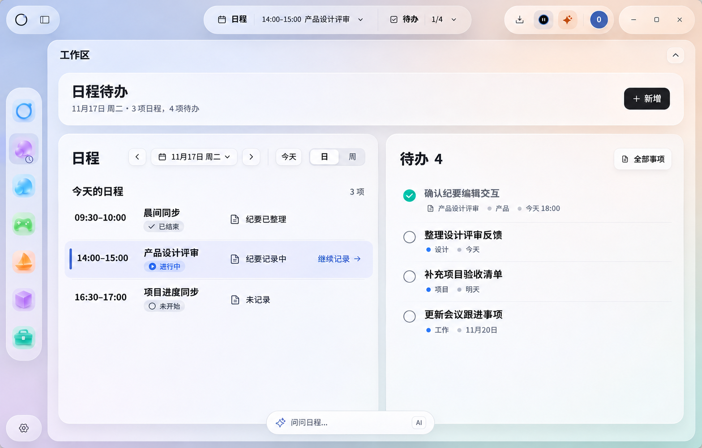
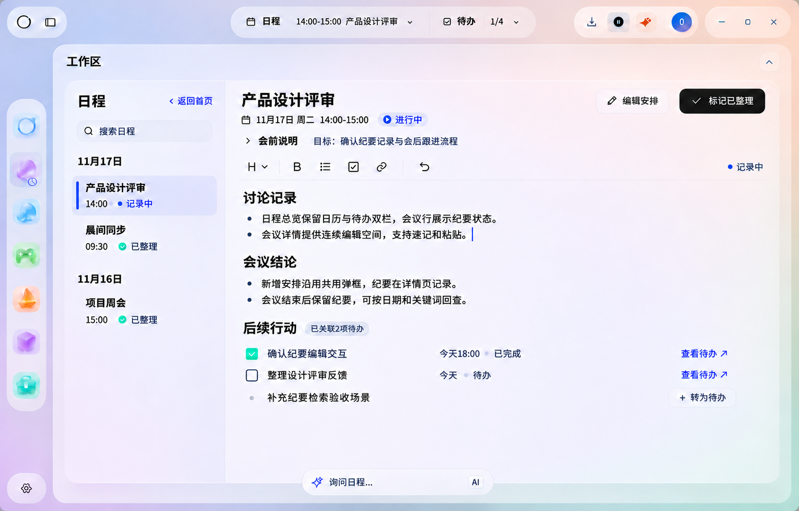
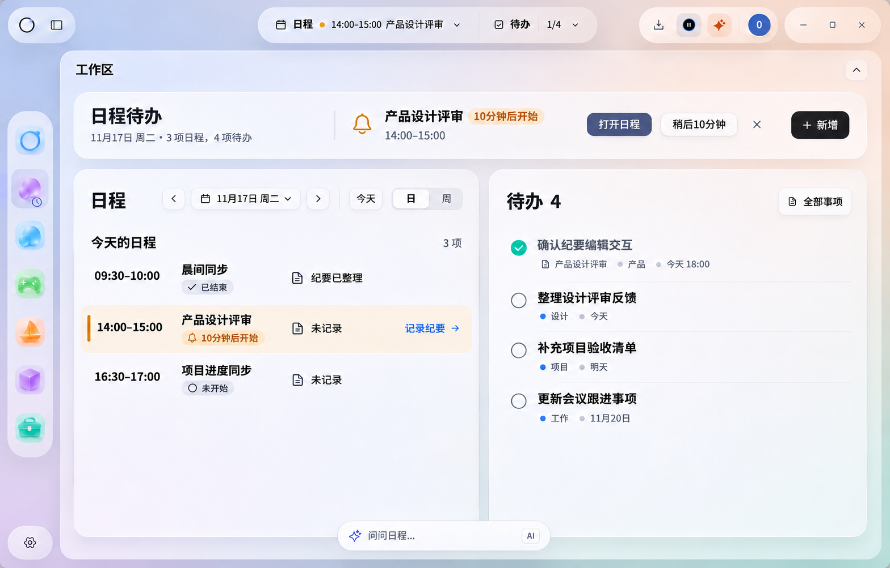

# 日程与会议纪要界面优化方案

日期：2026-11-17。状态：首版已在本地实现并完成专项与 Electron 实机验收，尚未发布；现有新增弹框统一规则保持有效。此文后半部分保留最初现状检查与高保真记录，实际交付范围以本节为准。

## 首版实施范围

已接入紧凑日／周工具栏、保留完成会议、统一单面板详情、手动富文本纪要、历史正文搜索、自动保存、本地草稿恢复、独立版本冲突处理、后续行动转待办及双向来源跳转。原会前备注保持原义，纪要独立写入工作台 `meeting-notes.db`，不修改共享待办 schema。删除会议时保留纪要，恢复原会议后可继续访问。

页头提醒沿用已确认布局：宽工作区整合进原标题卡，窄工作区收为铃铛入口，不增加独立中间提示条；打开、稍后10分钟、关闭具有各自明确作用。纪要详情隐藏总览标题卡，左侧「返回首页」返回日程待办总览并保留日期与滚动。

后续行动首版记录标题，在共用新建弹框里设置日期、优先级与分类；结构化负责人、AI 整理和录音转写列为后续增强。纪要格式工具提供标题、加粗、列表、链接与撤销，勾选状态属于关联的真实待办，不把未转换行动伪装成可完成任务。

实现与验收入口：`tooling/meeting-notes-pilot.mjs`、`tests/meeting-notes-store.test.ts`、`tests/meeting-notes-draft.test.ts`、`tests/todo-week-schedule.test.ts`；最终验收记录见根目录 `design-qa.md`。28 项专项、12 项 Electron 流程及 `npm run verify` 通过。全量测试有 13 项其他范围失败，未计为全库通过。

[实机验收报告](../../design/schedule-notes-2026-11-17/implementation/report.json) · [总览提醒实机图](../../design/schedule-notes-2026-11-17/implementation/01-reminder-overview.png) · [纪要详情实机图](../../design/schedule-notes-2026-11-17/implementation/02-meeting-detail.png) · [窄窗口详情](../../design/schedule-notes-2026-11-17/implementation/03-narrow-meeting.png) · [共用转待办弹框](../../design/schedule-notes-2026-11-17/implementation/04-convert-action-modal.png) · [窄窗口提醒](../../design/schedule-notes-2026-11-17/implementation/05-narrow-reminder.png)。本次截图均来自隔离数据，未向真实会议或待办写入验收样例。

用户已确认第一版以「手动速记／粘贴会议内容」为主要场景，优先做好纪要编辑、自动保存、历史回查和待办关联。

2026-11-17 高保真反馈已纳入：取消工作区顶部的「日程待办／会议纪要」Tab，纪要从对应日程进入；压缩日程卡片上方日期与视图操作区，保留「今天的日程」内容。

会议详情单面板修订：会议标题与纪要合并到同一块玻璃工作区，左侧日程列表从顶部开始，右侧放置紧凑的会议信息、操作和连续正文。

返回入口修订：文案统一为「返回首页」，位于左侧日程列表的标题行，与「日程」同行；右侧会议名称与时间、会前说明和正文左对齐。此次只调整入口文案，沿用原返回目标，即日程工作台首页（日程待办总览）。

提醒布局修订：提醒复用现有「日程待办」标题卡右侧空白，移除单独占据工作区中间位置的提醒条，保持主内容的起点与尺寸。

已确认（2026-11-17）：用户同意页头整合提醒态 v2 的布局与醒目程度。提醒复用标题卡空间，日程／待办两栏位置和大小保持一致，以 `03-schedule-reminder-v2.png` 为视觉依据；对应功能已进入首版本地实现。

## 推荐方向

将日程组织为「安排 → 记录 → 跟进」三个环节。新增安排继续使用共用弹框；点开日程后，在工作区查看详情和记录纪要；会议产生的跟进事项与现有待办关联。

纪要是日程的可选内容。普通约定、专注安排可以只保留时间和说明，首次输入记录后才形成纪要。

## 实施前现状检查（历史记录）

通过当前运行的 Electron 工作台查看了以下三步，只进行了导航、展开表单和关闭操作，没有录入或保存会议、修改已有待办，也没有发送模型请求。

| 步骤 | 当前画面与判断 | 对纪要功能的影响 |
| --- | --- | --- |
| 1. 日程待办总览 | 日历、日／周切换与待办双栏的结构可保留 | 需要补充纪要状态、历史记录入口和日程详情入口 |
| 2. 顶栏新增日程 | 已使用居中共用弹框，适合快速安排时间 | 保持轻量，让创建与持续记录分别使用适合的空间 |
| 3. 更多设置 → 备注／进展 | 目前只有通用短文本框，地点、参与人和议程共用同一入口 | 扩展独立的纪要编辑区，并区分会前信息与会中记录 |

### 步骤 1：总览

### 步骤 2：共用新增弹框

### 步骤 3：当前记录区域

检查限制：当天没有现存日程，因此未实机走通已有会议的编辑和历史检索。截图右下角有系统通知遮挡，本文的视觉观察限定在无遮挡的日程卡、创建弹框和备注区域。没有进行读屏、完整键盘操作或对比度测量，不能据此认定无障碍合规。

代码补充确认：`WeekSchedule` 当前点击标题直接调用编辑；`meetingItems` 排除 `done` 记录；通用 `note` 上限 5000 字；部分 AI 待办读取会截取备注。这些属于实现检查结论，不作为已实机完成的流程。

## 页面结构

### 1. 日程待办总览

- 保留当前标题卡、日／周切换以及日程／待办双栏，月历按需打开。
- 日程卡片顶部将标题、前后日期切换、日期入口、「今天」和日／周切换合为紧凑单行；日期显示为「11月17日 周二」，点击打开可选择年月日的月历。
- 日视图不常驻周日期条，工具栏下直接呈现「今天的日程」；周视图再显示紧凑周日期条，前后切换按当前视图移动一天或一周。
- 页头保持标题和「新增」，统计信息在各自区域内表达，避免重复堆叠逾期提醒。
- 日程行呈现时间、名称、时间状态及纪要状态。纪要状态使用文字「未记录／记录中／已整理」，状态不会仅靠颜色表达。
- 日程时间状态根据开始、结束时间显示「未开始／进行中／已结束」；纪要整理状态与时间状态分别管理，时间结束不等于纪要已整理。
- 已结束或标记完成的日程仍可按日期查看与检索，普通待办继续沿用其完成规则。
- 工作区顶部只保留「工作区」标题与收放按钮，不设置「日程待办／会议纪要」Tab。纪要统一从对应日程进入。

### 2. 日程详情与纪要

点击日程名称或「继续记录」进入该日程的详情与纪要。日程列表和顶栏日程复用同一个详情组件。

- 整体只使用一块连续玻璃工作区，内部左右分区；移除独立的全宽会议标题卡及其与正文面板之间的间隙。
- 左侧日程列表从工作区顶部开始，标题行左侧为「日程」，右侧为「返回首页」，不增加额外一行；搜索框和列表保持原位置。右侧顶部紧凑排列日程名称和编辑安排／标记已整理，下一行显示日期、时间与会议状态。会议名称左缘与右侧正文对齐。「编辑安排」继续打开现有事项编辑弹框。
- 会前信息：将当前备注作为会前说明呈现，可折叠查看地点、参会人、议程等内容。首版保留原文本，结构化地点和参与人可后续扩展。
- 主体：宽敞的纪要编辑区，可直接书写、粘贴记录。提供少量标题、列表和勾选项工具，以及可选模板「讨论记录／结论／后续行动」。
- 底部：关联待办，展示已创建事项的状态与回跳入口；章节使用间距或一条分隔线组织。
- 自动保存，切换日期、日程和页面后保留内容；仅在保存中或失败时提供必要反馈，失败后可重试。
- 未开始的会议可以提前写提纲；会议进行时可快速追加记录；结束后继续整理和回查。
- 左侧日程列表与右侧正文独立滚动，右侧页头和工具栏保持可用；这一交互规则在实现阶段验收。

### 3. 纪要入口与历史回查

纪要入口属于对应日程。历史记录通过日期选择和日程列表回查；日程检索支持标题与纪要正文关键词，命中结果仍以日程呈现，点击后查看这场会议的记录。已结束的日程继续保留，不设独立纪要库或顶层纪要页签。

详情中的窄列表也使用「日程／搜索日程」，每条会议对应自己的纪要。返回操作恢复原日期、筛选和滚动位置。纪要属于当前日程工作台，沿用现有日程 Bot 与并排／浮动交互。

## 宽窄窗口与视觉规则

- 总览保持当前双栏，现有窄工作区沿用上下排列。
- 宽屏日期工具栏保持单行；窄工作区优先沿用日程、待办上下排列，仍不足时只将视图操作移至第二行，日期文字保持完整，不恢复常驻多行日历。
- 详情的工作区可用宽度充足时，使用约 240px 的日程列表与右侧正文；正文空间不足时切为单栏详情，「返回首页」入口保留在单栏页头左侧，回到日程工作台首页。
- 根据工作区实际宽度切换布局，计入导航和助手占位；保留用户已选的助手模式。
- 总览页头沿用已确认的标题卡；详情页标题归入右侧编辑工作区，与纪要共用玻璃底面。标题仍有底面承接，依靠字号、间距与对齐建立层级。工作区外表面遵循经典／悬浮导航、三档材质和主题设置，正文使用统一的可读编辑底面。
- 内部提纲、讨论、结论与行动项使用标题、间距和轻分隔组织，避免每段再套玻璃卡片。
- 长文阅读宽度、正文字号、对比度、键盘焦点与小窗口滚动在高保真和实现阶段专门验收。

## 日程提醒态

实施前代码检查：原页内提醒条显示事项名称和「稍后10分钟」。页头整合提醒态 v2 的布局与醒目程度已于 2026-11-17 获用户确认，本次已改为以下整合方式。

- 按日程各自设置的提醒时间触发；高保真以 2026-11-17 周二 13:50 提醒 14:00–15:00 的「产品设计评审」为例。
- 提醒整合进现有「日程待办」标题卡右侧空白，显示会议名称、开始倒计时、起止时间，以及打开日程／稍后10分钟／关闭操作；保留原新增按钮，不增加独立容器。
- 提醒出现与收起时，标题卡高度、日程／待办两栏的起点和尺寸保持一致，不新增中间提示条或挤占正文高度。铃铛与倒计时使用少量暖色，页头沿用原玻璃底面。
- 窄工作区将提醒收为铃铛与倒计时入口，点击后就近展开会议与操作；不增加常驻提醒行，保留日期操作、编辑内容和新增入口。
- 对应会议行同步显示「10分钟后开始」等文字与轻暖色强调，不仅靠颜色表达。时间状态随真实时间变化，纪要状态继续独立。
- 「打开日程」进入对应日程的详情与纪要；不自动打开弹框、切换日期或抢走编辑焦点。
- 「稍后10分钟」只延后这次提醒，不改变会议开始、结束时间；关闭按钮只收起本次提示，不完成或删除日程。
- 保留已确认的单行日期工具栏和日程／待办双栏，不恢复常驻周日期条或工作区 Tab。

## 纪要与待办的关联

1. 手动记录的行动项可「转为待办」，复用刚统一的新增弹框，预填标题并让用户确认日期等字段。
2. 首版在共用新增弹框中设置期限等现有个人待办字段；结构化负责人作为后续增强。
3. 创建成功后显示真实待办状态及「查看待办」，再次进入该纪要仍能找到关联事项。
4. 待办详情提供来源会议回跳。任务完成后，纪要里的关联状态同步。
5. 相同行动项再次整理时显示已关联结果，避免重复创建。

## 日程 Bot 辅助

在手动记录流程稳定后增加「整理纪要」和「提取行动项」。

- 整理根据当前日程及所选记录生成讨论要点、结论和行动项。
- 原始记录保留，整理结果先作为草稿预览，经用户确认后形成整理稿。
- 待办建议复用现有确认机制；负责人、期限不明确时标为待确认。
- 处理中的日程关联和记录版本固定，切换日程不会把生成结果写入另一场会议。
- 录音转写作为后续可选扩展，届时再设计音频导入／录制、转写状态与回放定位等交互。

## 数据与保存边界

- 基础日程继续使用现有共享待办数据与创建／编辑接口。
- 纪要单独保存，以稳定的日程 ID 关联；日程改名或改期仍能找到原纪要。
- 现有备注保留为会前信息，用户可手动复制需要的段落到纪要。
- 纪要采用自己的保存版本，避免每次输入都改写共享任务主体。
- 删除日程隐藏其详情入口，但保留关联纪要；恢复原日程后重新访问，不随任务删除自动销毁记录。

## 建议实施顺序

第一版：紧凑日程工具栏、日程详情、手动纪要、自动保存、完成会议回查、通过日程检索查找纪要与手动关联待办。

后续增强：日程 Bot 整理、提取行动项与整理稿确认；录音转写作为后续可选扩展。

## 高保真设计稿（2026-11-17）

用户已同意制作总览与详情高保真，并补充查看日程提醒态。以下属于同一方案，使用虚构示例数据，是设计参考图；实机结果与验证状态见文首和 `design-qa.md`。首版以手动速记、粘贴内容为主。

以下展示总览 v2、详情单面板 v5 和整合页头的日程提醒态 v2，第一版及此前修订图片与生成记录保留供比对。

### 日程总览

保留日程、待办双栏与标题卡；移除工作区的两个 Tab。日程卡片顶部改为单行日期工具栏，日视图移除常驻周日期条，让「今天的日程」上移；日程行继续呈现时间状态、纪要状态与「继续记录」。

### 日程详情／纪要

沿用同一导航、主题与玻璃材质，顶部同样不设 Tab。原上下两块合并为同一连续工作区，左侧日程列表通顶，返回入口位于左侧列表的标题行；右侧页头放置当前会议名称、时间与操作，会议名称与正文左缘对齐。会前说明、工具栏和纪要正文连续排列。后续行动区区分已关联待办、已完成待办及尚未创建的行动项，自动保存不设置常驻成功文案。

[内置 ImageGen 总览 v2 生成记录](../../design/schedule-notes-2026-11-17/high-fidelity/generation-prompts-v2.md)

[内置 ImageGen 详情单面板 v5 最终提示词与生成记录](../../design/schedule-notes-2026-11-17/high-fidelity/generation-prompts-v5.md)

### 日程提醒触发

展示会前10分钟的示例提醒。提醒信息与操作整合进原有标题卡右侧空白，原新增按钮保留；主内容两栏不移动。对应会议行显示即将开始，「打开日程」衔接当前会议详情与纪要。提醒时间按各日程设置生效。

[内置 ImageGen 页头提醒态 v2 最终提示词与生成记录](../../design/schedule-notes-2026-11-17/high-fidelity/generation-prompts-reminder-v2.md)

返回入口、左右层级和标题卡提醒布局均已确认，本次按上述范围实施首版。
