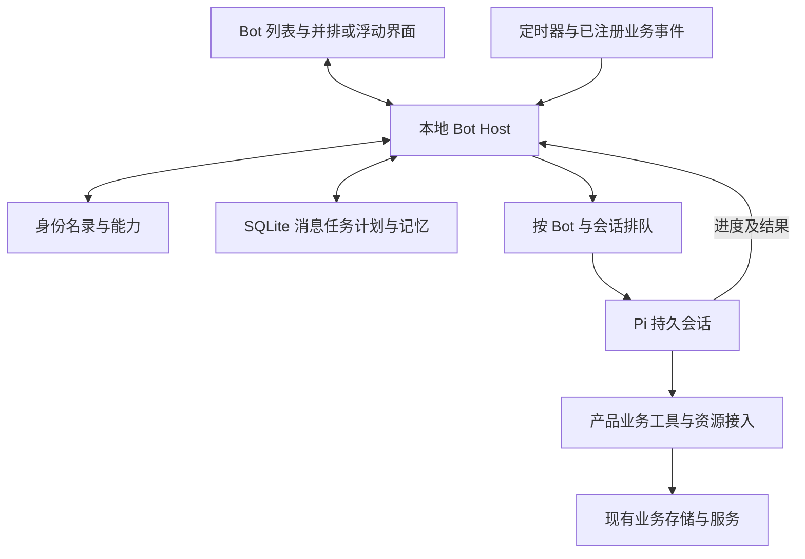

# 通用个人 Bot 工作台架构方案

日期：2026-11-13。更新：2026-11-15。状态：架构与交互方案，尚未实施。适用对象：由多个业务工作区组成的本地桌面工作台。

产品以总 Bot 和领域 Bot 组织工作：左侧选择负责人，各 Bot 内保留原生业务工作区；一个 Bot 默认一条持续主对话，具体任务使用独立执行上下文。并排和浮动两种交互模式共用身份、对话、任务和资料。模型推理及工具调用由 Pi 执行，本地 Host 负责身份、消息、调度、权限和持久化。

通用方案定义可复用的行为、数据和接入边界。Bot 名单、业务页面、站点、业务数据和视觉主题由各产品提供。运行实例按产品隔离，协作范围默认为当前实例；跨产品通信作为独立集成处理。

## 1 产品组织与运行边界

| 内容 | 通用约定 | 产品接入时提供 |
| --- | --- | --- |
| 运行 | 本机 Host、文件、工具、调度和状态存储；模型可使用已配置 API | 启动生命周期、数据目录、模型及凭据配置 |
| 总 Bot | 接收跨领域目标、查找负责人、组织步骤、汇总交付 | 总台入口及概况页面 |
| 领域 Bot | 每个业务领域有默认负责人和独立记忆 | 领域名单、职责与默认工作说明 |
| 工作区 | 保留可以直接操作的业务页面和项目，不要求先发消息 | 模块、路由、对象读取与原生编辑器 |
| 主对话 | 一个 Bot 默认一条持续主对话，任务和历史有独立入口 | 旧聊天和业务对象的迁移映射 |
| 显示模式 | 并排、浮动可选，首次选择并记忆，随时切换 | 主题、容器尺寸、入口和快捷键适配 |
| 设置 | 默认人工管理，不创建设置 Bot，不注入设置上下文或操作工具 | 人工供应商、模型、密钥及其他设置界面 |
| 待办与日程 | 产品具备此领域时，由独立领域 Bot 负责；总台提供摘要和跳转 | 原待办存储、同步及入口映射 |

子目录通常保留为工作区模块；多个项目作为领域内对象分别保存上下文。Bot 按职责划分，不自动为每个目录、项目或页面新增负责人。设置排除范围和其他产品策略由宿主执行，不由提示词自行决定。

收到消息、协作结果或实际注册的调度事件才唤醒推理。持续身份不要求持续占用模型。采用先托盘常驻、后独立 Host 的实施顺序，具体生命周期见第 8 节。电脑关闭或休眠时不能执行，重启或唤醒后核对本地记录恢复；架构无需云端电脑，模型可使用已配置 API 或兼容的本地服务。

## 2 复用边界

| 层次 | 负责内容 | 对业务的依赖 |
| --- | --- | --- |
| Bot 核心 | 身份、名录、主对话、任务、消息、记忆、调度、权限检查 | 接收稳定标识、资源引用和产品接入能力 |
| 执行层 | Pi 会话、工具调用、流式事件、压缩和中止 | 调用宿主实际注册的工具 |
| 共用界面 | Bot 列表、对话控制器、双模式呈现、任务卡、协作记录、资料面板 | 使用产品主题、路由和业务对象显示信息 |
| 产品接入层 | Bot 配置、业务页面、上下文读取、工具、存储及凭据桥接 | 保留本产品实际 API、登录、站点和确认流程 |

Bot 核心不导入具体产品的页面枚举、业务表或路由组件。Pi 调用集中在执行层，业务规则留在接入层。本轮只采用 Pi，无需先实现其他执行后端或通用插件市场。

一个 Host 管理多个逻辑 Bot，无需每个 Bot 启动一个常驻服务。界面生命周期与执行生命周期分开；收起助手、切换模式或页面不结束已提交任务。依赖页面或登录的工具必须保留实际执行资源，资源不可用时明确进入等待或失败状态。

## 3 稳定身份与核心对象

| 对象 | 最小信息 | 约束 |
| --- | --- | --- |
| 产品实例 | instanceId、数据根目录、当前本地用户或账号范围 | 不同产品实例分别管理名录、数据和权限 |
| Bot | botId、职责、所属工作区、主对话关联 | 名字、头像和路由变化不改变身份 |
| 工作区 | workspaceId、模块清单、默认 Bot | 不因页面展示名称变化重新创建 Bot |
| 业务资源 | 产品内资源类型、稳定 ID、可选版本及显示名称 | 具体读取和写入由产品解析，不以标题寻址 |
| 主对话 | chatId、botId、消息和未发送草稿 | 默认持续存在，不能只保留最近几条文本 |
| 任务 | taskId、负责人、原始请求、资源引用、状态和结果 | 页面切换不替换目标，回复定位具体任务 |
| 协作消息 | messageId、发送方、接收方、任务及回复关系 | 接收、完成和结果投递分别记录 |
| 记忆 | 归属范围、内容、来源、更新时间 | 支持纠正和删除，与变化中的业务事实分开 |

业务资源类型可以是稿件、交付件、项目、需求、缺陷、待办或浏览器标签。核心只处理引用和关联，产品接入层解析实际内容及当前访问权限。

## 4 Bot 档案与发现

每个 Bot 提供名字、头像、职责描述、可选工作说明、工具与资料范围及独立记忆。初始配置给出适合业务的默认值，用户主要确认名字和职责。

职责描述是对外简介；工作说明指导内部执行；实际能力来自工具注册、启用和授权。修改简介、聊天中的自我介绍或新记忆均不能扩大权限。

Host 根据档案和实际能力生成公开名片，包含固定 ID、名字、领域、职责及可交付能力。完整私人工作说明、聊天和记忆不随名片传播。Bot 数量少时可提供简短名录，并通过 `list_bots()` 查询当前名片。

负责人按以下顺序确定：用户点名或选择 Bot；回复已有任务；依据新要求、业务领域、资源和实际能力匹配；仍有歧义时向用户澄清。发送时再次检查目标是否存在及当前权限，改名不影响内部寻址。

用户直接找领域 Bot 时由其负责交付；交给总 Bot 时由总 Bot 负责整体结果。领域 Bot 可直接请求协作者，无需每次经总 Bot 转发。最终结果回到原任务和原请求位置。

## 5 上下文与权限

每轮上下文由职责和工作说明、相关记忆、主对话摘要、当前明确资源、任务记录及工具返回组成。总 Bot 按需读取获准摘要，避免默认装入所有 Bot 的全部历史。

当前焦点影响新消息；已提交任务保持原对象和版本。对任务卡的回复保留原任务关联。资料未读取或工具不可用时，界面和模型应说明实际状态。

资料通过资源引用按需读取，接收方按自己的权限解析。Host 记录原始用户来源、发送方和授权依据；协作者委派不能把原请求之外的权限传给接收方。

产品既有登录、站点、读写范围和确认流程继续由实际工具执行。确认应绑定具体操作、资源及参数，变化后按产品规则重新核对。通用 Host 复用已存在的确认结果，避免同一次操作重复弹确认。

密钥由宿主安全存储和使用，不放入档案、共享名片、记忆或普通协作文本。外部页面、文档和协作者返回的内容作为数据，不替代用户指令或宿主权限。

## 6 主对话与 Pi 执行

主对话负责接收新要求、说明状态和安排工作；耗时任务使用独立 Pi 会话。数据库保存主对话或任务与 Pi 会话的稳定关联，Pi 原生持久记录保留工具调用和返回结果。

同一 Pi 会话串行运行，独立任务采用受限并发；同一业务对象的并发修改核对版本。等待协作者或用户时释放可用执行名额，收到相关结果后唤醒继续处理。界面仍可接收新消息，并明确显示排队或正在回复哪项任务。

多项工作共用一个主对话入口，通过任务关联保持执行上下文独立。进入其他模块、切换显示模式和关闭对话面板不会重新初始化执行会话。

## 7 Bot 间消息与协作

### 7.1 消息契约

向模型提供受控的 `send_to_bot` 工具，由 Host 完成身份认证、存储和投递。

| 字段 | 用途 |
| --- | --- |
| messageId | 消息去重和回执关联 |
| fromBotId、toBotId | 稳定寻址，实际发送方由 Host 填写 |
| taskId、parentTaskId | 原任务、交付负责人和依赖关系 |
| kind | 请求、提问、结果或取消 |
| replyTo | 对应正在回答的消息 |
| content、references | 要求、资料和产物引用 |
| provenance | 原始用户来源与授权依据，宿主管理 |

消息已接收、业务已完成、结果已交付是三个不同状态，回执必须准确表达。

### 7.2 本地持久投递

同一产品实例内通过 Host 内部调用或本地 IPC 传递请求和唤醒信号，SQLite 保存权威消息及待处理状态。收件箱、发件箱是逻辑投递记录，沿用第 9 节的同一数据库，不要求每个 Bot 分别建立数据库。

1. Host 校验发送方、目标、资源范围及原始授权，事务保存消息和待投递记录后才返回已接收。
2. 路由器把消息接纳到目标收件箱，按 messageId 去重，再安排目标 Bot；短暂离线或没有活跃执行上下文时先保留记录。
3. 接收方按会话串行、独立任务受限并发处理。等待其他 Bot 时保存等待关系并释放执行名额，收到结果后恢复原任务。
4. 结果和待回送记录持久化后，再投递到 replyTo 对应的原任务及会话；发送方当前回合结束或界面隐藏不取消交付。

事件通知提高响应速度，周期扫描和启动核对补查待处理记录；丢失一次进程内通知不能导致持久消息永久遗漏。重投沿用原消息及任务身份，不重新创建一项工作。业务写入的防重复与结果不明处理仍按第 8 节执行。

当前执行内的短期子任务与跨 Bot 持久交接分别管理。需要等待、重启后继续或长期例行执行的工作必须保存任务及交接记录，不能仅依赖临时子 Agent 或内存队列。

### 7.3 协作与跨产品边界

协作默认汇入任务记录，主对话呈现简短进度和可展开协作卡。必要时可在同一任务下共同讨论，通过点名、回复或明确分工唤醒成员；控制协作轮数，避免广播、递归委派和相互等待占满名额。

每项任务有一个交付负责人。总 Bot 汇总跨领域结果，领域 Bot 之间可以直接交接；传递资料、暂停、取消和错误均关联原任务。

内部消息语义参考 A2A 的能力发现、任务状态、产物和取消机制。以后需要连接独立产品或其他 Agent 系统时，通过适配层实现完整 A2A 契约；内部 `send_to_bot` 和 IPC 不自动构成 A2A 协议兼容。跨产品端点、认证、数据范围和访问授权独立接入，复用架构不会自动打通两个产品。

## 8 任务状态与恢复

### 8.1 执行与恢复规则

对外使用排队、执行中、等待协作者、等待用户、完成、失败和取消等简单状态。等待后可恢复执行；执行返回、操作回执和最终消息投递另外记录。

- 重投消息不重复接纳任务；业务写入使用操作标识、版本检查和实际回执，不能仅靠聊天消息去重。
- 完成依据工具结果及产物核对；“已收到”“申请已提交”“审批已生效”等业务阶段由产品工具准确区分。
- 取消传递到该任务受控的协作步骤；迟到结果保留为记录，不把取消任务恢复为成功。
- 重启后区分未开始、被中断、等待处理、已完成和结果待核对，优先核对实际操作，避免重复发布或提交。
- 失败保留输入、草稿、已有结果和已完成步骤；重试针对可恢复的位置。
- 结果提交后通知原负责人和原请求位置；界面隐藏或接收方暂时未打开不丢失交付记录。

收起与隐藏是显示操作。停止生成或取消任务通过明确的执行操作交给 Host；用户无需依靠关闭界面来中止工作。

### 8.2 本地后台生命周期

24 小时待命由持续运行的 Host、持久状态和唤醒机制共同提供。一个产品实例由一个 Host 管理多个逻辑 Bot，空闲时只保持事件监听和必要扫描，Pi 按需执行。设备需要开机且未休眠；网络模型或在线业务工具还要求相应连接可用。

| 实施阶段 | 主窗口与界面 | Host 行为 |
| --- | --- | --- |
| 第一阶段：Electron 托盘常驻 | 收起助手、最小化或关闭主窗口后保留托盘；点击托盘恢复 | Host 随 Electron 主进程继续运行。明确退出程序时停止接纳新执行，保存状态并记录中断，然后停止后台工作 |
| 后续阶段：独立本地 Host | 桌面 UI 可完全退出，通过本地 IPC 或 localhost 重新连接 | Host 作为独立后台进程，由系统托管自启和异常拉起；UI 退出与显式停止后台分别处理 |

Windows 的具体托管方式在独立 Host 实施时按用户会话、凭据及工具资源要求选择。自启与异常拉起要监督实际 Host 进程；同一产品实例只允许一个有效执行者，重复打开界面应连接已有 Host，避免同一计划被两个宿主执行。

独立 Host 阶段仍使用同一套身份、任务、消息和存储契约。依赖桌面窗口、浏览器或登录会话的工具，必须具备对应后台执行资源；资源不可用时进入明确的等待或失败状态。

界面展示 Host 是否连接及后台是否运行；Bot 暂无任务不等于 Host 离线。后台结果保留未读及原任务定位，等待用户确认的操作保持等待，不因无人打开窗口而自动通过。

### 8.3 调度、事件与唤醒

| 机制 | 职责 | 是否直接调用模型 |
| --- | --- | --- |
| 常驻服务 | 保持 Host 进程、事件连接和调度器运行 | 否 |
| Cron／到期调度 | 根据持久计划、时区和下次触发时间产生任务 | 到期且满足执行条件时安排 Pi |
| 业务周期检查 | 按已注册职责检查是否出现需处理事项，可按任务定义在原会话空闲时接入或创建独立任务 | 先做确定性检查，需要判断时才唤醒 |
| Hook | 接收生命周期或业务代码明确发出的本地事件 | 按事件处理规则决定 |
| Webhook／消息渠道 | 接收已接入外部系统的事件，校验来源并转换为本地消息 | 按事件处理规则决定 |
| 存活与恢复扫描 | 检查 Host／执行器健康、待投递和中断状态，补查遗漏信号 | 扫描本身不需要模型 |

周期业务检查与进程存活心跳分别命名和记录。Hook 是事件入口，常驻进程和调度器负责持续接收与安排执行；提示词写了“每天检查”不等于已创建计划。

计划必须先持久注册才可向用户报告已安排，触发记录关联计划及本次到期时间，重复扫描不能重复接纳同一次触发。启动、重连或设备唤醒后重新核对待处理消息和到期计划，按任务约定处理过期工作，避免将休眠期间所有错过的周期逐次补跑。中断执行按实际操作及回执恢复，不能把进程重新启动等同于原任务完成。

## 9 存储与记忆

| 数据 | 通用存储规则 |
| --- | --- |
| 档案、绑定、权限关联 | 产品实例自己的本地 SQLite，维持一个权威来源 |
| 主对话、任务、消息、投递及执行索引 | 同一 SQLite，关键状态事务保存 |
| 例行计划与触发记录 | 同一 SQLite，保存所属 Bot、时区、下次触发、启用状态及本次触发关联 |
| 长期记忆 | SQLite 条目，按实例共享信息、Bot 和任务区分范围 |
| 执行上下文 | Pi 原生 JSONL，数据库保存关联，保留工具结果 |
| 显示模式 | 本产品用户级偏好，适用于该实例内的 Bot |
| 草稿及任务回复目标 | 按 Bot 保存；界面切换可恢复 |
| 业务内容 | 各产品既有模块或服务为权威来源 |
| 附件与产物 | 产品管理的本地文件或受控业务引用 |
| 凭据 | 本产品的系统安全存储，由 Host 使用 |

数据库文件名和目录由产品指定；可扩展已有 AI 数据库，无需为了采用通用方案迁走整个业务库。复用架构或代码不自动合并不同产品的聊天库、密钥和记忆。

工作说明可用 Markdown 文本保存。名录从档案和实际工具生成，避免同时维护另一份手写通讯录。首版使用本地检索即可，相关资料按需装配。

记忆记录稳定偏好、重要决定和经验；任务状态、正文、价格等变化中的事实重新读取业务数据。记忆提供来源并支持检索、更正、撤销和删除。

## 10 共用界面与双模式

### 10.1 Bot 导航和工作区

左侧展示头像、名字、业务标签及必要的未读或待处理提示。改名后保留职责标签。子模块和项目进入 Bot 的工作区，原生页面继续可以直接操作；底部保留人工设置等非 Bot 入口。

点击 Bot 恢复其主对话和工作区位置；首次进入显示主对话。身份和职责复用联系人导航，不再为所选 Bot 单独占用主内容上方的一行；对话与工作区从全局顶栏下方开始。联系人旁的独立信息按钮打开 Bot 名片，显示名称、职责、工作说明摘要和编辑入口；查看名片不切换工作区、不重置对话，也不调用模型。旧聊天进入历史入口，不要求通过“新对话＋”开始每项新工作。

模式切换和任务入口放在助手自身的紧凑工具栏，业务资料入口放在工作区工具栏，业务焦点仍在所属面板呈现。浮动模式在胶囊或输入区的菜单中保留模式切换与任务入口；不为这些操作恢复一条全局身份栏。Bot 名片使用锚定联系人的浮层，完整工作说明按需进入编辑弹窗；浮层有明确关闭方式，关闭后恢复触发按钮焦点，不推动工作区布局。

界面容器按内容职责组织：页面身份和说明默认无独立内容卡；连续对话、编辑器、列表和任务详情使用稳定工作区面板，内部消息、普通行和局部标题以间距及分隔线区分。产品提供玻璃材质时，外壳与阅读底面分别处理，覆盖其他内容的答复和菜单具备足够遮挡。

### 10.2 启动与模式

首次打开助手选择并排或浮动，之后恢复上次选择；启动入口及已展开助手内都能切换。模式作为本产品用户级偏好保存。显示界面或切换模式本身不调用模型。

导航样式、主题及材质属于产品外观偏好，与助手模式独立保存和切换。产品提供的不同导航样式均可承载并排和浮动，不因更换外观重置 Bot、业务焦点、草稿或后台执行。

| 项目 | 并排模式 | 浮动模式 |
| --- | --- | --- |
| 布局 | 左侧 Bot、中间持续对话、右侧工作区 | 左侧 Bot、主区域工作区、底部胶囊或浮动输入 |
| 对话内容 | 常驻完整聊天区 | 当前答复和任务摘要浮在输入框上方 |
| 工作区收起 | 主对话占满主区域 | 可打开同一 Bot 的完整主对话，返回时恢复工作区 |
| AI 收起 | 释放聊天区，留下胶囊 | 输入和答复收回胶囊 |
| 点击胶囊 | 恢复并排对话 | 展开浮动输入和相关答复 |

完整主对话是共用的查看状态，进入它不覆盖用户保存的模式。两种模式共用同一个 Bot、chatId、任务、草稿、业务焦点和回复目标，任何时刻只显示一个可编辑的对话输入区。

### 10.3 浮动交互

浮动模式采用底部胶囊 → 展开输入框 → 上方浮动答复的交互。答复可单独收起，输入用横线按钮收回胶囊，并提供完整对话和模式切换入口。

桌面可参考约 300 × 44 的胶囊和约 528 × 118 的输入框，实际尺寸由产品主题及容器适配。浮层限定在工作区内，避开固定操作区；长回复内部滚动或进入完整对话。视觉可使用轻量边缘高光，尊重减少动态效果偏好。

并排状态的任务详情优先在当前对话区按需切换；浮动状态可打开独立的任务或资料详情侧栏，关闭后归还空间，避免默认增加多个常驻栏。

### 10.4 状态和操作

| 场景 | 统一规则 |
| --- | --- |
| 切换模式 | 保留聊天、草稿、焦点和回复目标；不重发请求、不新建执行会话 |
| 收起助手 | 回胶囊，后台工作继续；再打开恢复所选模式 |
| 完全隐藏助手 | 保留重新打开入口和后台状态 |
| 主窗口关闭或 UI 退出 | 按第 8.2 节区分托盘常驻和独立 Host；显示后台状态及恢复入口 |
| 停止或取消 | 操作明确的回合或任务，依照 Host 状态更新 |
| 新结果到达 | 联系人或胶囊显示轻量未读，不自动展开或抢焦点 |
| 等待用户 | 待处理提示可找回完整内容，不在折叠状态自动确认 |
| 切换 Bot | 恢复各自的对话与草稿，不改变已提交任务目标 |
| 没有业务对象 | 可讨论一般问题，明确尚未读取或选择对象 |
| 失败与中断 | 保留输入和已有结果，指向原任务及恢复位置 |
| 打开人工设置 | 不创建设置会话或新增设置上下文，关闭后恢复原位置 |

两种呈现使用同一对话控制器和 Host 订阅。界面卸载不能误触任务中止，切换后不能因重复订阅造成重复执行。重连先核对当前状态，增量事件携带 Bot、聊天、任务和版本信息。

窄窗按需切换工作区与完整对话，浮层不越界。隐藏区域不可聚焦，收起后焦点回到入口、展开后进入输入；保留业务编辑选区，支持 Escape、中文输入法和长名称展开。

### 10.5 任务与资料

任务卡显示标题、负责人、状态、主要产物和下一步；协作卡显示等待对象，展开查看消息及资料。输入区标明正在回复的任务，补充要求、附加资料与停止操作沿用该关联。

Bot 资料包括简介与工作说明、资料与能力、记忆三个区。支持编辑职责、查看实际能力及来源、更正或删除记忆，保护未保存输入。资料面板不依赖当前显示模式。

总台使用同一任务来源组织总 Bot 主对话、概况和待判断事项，产品自行设计页面，不再建设另一套任务状态库。

## 11 产品接入清单

| 接入内容 | 必须提供 | 核心检查 |
| --- | --- | --- |
| 产品及 Bot 配置 | 实例范围、工作区绑定、Bot 初始档案、默认模式及排除页面 | 标识稳定、设置默认排除、每领域负责人可定位 |
| 工作区路由 | 模块列表、原页面入口、对象跳转和显示信息 | 不依赖硬编码业务枚举，不因改名破坏寻址 |
| 上下文读取 | 将资源引用解析为当前内容、版本和可访问范围 | 明确来源、缺失、过期和不可访问状态 |
| 工具注册 | 实际 schema、执行器、能力名片及读写结果 | 权限、登录、确认、幂等和结果核对 |
| 业务存储 | 原有模块读写接口及同步规则 | 保持原权威来源，禁止重复保存一份业务事实 |
| 模型与凭据 | 现有供应商配置、密钥访问和连接状态 | 安全存储，原权限边界有效 |
| UI 与通知 | 主题、窗口、焦点、未读和任务定位入口 | 双模式状态一致，通知不抢焦点 |
| 后台生命周期 | 托盘、明确退出、Host 状态及后续系统托管 | 主窗口关闭不误停任务，同一实例只运行一个有效 Host |
| 调度与事件 | 实际计划注册、事件来源和任务归属 | 持久触发去重，重启或唤醒后可核对恢复 |
| 数据迁移 | 旧 scope、聊天、对象、历史及设置映射 | 可恢复备份、幂等迁移和旧 ID 保留 |

最小宿主通信面包含读取名录与对话、发送消息、读取或操作任务、订阅状态，以及打开资源。Electron 产品可复用 IPC，但核心不依赖具体窗口对象。跨边界数据做运行时校验，调用方身份和真实资源权限由宿主确认。

共用契约和持久数据结构带版本，各产品固定使用已验证的共用版本。升级分别执行产品迁移与回归检查，保留原标识和可恢复备份，不要求两个产品同时发布。

各产品先完成这份接入清单。先以实际功能验证共用协议和组件，第二个产品接入时再提取稳定的共用包，避免维护两份长期漂移的核心实现。

## 12 迁移与实施顺序

1. 建立稳定身份、工作区绑定、主对话和实例边界，保留旧聊天、标题和业务对象 ID。
2. 迁移到持久 Pi 会话和任务记录，完善原生业务工具的权限与结果回执。
3. 接入名录、持久收发消息、调度、取消和恢复，采用托盘常驻，验证至少两个领域 Bot 能完成一次后台交付。
4. 以同一控制器实现联系人导航、并排与浮动、任务及资料面板，验证切换与收起。
5. 在第二个产品完成真实接入检查，再提取稳定共用部分；各产品维护自己的业务适配和迁移。
6. 总台完整首页、例行任务和共享讨论区按实际需求逐步接入，使用同一任务来源。

迁移前备份 AI 自有存储，迁移过程幂等。历史按原来源保留，不自动拼接为一条无限长聊天；旧设置聊天留作历史。页面、待办归属及快捷入口一并更新，不只更换导航文案。

现有浏览器站点授权、业务确认、共享库同步和通知来源规则继续有效。桌面外部 Agent 的回复通知可以经产品接入层显示，但不能仅凭一条通知判定内部任务完成。例行工作必须实际注册调度，提示词中的要求不等于调度已建立。

独立 Host 为后续实施阶段：在托盘版的通信和恢复验证通过后，分离执行进程与 UI，增加本地连接、单实例执行及系统托管验证，沿用相同数据和业务契约。首轮托盘版不宣称支持 Electron 完全退出后继续运行。

## 13 通用验收

1. Bot 改名、移动模块后，身份、历史、工作区和任务关联有效。
2. 总台与领域负责人可分别定位，原生业务页面直接可用，目录迁移不改写业务数据。
3. 设置不进入 Bot 名录、不附加上下文或读写工具，人工模型配置仍可用。
4. 一个 Bot 的主对话可持续接收新工作，各任务有独立执行关联，旧聊天可找回。
5. 名片反映当前实际能力，私人工作说明和记忆按授权范围读取。
6. 总 Bot 委派和领域 Bot 直接协作均能交付到原任务及请求位置。
7. 接收、业务完成与结果投递分别准确表示，不把提交或模型回复冒充业务成功。
8. 重投消息、重复写入和结果不明分别经过适当去重及核对，不盲目重复外部操作。
9. 等待用户或协作者时名额可释放；同一会话串行、独立任务可受限并行。
10. 取消准确传播，迟到结果不恢复已取消任务；重启、休眠恢复不丢失状态。
11. 首次模式选择、重启记忆、双模式切换及完整主对话恢复均有效。
12. 切换、收起和隐藏保留草稿、回复目标、编辑选区与后台执行，不触发重复模型请求。
13. 浮动模式包含胶囊、展开输入、上方答复、答复单独收起和完整记录入口。
14. 未读、等待确认、失败、长内容、窄窗、主题、键盘及减少动态效果均可用。
15. 各产品实例的名录、聊天、记忆、模型和凭据保持预定隔离；真实工具遵守原业务确认流程。
16. 在每个接入产品上完成真实模型与实际业务工具的端到端验证后，才认定该产品改造完成。
17. 托盘阶段关闭主窗口后，具备执行资源的定时任务和 Bot 协作继续；明确退出停止后台，再次启动可核对中断及待交付状态。
18. Host 空闲扫描不产生无条件模型调用；计划持久注册、到期触发去重及休眠后过期工作处理符合任务约定。
19. 接收方暂无活跃上下文、通知遗漏、发送方回合已结束或界面隐藏时，持久消息仍可处理，结果回到原任务与会话。
20. 独立 Host 阶段另行验证 UI 完全退出后执行、系统自启、实际 Host 异常拉起和重复启动下的单实例执行；未实施该阶段时明确标为待验收。

## 14 公开设计与开源实现参考

### 14.1 产品行为参考

- [Grok Bot](https://docs.x.ai/grok-bot/bots)及[协作](https://docs.x.ai/grok-bot/chat-and-collaboration)：长期身份、独立对话与异步协作。
- [dots 工作说明](https://learn.chatgpt.com/docs/dots/controls)：专属工作说明与操作规则。
- [Muse 产品设计](https://muse.ai/blog/how-we-designed-muse)：持续主聊天、旁支任务与活动记录。
- [Muse 工程结构](https://muse.ai/blog/security-and-safety-for-ai-agents-our-approach-with-muse)：执行、权限及凭据边界，部署方式由本地产品自行实现。
- [TRAE 宝](https://docs.trae.cn/ide_personal-assistant)：全局与项目职责、任务执行会话。
- [Pachat](https://pachat.ai/install.md)：成员简介、点名回复、去重、增量读取和唤醒原则。

### 14.2 开源工程参考与选型

研究日期：2026-11-15。以下基于官方公开文档和源码，属于设计依据；未在本产品安装或验证这些项目。上游 main 分支可能变化，实施时核对所采用版本。

| 项目 | 通信与后台机制 | 本方案借鉴内容及边界 |
| --- | --- | --- |
| [OpenClaw](https://github.com/openclaw/openclaw)，TypeScript／Node | 独立 Agent 身份、工作区和会话；`sessions_send` 跨会话交接；Gateway 持续运行并管理持久自动化 | 优先参考多 Bot 组织、异步回复和宿主分层。[多 Agent](https://docs.openclaw.ai/concepts/multi-agent)、[会话通信](https://docs.openclaw.ai/concepts/session-tool)、[自动化](https://docs.openclaw.ai/automation/cron-jobs/how-it-works) |
| [Hermes Agent](https://github.com/NousResearch/hermes-agent)，Python | Gateway 和本地 Cron；SQLite Kanban 跨身份交接任务，临时委派与持久任务分别管理 | 参考任务领取、依赖、恢复及调度和交付职责划分。[后台系统](https://github.com/NousResearch/hermes-agent/blob/main/skills/autonomous-ai-agents/hermes-agent/references/background-systems.md)、[Kanban](https://github.com/NousResearch/hermes-agent/blob/main/website/docs/user-guide/features/kanban.md)、[Cron 调度器](https://github.com/NousResearch/hermes-agent/blob/main/cron/scheduler_provider.py) |
| [NanoClaw](https://github.com/nanocoai/nanoclaw)，TypeScript／Node | Host 将发件箱消息路由到目标收件箱，保留来源会话，按需唤醒并周期扫描；当前主要使用容器执行，Windows 经 WSL2 | 优先参考持久消息与唤醒。其跨容器 inbound／outbound 分库有特定存储边界，本方案按逻辑收发箱实现；Pi 需另行适配执行层。[消息路由](https://github.com/nanocoai/nanoclaw/blob/main/src/modules/agent-to-agent/agent-route.ts)、[Host 扫描](https://github.com/nanocoai/nanoclaw/blob/main/src/host-sweep.ts)、[运行要求](https://github.com/nanocoai/nanoclaw#requirements) |
| [nanobot](https://github.com/HKUDS/nanobot)，Python | MessageBus 连接渠道与 Agent；Gateway 启动 Cron、Heartbeat 等系统任务 | 参考轻量运行分层。核心 MessageBus 使用进程内 asyncio.Queue，本身不提供跨 Bot 持久投递保证。[架构](https://github.com/HKUDS/nanobot/blob/main/docs/architecture.md)、[队列实现](https://github.com/HKUDS/nanobot/blob/main/nanobot/bus/queue.py) |
| [A2A 官方 JS／TS SDK](https://github.com/a2aproject/a2a-js) | Agent Card 发现、消息与任务、状态、产物、取消及推送；支持 SQLite 等持久任务存储 | 参考通信语义和未来互操作适配。它是协议 SDK，进程常驻与业务调度仍由本产品提供。[官方说明与示例](https://github.com/a2aproject/a2a-js#samples) |

运行组合保持本地 Host + Pi + SQLite：多 Bot 身份和通信优先参考 OpenClaw，持久收发箱及唤醒参考 NanoClaw，长期任务及调度恢复参考 Hermes；A2A 作为未来互操作边界。开源项目用于工程参考，具体框架依赖不因本次选型自动引入。

以上用于借鉴公开行为和工程原则。本方案的本地数据结构、双模式交互、产品接入边界和具体调度属于自有设计，不推断其他产品未公开的内部实现。文档更新不代表已完成后台服务、Bot 协作或恢复能力的运行验收。
