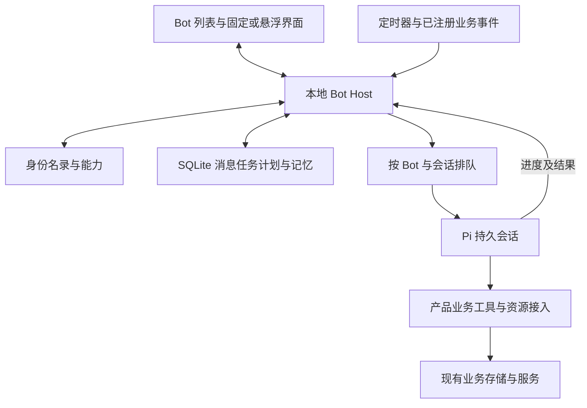

# 通用个人 Bot 工作台架构方案

日期：2026-11-13。更新：2026-11-18。状态：通用架构与交互契约；OnO 既有后台见[实施与验证记录](bot-implementation-validation-2026-11-16.md)，会话／通信核心见[首批实施记录](bot-collaboration-implementation-2026-11-17.md)；CMO 也已有[独立实施记录](C:/Myself/vibe_coding/cmo_workbench/docs/requirements/shared/ai-assistant/bot-workbench-implementation-2026-11-18.md)。本次补齐近期界面修订与长对话管理契约，新增历史管理仍待实施，本轮仅更新文档。适用对象：由多个业务工作区组成的本地桌面工作台。

产品以总 Bot 和领域 Bot 组织工作：左侧选择负责人，各 Bot 内保留原生业务工作区；一个 Bot 默认一条持续主对话，普通续聊延续主会话，明确隔离的工作持有自己的执行上下文。固定模式和悬浮模式共用本窗口身份、对话、草稿、工作和交付件，主窗口／灵动岛草稿独立。模型推理及工具调用由 Pi 执行，本地 Host 负责身份、消息、调度、权限和持久化。

通用方案定义可复用的行为、数据和接入边界。Bot 名单、业务页面、站点、业务数据和视觉主题由各产品提供。运行实例按产品隔离，协作范围默认为当前实例；跨产品通信作为独立集成处理。

`bot-workbench/v2`（2026-11-16）是早期契约基线，不代表当前运行版本；2026-11-18 回传修复后 OnO 为 v8、数据库 6；CMO 前次核对为 v7、数据库 6，本次未改动其运行代码。v8 固定接收事件与新回复段的持久关联，并替换空闲旧 Host，详见[实施记录第 8 节](bot-collaboration-implementation-2026-11-17.md#8-2026-11-18-协作回传顺序与旧后台修复)。实现／验证范围按各自记录判断。[完整方案](bot-collaboration-and-sync-plan-2026-11-17.md)与[CMO 接入方案](../../../design/cmo-bot-workbench-implementation-2026-11-15.md)记录持续双方消息、可选工作关联、原地确认、补充、可靠接纳及剩余优化，后续按实际能力协商，不只复制版本号。第 10.7 节维持分入口草稿，第 10.9 节定义新增历史操作，第 12 节维持迁移不变量；历史图片不覆盖后来的文字决定。

## 1 产品组织与运行边界

| 内容 | 通用约定 | 产品接入时提供 |
| --- | --- | --- |
| 运行 | 本机 Host、文件、工具、调度和状态存储；模型可使用已配置 API | 启动生命周期、数据目录、模型及凭据配置 |
| 总 Bot | 接收跨领域目标、查找负责人、组织步骤、汇总交付 | 总台入口及概况页面 |
| 灵动岛 AI 对话 | 固定进入本产品总 Bot 的同一主对话 | 桌面快捷入口、跨窗口状态同步及完整对话跳转 |
| 领域 Bot | 每个业务领域有默认负责人和独立记忆 | 领域名单、职责与默认工作说明 |
| 工作区 | 保留可以直接操作的业务页面和项目，不要求先发消息 | 模块、路由、对象读取与原生编辑器 |
| 主对话 | 一个 Bot 同时只有一个当前主对话；可按用户明确操作将旧聊天归历史并开始新话题，Bot 身份持续 | 旧聊天和业务对象的迁移映射、历史管理及主对话切换契约 |
| 显示模式 | 固定、悬浮可选，首次选择并记忆，随时切换 | 主题、容器尺寸、入口和快捷键适配 |
| 设置 | 默认人工管理，不创建设置 Bot，不注入设置上下文或操作工具 | 人工供应商、模型、密钥及其他设置界面 |
| 待办与日程 | 产品具备此领域时，由独立领域 Bot 负责；总台提供摘要和跳转 | 原待办存储、同步及入口映射 |

子目录通常保留为工作区模块；多个项目作为领域内对象分别保存上下文。Bot 按职责划分，不自动为每个目录、项目或页面新增负责人。设置排除范围和其他产品策略由宿主执行，不由提示词自行决定。

收到消息、协作结果或实际注册的调度事件才唤醒推理。持续身份不要求持续占用模型。采用先托盘常驻、后独立 Host 的实施顺序，具体生命周期见第 8 节。电脑关闭或休眠时不能执行，重启或唤醒后核对本地记录恢复；架构无需云端电脑，模型可使用已配置 API 或兼容的本地服务。

## 2 复用边界

| 层次 | 负责内容 | 对业务的依赖 |
| --- | --- | --- |
| Bot 核心 | 身份、名录、主对话、任务、消息、记忆、调度、权限检查 | 接收稳定标识、资源引用和产品接入能力 |
| 执行层 | Pi 会话、工具调用、流式事件、压缩和中止 | 调用宿主实际注册的工具 |
| 共用界面 | Bot 列表、对话控制器、双模式呈现、任务卡、协作记录、交付件列表、Bot 资料面板 | 使用产品主题、路由和业务对象显示信息 |
| 产品接入层 | Bot 配置、业务页面、上下文读取、工具、存储及凭据桥接 | 保留本产品实际 API、登录、站点和确认流程 |

Bot 核心不导入具体产品的页面枚举、业务表或路由组件。Pi 调用集中在执行层，业务规则留在接入层。本轮只采用 Pi，无需先实现其他执行后端或通用插件市场。

一个 Host 管理多个逻辑 Bot，无需每个 Bot 启动一个常驻服务。界面生命周期与执行生命周期分开；收起助手、切换模式或页面不结束已提交任务。依赖页面或登录的工具必须保留实际执行资源，资源不可用时明确进入等待或失败状态。

## 3 稳定身份与核心对象

| 对象 | 最小信息 | 约束 |
| --- | --- | --- |
| 产品实例 | instanceId、数据根目录、当前本地用户或账号范围 | 不同产品实例分别管理名录、数据和权限 |
| Bot | botId、职责、所属工作区、主对话关联 | 名字、头像和路由变化不改变身份 |
| 工作区 | workspaceId、模块清单、默认 Bot | 不因页面展示名称变化重新创建 Bot |
| 业务资源 | 产品内资源类型、稳定 ID、可选版本及显示名称 | 具体读取和写入由产品解析，不以标题寻址 |
| 主对话 | chatId、botId、消息和未发送草稿 | 默认持续存在，不能只保留最近几条文本 |
| 任务 | taskId、负责人、原始请求、资源引用、状态和结果 | 页面切换不替换目标，回复定位具体任务 |
| 协作消息 | messageId、发送方、接收方、可选工作关联及 replyTo | 询问／通知不强制建立业务工作；接收、完成和结果投递分别记录 |
| 双方往来 | 两个稳定 Bot ID、原消息及分页定位 | 跨工作持续阅读，不新建每工作对话，不自动注入全部模型上下文 |
| 记忆 | 归属范围、内容、来源、更新时间 | 支持纠正和删除，与变化中的业务事实分开 |

业务资源类型可以是稿件、交付件、项目、需求、缺陷、待办或浏览器标签。核心只处理引用和关联，产品接入层解析实际内容及当前访问权限。

## 4 Bot 档案与发现

每个 Bot 提供名字、头像、职责描述、可选工作说明、工具与资料范围及独立记忆。初始配置给出适合业务的默认值，用户主要确认名字和职责。

职责描述是对外简介；工作说明指导内部执行；实际能力来自工具注册、启用和授权。修改简介、聊天中的自我介绍或新记忆均不能扩大权限。

Host 根据档案和实际能力生成公开名片，包含固定 ID、名字、领域、职责及可交付能力。完整私人工作说明、聊天和记忆不随名片传播。Bot 数量少时可提供简短名录，并通过 `list_bots()` 查询当前名片。

负责人按以下顺序确定：用户点名或选择 Bot；回复已有任务；依据新要求、业务领域、资源和实际能力匹配；仍有歧义时向用户澄清。发送时再次检查目标是否存在及当前权限，改名不影响内部寻址。

用户直接找领域 Bot 时由其负责交付；交给总 Bot 时由总 Bot 负责整体结果。领域 Bot 可直接请求协作者，无需每次经总 Bot 转发。最终结果回到原任务和原请求位置。

## 5 上下文与权限

每轮上下文由职责和工作说明、相关记忆、主对话摘要、当前明确资源、任务记录及工具返回组成。总 Bot 按需读取获准摘要，避免默认装入所有 Bot 的全部历史。

当前焦点影响新消息；已提交任务保持原对象和版本。对任务卡的回复保留原任务关联。资料未读取或工具不可用时，界面和模型应说明实际状态。

资料通过资源引用按需读取，接收方按自己的权限解析。Host 记录原始用户来源、发送方和授权依据；协作者委派不能把原请求之外的权限传给接收方。

产品既有登录、站点、读写范围和确认流程继续由实际工具执行。确认应绑定具体操作、资源及参数，变化后按产品规则重新核对。通用 Host 复用已存在的确认结果，避免同一次操作重复弹确认。

密钥由宿主安全存储和使用，不放入档案、共享名片、记忆或普通协作文本。外部页面、文档和协作者返回的内容作为数据，不替代用户指令或宿主权限。

## 6 主对话与 Pi 执行

主对话负责接收新要求、说明状态和安排工作；耗时任务使用独立 Pi 会话。数据库保存主对话或任务与 Pi 会话的稳定关联，Pi 原生持久记录保留工具调用和返回结果。

需要用户选择、补充信息或确认时，在对应回复下展示结构化操作卡，直接回答原问题或确认原操作，不要求先进入任务详情。提交、取消和回执沿用原任务与操作的稳定标识，后台确认后原位显示结果；刷新可恢复，未发送草稿保持。业务写入仍有预览、明确确认和版本核对，不能把选择一个选项当成批准所有后续操作。工作进度保留全过程和异常处理，已完成操作在对话内折叠为可查看的回执。

同一 Pi 会话串行运行，独立任务采用受限并发；同一业务对象的并发修改核对版本。等待协作者或用户时释放可用执行名额，收到相关结果后唤醒继续处理。界面仍可接收新消息，并明确显示排队或正在回复哪项任务。

多项工作共用一个主对话入口，通过明确绑定管理主会话和隔离上下文。消息、业务工作、单次运行与模型会话分别记录；补充关联原工作，不能把每次发送都强制变成新业务。进入其他模块、切换显示模式和关闭对话面板不会重新初始化执行会话。忙碌输入、运行代际及缓存取舍按完整方案实施，不因为本段更新就视为已有运行能力。

### 6.1 显示历史、模型上下文与当前主对话

这三层分别管理：收起旧消息只改显示边界；上下文压缩只调整模型下一轮输入；开始新对话才切换当前主聊天并使用新 Pi 绑定。旧历史仍可阅读，长期记忆不因新话题清除；删除是历史管理中的独立操作。

主对话切换由 Host 以请求 ID、所见绑定版本及事务维护唯一指针，多窗口竞争和重试不得创建重复主聊天。原任务、原 action、Pi 文件及回传位置不被改绑，旧工作继续回原对话，新界面保留其待处理入口。历史对用户只读与原工作继续写回状态并不矛盾；不把旧运行结果自动注入新话题。

新旧聊天草稿按 chatId 和入口各自保存，迟到保存／发送回执不能清除新输入；语音录制／预览也纳入切换防丢失。双方 Bot 消息流持续存在，不按用户主聊天分段截断。详细约束见[完整方案第 12.7 节](bot-collaboration-and-sync-plan-2026-11-17.md#127-聊天历史管理与长对话已纳入方案待实施)，本节为待实施扩展。

## 7 Bot 间消息与协作

### 7.1 消息契约

向模型提供受控的 `send_to_bot` 工具，由 Host 完成身份认证、存储和投递。

| 字段 | 用途 |
| --- | --- |
| messageId | 消息去重和回执关联 |
| fromBotId、toBotId | 稳定寻址，实际发送方由 Host 填写 |
| taskId、rootTaskId、parentTaskId | 适用时关联原工作、交付负责人和依赖；普通询问／通知可无业务关联 |
| kind | 请求、提问、通知、修正、结果或取消 |
| replyTo | 对应正在回答的消息 |
| content、references | 要求、资料和产物引用 |
| provenance | 原始用户来源与授权依据，宿主管理 |

消息已接收、业务已完成、结果已交付是三个不同状态，回执必须准确表达。

### 7.2 本地持久投递

同一产品实例内通过 Host 内部调用或本地 IPC 传递请求和唤醒信号，SQLite 保存权威消息及待处理状态。收件箱、发件箱是逻辑投递记录，沿用第 9 节的同一数据库，不要求每个 Bot 分别建立数据库。

1. Host 校验发送方、目标、资源范围及原始授权，事务保存消息和待投递记录后才返回已接收。
2. 路由器把消息接纳到目标收件箱，按 messageId 去重，再安排目标 Bot；短暂离线或没有活跃执行上下文时先保留记录。
3. 接收方按会话串行、独立任务受限并发处理。等待其他 Bot 时保存等待关系并释放执行名额，收到结果后恢复原任务。
4. 结果和待回送记录持久化后，按 replyTo 与真实来源投递；有工作时恢复原依赖，无工作时传递对应回复。发送方当前回合结束或界面隐藏不取消交付；通知默认不触发自动互答。

事件通知提高响应速度，周期扫描和启动核对补查待处理记录；丢失一次进程内通知不能导致持久消息永久遗漏。重投沿用原消息及任务身份，不重新创建一项工作。业务写入的防重复与结果不明处理仍按第 8 节执行。

当前执行内的短期子任务与跨 Bot 持久交接分别管理。需要等待、重启后继续或长期例行执行的工作必须保存任务及交接记录，不能仅依赖临时子 Agent 或内存队列。

### 7.3 协作与跨产品边界

正式交办保留工作依赖，普通询问和通知也能直接传递。主对话呈现一行交接与必要工作状态，问题、原 action 的确认卡和真实回执回到用户发起对话；不把执行 Bot 私聊作为必经流程。控制协作轮数，避免广播、递归委派和相互等待占满名额。

双方消息按两个 Bot 查询，工作关联不构成记录分区；点击交接定位原 messageId，可继续读取前后获准内容。只读记录保留发送者、时间和原文，不混入用户私聊、私人记忆或工具日志。采用已确认整窗 v4：原对话区临时阅读，工作区不收窄或被覆盖，无第三列和对象切换条，返回恢复原草稿／滚动。它与按 rootTaskId 聚合原操作的工作视图分开，也不扩大灵动岛等入口权限。

每项任务有一个交付负责人。总 Bot 汇总跨领域结果，领域 Bot 之间可以直接交接；传递资料、暂停、取消和错误均关联原任务。

内部消息语义参考 A2A 的能力发现、任务状态、产物和取消机制。以后需要连接独立产品或其他 Agent 系统时，通过适配层实现完整 A2A 契约；内部 `send_to_bot` 和 IPC 不自动构成 A2A 协议兼容。跨产品端点、认证、数据范围和访问授权独立接入，复用架构不会自动打通两个产品。

## 8 任务状态与恢复

### 8.1 执行与恢复规则

对外使用排队、执行中、等待协作者、等待用户、完成、失败和取消等简单状态。等待后可恢复执行；执行返回、操作回执和最终消息投递另外记录。

- 重投消息不重复接纳任务；业务写入使用操作标识、版本检查和实际回执，不能仅靠聊天消息去重。
- 完成依据工具结果及产物核对；“已收到”“申请已提交”“审批已生效”等业务阶段由产品工具准确区分。
- 取消传递到该任务受控的协作步骤；迟到结果保留为记录，不把取消任务恢复为成功。
- 重启后区分未开始、被中断、等待处理、已完成和结果待核对，优先核对实际操作，避免重复发布或提交。
- 失败保留输入、草稿、已有结果和已完成步骤；重试针对可恢复的位置。
- 结果提交后通知原负责人和原请求位置；界面隐藏或接收方暂时未打开不丢失交付记录。

收起与隐藏是显示操作。停止生成或取消任务通过明确的执行操作交给 Host；用户无需依靠关闭界面来中止工作。

### 8.2 本地后台生命周期

24 小时待命由持续运行的 Host、持久状态和唤醒机制共同提供。一个产品实例由一个 Host 管理多个逻辑 Bot，空闲时只保持事件监听和必要扫描，Pi 按需执行。设备需要开机且未休眠；网络模型或在线业务工具还要求相应连接可用。

| 实施阶段 | 主窗口与界面 | Host 行为 |
| --- | --- | --- |
| 基础部署：随 UI 生命周期 | 收起助手、最小化或关闭主窗口后保留托盘；点击托盘恢复 | 明确退出程序时停止接纳新执行，保存中断状态后停止后台。OnO 也使用独立进程，通过退出协议结束 Host |
| 独立后台部署（OnO 已实现 M5） | 桌面 UI 可完全退出，通过本地 IPC 重新连接 | Host 作为独立后台进程，由系统托管自启和异常拉起；UI 退出与关闭后台开关分别处理 |

产品按用户会话、凭据及工具资源选择系统托管。OnO 使用 Windows 当前用户任务、普通权限交互会话、登录/一分钟恢复触发及单实例锁；UI 经认证命名管道连接。自启与异常拉起监督实际 Host，同一实例只允许一个有效执行者，重复打开界面连接已有 Host，避免同一计划被两个宿主执行。CMO 当前也已有独立 Host 路径；是否注册托管及实际验证范围仍查其自身记录，不能沿用 OnO 的运行结论。

独立 Host 阶段仍使用同一套身份、任务、消息和存储契约。依赖桌面窗口、浏览器或登录会话的工具，必须具备对应后台执行资源；资源不可用时进入明确的等待或失败状态。

界面展示 Host 是否连接及后台是否运行；Bot 暂无任务不等于 Host 离线。后台结果保留未读及原任务定位，等待用户确认的操作保持等待，不因无人打开窗口而自动通过。

### 8.3 调度、事件与唤醒

| 机制 | 职责 | 是否直接调用模型 |
| --- | --- | --- |
| 常驻服务 | 保持 Host 进程、事件连接和调度器运行 | 否 |
| Cron／到期调度 | 根据持久计划、时区和下次触发时间产生任务 | 到期且满足执行条件时安排 Pi |
| 业务周期检查 | 按已注册职责检查是否出现需处理事项，可按任务定义在原会话空闲时接入或创建独立任务 | 先做确定性检查，需要判断时才唤醒 |
| Hook | 接收生命周期或业务代码明确发出的本地事件 | 按事件处理规则决定 |
| Webhook／消息渠道 | 接收已接入外部系统的事件，校验来源并转换为本地消息 | 按事件处理规则决定 |
| 存活与恢复扫描 | 检查 Host／执行器健康、待投递和中断状态，补查遗漏信号 | 扫描本身不需要模型 |

周期业务检查与进程存活心跳分别命名和记录。Hook 是事件入口，常驻进程和调度器负责持续接收与安排执行；提示词写了“每天检查”不等于已创建计划。

计划必须先持久注册才可向用户报告已安排，触发记录关联计划及本次到期时间，重复扫描不能重复接纳同一次触发。启动、重连或设备唤醒后重新核对待处理消息和到期计划，按任务约定处理过期工作，避免将休眠期间所有错过的周期逐次补跑。中断执行按实际操作及回执恢复，不能把进程重新启动等同于原任务完成。

## 9 存储与记忆

| 数据 | 通用存储规则 |
| --- | --- |
| 档案、绑定、权限关联 | 产品实例自己的本地 SQLite，维持一个权威来源 |
| 主对话、任务、消息、投递及执行索引 | 同一 SQLite，关键状态事务保存 |
| 例行计划与触发记录 | 同一 SQLite，保存所属 Bot、时区、下次触发、启用状态及本次触发关联 |
| 长期记忆 | SQLite 条目，按实例共享信息、Bot 和任务区分范围 |
| 执行上下文 | Pi 原生 JSONL，数据库保存关联，保留工具结果 |
| 显示模式 | 本产品用户级偏好，适用于该实例内的 Bot |
| 草稿、附件引用及任务回复目标 | 按 chatId + 来源入口保存，各入口拥有独立草稿及递增版本，见第 10.7 节 |
| 历史显示边界与阅读位置 | 按 Bot、chat、入口保存稳定消息 ID／水位，不作为正文删除或模型摘要；主窗口固定／悬浮共用，灵动岛独立阅读 |
| 业务内容 | 各产品既有模块或服务为权威来源 |
| 附件与产物 | 产品管理的本地文件或受控业务引用 |
| 凭据 | 本产品的系统安全存储，由 Host 使用 |

数据库文件名和目录由产品指定；可扩展已有 AI 数据库，无需为了采用通用方案迁走整个业务库。复用架构或代码不自动合并不同产品的聊天库、密钥和记忆。

工作说明可用 Markdown 文本保存。名录从档案和实际工具生成，避免同时维护另一份手写通讯录。首版使用本地检索即可，相关资料按需装配。

记忆记录稳定偏好、重要决定和经验；任务状态、正文、价格等变化中的事实重新读取业务数据。记忆提供来源并支持检索、更正、撤销和删除。

历史删除须说明正文、Pi 记录、索引、摘要缓存和任务引用的实际处置，先核对运行及保留依赖。保留的长期记忆、业务对象和文件另行管理，不把清屏或归档描述为已经删除；业务源数据、共享库、其他产品和审计记录不得被顺带清理。

### 9.1 OnoSan 长期记忆方案

本节适用于 OnoSan，待实施。记忆继续逐条存入本产品 `chats.db` 的 `bot_memories`。私人记忆归当前 Bot，全局记忆在本产品实例内共享。

1. **先限定读取范围，再套用预算。** 用户直接与 Bot 对话时，该 Bot 可用自己的私人记忆和全局记忆。Bot 间只读询问只可用全局记忆与用户明确授权的资料。Host 根据请求来源定范围，现有 Bot Runtime 的常用注入和按需检索工具 `search_memory` 共用这套规则。私人记忆在组装只读询问的提示词时即被排除。
2. **按真实用户发言触发审查。** 用户回合收尾后，以已接纳的用户消息 ID 识别本轮新增发言，只审查尚未处理的内容。用户补充的新发言也按自己的 ID 处理。Bot 回信、审批完成和任务重试继续沿用原处理进度。记忆写入与处理进度一并提交，重试沿用同一消息 ID。同义条目跳过，用户明确纠正时更新同范围的自动条目。后台提炼仅写当前 Bot 的私人记忆。全局记忆由用户明确要求共享，或在记忆页主动选择全局。
3. **自动记忆由 Host 控制。** 设置新增「记忆管理」，只有一个「是否开启自动记忆」开关，默认关闭，对实例内各 Bot 生效。Host 在排队时核对开关，提交时核对开关和候选是否属于当前这次开启。关闭后丢弃尚未写入的候选，再开启只处理之后的新发言。手工添加、明确说「记住」和查看已保存条目各自照常可用。

常用区超额时，按同范围内的最后正文修改或明确记住时间，从旧到新移出条目。退出常用区的条目保留正文、ID 和来源，仍可按需查询。用户主动保存成功即进入所属范围的常用区，后台提炼默认按需。首版建议每轮私人常用最多 10 条且不超过 1,000 字符，全局常用最多 5 条且不超过 500 字符，按需整轮最多新增 5 条且不超过 900 字符。首版建议新条目最多 300 字符，超长在保存前提示缩短或拆条，既有长条保留原文可查。

一个条目可关联多个支持当前结论的用户原话。打开原文时按各自会话权限校验。记忆页沿用现有资料页入口，参照资料库展示可点击的单行列表，提供「全部」「当前 Bot」「全局」三个筛选。详情展示正文、范围和来源，空状态及添加表单沿用已确认的样式。

#### 参考来源

- **私人／全局范围**参考 [Grok Bot 的产品说明](https://docs.x.ai/grok-bot/bots#what-a-bot-remembers)。Bot 间只读权限和开关生效规则由 OnoSan 定义。
- **回合后增量审查、按需检索和代码腾位**参考 DS Bot 的[审查触发](https://github.com/Fei2411/DS-Bot/blob/v0.3.8/ds-bot/src/host/memory-review.js#L371-L397)、[检索工具](https://github.com/Fei2411/DS-Bot/blob/v0.3.8/ds-bot/src/host/memory.js#L1151-L1212)和[主记忆溢出处理](https://github.com/Fei2411/DS-Bot/blob/v0.3.8/ds-bot/src/host/memory.js#L461-L484)。OnoSan 用真实用户消息 ID 去重。
- **常用记忆的有限预算和有依据的抽取**参考 [Hermes 的容量规则](https://hermes-agent.nousresearch.com/docs/user-guide/features/memory#how-it-works)和[审查提示词](https://github.com/NousResearch/hermes-agent/blob/v0.23.2/agent/background_review.py#L443-L472)。方案中的预算数值由 OnoSan 设定。
- **多条原话对应一个结论**按用户要求纳入，对照 [OpenClaw 的多来源追踪](https://docs.openclaw.ai/concepts/memory-provenance)。

验收时分别验证用户对话和 Bot 只读询问的可见范围。补充、审批、回信与重试同一任务时，只有新用户发言进入审查。审查进行中关闭再开启，确认旧候选无法提交，开启后的新发言可正常记录。

## 10 共用界面与双模式

### 10.1 Bot 导航和工作区

左侧展示头像、名字、业务标签及必要的未读或待处理提示。改名后保留职责标签。子模块和项目进入 Bot 的工作区，原生页面继续可以直接操作；底部保留人工设置等非 Bot 入口。

点击 Bot 恢复其主对话和工作区位置；首次进入显示主对话。身份和职责复用联系人导航，不再为所选 Bot 单独占用主内容上方的一行；对话与工作区从全局顶栏下方开始。展开／折叠均由联系人右键及键盘菜单入口打开 Bot 资料，移除信息角标；显示名称、职责、能力和编辑入口，查看不切工作区、不重置对话、不调用模型。旧聊天进入历史入口，不要求通过“新对话＋”开始每项新工作。

对话标题行保留工作进度和交付件入口，模式从顶栏助手菜单选择「固定」「悬浮」「收起助手」，不再保留对话页头重复折叠按钮。工作区自身折叠入口沿用右侧分栏图标；操作按钮统一圆角矩形，业务焦点仍在所属面板。Bot 资料浮层不重复顶部名称栏，完整工作说明按需编辑；关闭后恢复联系人焦点，不推动工作区布局。

移除的是额外的 Bot 身份行，业务页面自己的标题、说明和主操作仍按产品外观规范保留。OnO 与 CMO 的经典、悬浮导航均使用业务标题卡；标题已在工作区外壳内时共享该外壳，不重复套卡。连续对话、编辑器、列表和任务详情使用稳定工作区面板，内部普通行以间距及分隔线区分。材质、阅读底面和浮层遮挡遵循产品最新规范，不依据旧图恢复裸标题或叠加整层蒙版。

### 10.2 启动与模式

首次打开助手选择固定或悬浮，之后恢复上次选择；启动入口及已展开助手内都能切换。模式作为本产品用户级偏好保存。显示界面或切换模式本身不调用模型。

导航样式、主题及材质属于产品外观偏好，与助手模式独立保存和切换。产品提供的不同导航样式均可承载固定和悬浮，不因更换外观重置 Bot、业务焦点、草稿或后台执行。

| 项目 | 固定模式 | 悬浮模式 |
| --- | --- | --- |
| 布局 | 左侧 Bot、中间持续对话、右侧工作区 | 左侧 Bot、主区域工作区、底部胶囊或悬浮输入 |
| 对话内容 | 常驻完整聊天区 | 当前答复和任务摘要浮在输入框上方 |
| 工作区收起 | 主对话占满主区域 | 可打开同一 Bot 的完整主对话，返回时恢复工作区 |
| AI 收起 | 释放聊天区，完全隐藏助手入口浮层 | 完全隐藏输入、答复及底部小入口 |
| 恢复入口 | 顶栏助手菜单切到「固定」 | 顶栏选择「悬浮」或点击「悬浮对话面板」，输入收起时可从底部胶囊恢复 |

完整主对话是共用的查看状态，进入它不覆盖用户保存的模式。两种模式共用同一个 Bot、chatId、任务、草稿、业务焦点和回复目标。单窗口不同时挂载固定、悬浮两个编辑器；主窗口与灵动岛各自保留草稿、引用和回复目标，两处均可直接输入。

导航展开／收起只让一个内容区域承接宽度变化：有独立固定对话区时固定工作区的边界和尺寸，让对话区吸收导航释放或占用的空间；无固定对话区时由工作区承接，悬浮助手保留固定锚点。动画全过程遵循相同边界，拖动／键盘调宽即时响应，不因此重挂原生页面、改变草稿或重置滚动。窄窗继续使用产品原有图标导航及覆盖模式。

### 10.3 悬浮交互

悬浮模式采用底部胶囊 → 展开输入框 → 上方悬浮答复的交互。答复可单独收起，输入用横线按钮收回胶囊，并提供完整对话和模式切换入口。

桌面可参考约 300 × 44 的小入口和约 528 × 118 的输入框，实际尺寸由产品主题及容器适配。小入口按应用视口横向居中，避开固定操作；轻流光提示，点击展开可触发一次短暂边缘流光与冲击波。长回复限定高度并内部滚动或进入完整对话，用户上翻后不强制跟随；尊重减少动态效果，不在每次流式更新触发全屏效果。

工作进度、交付件和双方消息记录统一只替换当前对话卡片内容；固定模式下右侧工作区的位置、尺寸、挂载和表单不变，悬浮模式下在原面板内切换。取消旧版临时占满主区域的阅读规则；关闭后恢复原阅读状态，不新增第三列。只有用户显式操作工作区折叠或资源跳转，才改变相应业务视图。

### 10.4 状态和操作

| 场景 | 统一规则 |
| --- | --- |
| 切换模式 | 保留聊天、草稿、焦点和回复目标；不重发请求、不新建执行会话 |
| 收起输入框 | 回底部胶囊，后台工作继续；展开恢复同一草稿 |
| 收起助手 | 完全隐藏助手及底部胶囊，通过顶栏模式入口重新展开；后台任务继续 |
| 主窗口关闭或 UI 退出 | 按第 8.2 节区分托盘常驻和独立 Host；显示后台状态及恢复入口 |
| 停止或取消 | 操作明确的回合或任务，依照 Host 状态更新 |
| 新结果到达 | 联系人或胶囊显示轻量未读，不自动展开或抢焦点 |
| 等待用户 | 待处理提示可找回完整内容，不在折叠状态自动确认 |
| 切换 Bot | 恢复各自的对话与草稿，不改变已提交任务目标 |
| 没有业务对象 | 可讨论一般问题，明确尚未读取或选择对象 |
| 失败与中断 | 保留输入和已有结果，指向原任务及恢复位置 |
| 打开人工设置 | 不创建设置会话或新增设置上下文，关闭后恢复原位置 |

两种呈现使用同一对话控制器和 Host 订阅。界面卸载不能误触任务中止，切换后不能因重复订阅造成重复执行。重连先核对当前状态，增量事件携带 Bot、聊天、任务和版本信息。

窄窗按需切换工作区与完整对话，浮层不越界。隐藏区域不可聚焦，收起后焦点回到入口、展开后进入输入；保留业务编辑选区，支持 Escape、中文输入法和长名称展开。

### 10.5 工作进度、交付件与 Bot 资料

主对话保留原有消息和待处理入口。工作进度、普通对话和迁移历史集中在「工作与对话」侧栏，列表提供「全部」「工作」「对话」筛选。需要关注的任务、进行中和已结束的工作依次展示。只有已结束且无工具、写入、协作、资料或成果证据的聊天才归入普通对话。工作详情呈现负责人、状态、成果与下一步，返回列表恢复条目焦点。打开、查看和关闭侧栏期间保留主对话、草稿与阅读位置。迁移历史只读，可显式引用到主对话草稿。任务补充通过明确的问题或对象关联处理，双方往来按第 7.3 节读取。

交付件是归属当前 Bot 对话或任务的已保存成果，例如稿件、报告、图片和文件。列表与详情默认在对话卡片内显示名称、类型及来源任务；用户明确选择“打开原文件／业务对象”才调用对应资源入口，并可回到来源对话。点击页头“交付件”本身不切换或隐藏工作区。沿用任务结果中的资源引用，实际内容保持原业务存储；参考素材不因更名被列为交付成果。

Bot 面板采用“资料／记忆／定时任务”三页签，顶部身份和编辑／关闭固定；资料页展示简介、工作说明及实际能力，记忆和计划各自管理。列表、编辑和新建表单在同一面板内切换，保留未保存输入，不跳转工作区；面板不依赖当前助手显示模式。

总台使用同一任务来源组织总 Bot 主对话、概况和待判断事项，产品自行设计页面，不再建设另一套任务状态库。

### 10.6 灵动岛直达总 Bot

灵动岛的 AI 对话是总 Bot 的桌面快捷入口。Host 按本产品实例中总 Bot 的稳定绑定解析 `botId + mainChatId`，不随主窗口当前选择的领域 Bot 改变，也不新建“灵动岛 Bot”或独立聊天。工作台内的悬浮助手仍跟随当前所选 Bot，两者的入口语义分别保留。

- 灵动岛与总台共享总 Bot 的消息、任务和交付件，使用同一 Host 提交及订阅；单纯展开或收起不调用模型，关闭小窗不取消已提交任务。
- 同一主对话在两处打开时，按第 10.7 节分别保存草稿、附件引用与回复目标；已发送的消息、回复和任务状态共用同一来源。主窗口正在操作其他 Bot 时不被自动切走。
- 小窗显示总 Bot 的实际名字及“总 Bot”身份，提供“打开完整对话”，跳到总台的同一聊天和任务位置；不覆盖用户保存的固定／悬浮偏好。
- 新需求先交给总 Bot，再按既有授权委派领域 Bot。需要业务页面时显式解析资源；灵动岛窗口只是请求来源，不能冒充业务浏览器载体或自动继承其他页面上下文。
- 任务通知与“继续处理”仍按原 `botId / taskId` 定位负责人；外部 Agent 消息保留原来源，不因 AI 入口改为总 Bot 而混入总 Bot 主对话。

旧灵动岛聊天按原领域保留历史和草稿，只更新新入口的目标绑定；不把旧待办对话重新归属或拼接到总 Bot。主窗口与灵动岛均由宿主校验为受信窗口，网页 guest 不获得 Bot IPC 权限。

### 10.7 分入口草稿与发送契约

启动握手通过认证 hello 返回 contractVersion；宿主只将当前契约的连接交给渲染器。旧版 v1 或没有契约标识的后台，确认无执行中及排队任务后正常关闭，再启动当前后台；有任务时明确报版本不匹配并保留任务，不强停。未知版本不自动降级。草稿在读取、保存回执和发送回执处按 DraftSnapshot 校验，旧版 { draft, owner } 包装不能进入输入框状态；发送回执格式异常继续保留原请求 ID，避免重复接纳。

2026-11-16 追加确认：主窗口与灵动岛只同步已发送消息、回复和任务状态；未发送的正文、引用资料和任务回复目标按入口分别保存。取消跨窗口草稿同步、编辑租约、续约、交接和手动接管。任务执行仍由同一 Host 按 Bot 串行调度，不把编辑限制当作执行去重。

**权威数据与入口边界：**

- `DraftSnapshot = { chatId, surface: main | island, revision, text, replyToTaskId: string | null, resources: ResourceRef[] }`。同一入口每次成功保存后版本加一；空正文也可保留引用或回复目标。
- OnO 在现有 SQLite 新增 `bot_drafts`，以 `(chat_id, surface)` 唯一定位草稿，保存 revision 和完整草稿载荷；草稿保存独立于聊天消息更新，避免流式回复或另一窗口覆盖输入。
- surface 由宿主根据受信 IPC 窗口解析，renderer 不能通过参数选择另一入口的草稿。主窗口固定／悬浮共用 `main` 草稿和同一控制器，灵动岛使用 `island` 草稿且只连接总 Bot。重开窗口不改变入口类型，不依赖临时窗口 ID。
- 同一 Bot 的两个入口均可直接输入，无“编辑权过期”“在此继续输入”等正常状态。草稿为空不代表其他入口没有草稿。

| 方法 | 输入与结果 | 必须保持的行为 |
| --- | --- | --- |
| `getDraft` | chatId → 当前入口 DraftSnapshot | 读取本入口草稿，不获取任何编辑权 |
| `saveDraft` | chatId、expectedRevision、完整草稿 → 新快照 | 只比较并更新当前入口版本；不调用模型 |
| `submit` | botId、chatId、expectedDraftRevision、clientRequestId、text、replyToTaskId、resources、pageContext，以及声明能力后的 intent／target → 接纳回执与本入口新草稿 | 保存消息、去重与工作关联；不强制每条输入新建根工作，只处理来源发送快照 |
| `onChanged` | draft 事件包含 chatId、draftSurface、revision | 草稿事件只刷新对应入口；消息和任务事件仍同步到两个入口 |

**输入、保存与异常：**

1. 保存沿用短防抖并在同一控制器内串行执行，使用最近确认的 revision。隐藏、切 Bot 和正常关闭先保存本入口草稿，不再释放或交接编辑权。
2. 输入法组合期间 Enter 不发送，正文在 compositionend 后保存；另一入口的输入与发送不打断当前组合。模型执行期间允许继续输入。
3. 保存失败或版本冲突保留当前输入，提供复制和“重试保存当前输入”；重试先读本入口最新版本，不读取或覆盖另一入口。去除会直接替换未保存输入的“载入已保存草稿”按钮。
4. Host 暂时断开不锁本地输入；重新连接后核对本入口快照并保存本地改动。只有取得保存回执的草稿保证崩溃恢复，未送达 Host 的按键不能宣称已保存。

**提交与去重：**

Host 校验受信来源和聊天权限后，在事务中按 clientRequestId 查询重复请求。去重摘要包含 Bot、聊天、来源入口、文本、回复目标、资源、pageContext 及声明能力后的 intent／target，不包含可变草稿版本。同 ID 同载荷返回原 messageId、适用的工作关联与接纳结果；同 ID 不同载荷拒绝。传输超时沿用原 ID 与冻结载荷核对，不另建任务。

首次提交校验当前入口的 expectedDraftRevision 与已保存内容，核对真实资源和权限，再在同一 SQLite 事务中保存用户消息、请求摘要及适用工作／操作关联，仅处理来源发送快照并递增版本。新工作创建相应记录，关联补充／回答沿用原工作；不支持关联能力时不能静默降级为新建。事务失败不清草稿，迟到回执不清后续新输入，主窗口与灵动岛互不清空。

发送准备和回执等待期间防止重复提交；从已保存快照构造请求，保存或发送后继续输入的新文字在回执到达后仍保留并另行保存。结果尚不明确时不自动用新输入覆盖待核对请求。同一 Bot 的普通执行串行，独立新工作排队；关联补充按完整方案在等待阶段更新原建议，或在已实现的安全检查点进入原运行，不另开并发通道。不同 Bot 可继续协作。

旧 ai:chat:draft 等无版本入口继续返回 DRAFT_PROTOCOL_REQUIRED，历史保持只读。OnO schema v3→v4 在可恢复备份之后事务新增分入口草稿表：原共享正文、版本、引用和回复目标仅迁入 main，island 初始为空；Bot、主对话和历史 ID 不变。

### 10.8 细节界面状态与验收

下表固定实现和验收行为，具体图稿及确认状态由各产品视觉记录维护。OnO 与 CMO 使用同一交互规则，内容和外观由产品提供；静态评审图不替代交互与异常恢复验收。

| 界面 | 正常状态与操作 | 空态、失败与退出 |
| --- | --- | --- |
| Bot 名片 | 联系人右键／键盘菜单打开；显示一次名称、职责、工作说明摘要及实际能力，进入编辑；不切 Bot、不运行模型 | 长内容内部滚动；Esc/外部点击关闭并恢复入口焦点；展开／折叠入口一致 |
| 编辑资料 | 名称、头像、职责、工作说明可编辑；能力只读，记忆另用其来源及编辑/删除操作；保存带 profile revision | 保存前不改档案；失败保留输入；版本冲突展示最新值并保留本地编辑；有修改时关闭提供继续编辑或放弃，不能静默丢弃 |
| 交付件列表 | 当前 Bot 可访问的成果，默认按最近更新；显示名称、类型、来源任务、生产 Bot，打开原资源并能回到来源任务 | 无成果显示空态；加载失败可重试；文件缺失、无权限单列状态；不把输入附件列成成果，不伪造预览 |
| 悬浮输入及答复 | 小入口、输入、答复分层收起；工作进度／交付件／双方历史在原面板查看，完整记录是同一 chatId；本窗口草稿沿用第 10.7 节 | 等待、失败、未读能回到原工作；窄窗可进入完整对话，不压缩成不可操作的浮层；覆盖层不透字、不抢焦点；收起助手时小入口也隐藏 |

未保存编辑的退出选择是界面防丢失机制，不新增业务操作审批。列表、名片和任务切换只改变查看状态；原聊天输入尚在编辑时继续由同一控制器持有，真实隐藏/卸载输入时保存本入口草稿。

近期共用细节按以下规则收敛，实施状态分别看各产品记录：

- 发送／接收均为居中透明单行事件，按“已发消息给／消息来自 → 对方头像 → 名称 → 小箭头”排列；统一 22px 头像、13px 文字、至少 32px 点击区、6px 间距与 8px 悬停圆角。两者可点击／键盘打开双方原消息，不用工作完成状态代替投递提示。
- 已发正文与交接事件保留时间顺序，回传后当前 Bot 另起新回复，不回填旧气泡或重复贴整份协作者报告；每条 Bot 回复在名称旁显示真实日期与时间。
- 侧栏展开／折叠同步紧凑化，沿用既有头像尺寸、纵向位置及圆角悬停外框；头像缓存与正文更新分离。输入和操作按钮统一圆角矩形；语音听写卡片相对输入框横向居中，下拉菜单不超出语音卡片边界。
- 选择卡直接呈现“其他 + 输入框”，能一行不两行；修改卡只突出实际变更。折叠的思考／工具正文展开后才挂载，长消息按需阅读；数据和可操作确认仍完整保留。

### 10.9 长对话管理与性能边界（待实施）

在页头更多菜单提供“收起历史消息”“开始新对话”“历史对话”；不挤占工作区、不增加常驻历史侧栏。新话题保留旧聊天、Bot、记忆、任务和成果；收起历史保留模型上下文；删除在历史管理内单独明确范围并确认。原工作进行中／待确认时始终有返回入口，且不因以上显示操作批准、取消或重放业务。

历史按稳定游标分页和有限消息挂载，上翻保持锚点，搜索／通知可定位未加载消息；记录增量与分页使用一致水位，旧页更新不丢失。不能只隐藏全量 DOM，也不能把增量传输、Pi 压缩或每轮释放 Agent 当作历史渲染优化已完成。Pi 压缩优先复用现有能力，不新建摘要运行引擎。

性能验证区分前台可见、后台／遮挡、冷启动、短／长对话、折叠／展开工具，以及侧栏、按钮悬停和输入。已有头像缓存与折叠过程延迟挂载是局部修复；清屏入口不作为卡顿根因证明，OnO 的测量不代替 CMO 验收。OnO P6 与 CMO M9 分别实施和记录证据，语义及完整场景见两份产品方案。

## 11 产品接入清单

| 接入内容 | 必须提供 | 核心检查 |
| --- | --- | --- |
| 产品及 Bot 配置 | 实例范围、工作区绑定、Bot 初始档案、默认模式及排除页面 | 标识稳定、设置默认排除、每领域负责人可定位 |
| 工作区路由 | 模块列表、原页面入口、对象跳转和显示信息 | 不依赖硬编码业务枚举，不因改名破坏寻址 |
| 上下文读取 | 将资源引用解析为当前内容、版本和可访问范围 | 明确来源、缺失、过期和不可访问状态 |
| 工具注册 | 实际 schema、执行器、能力名片及读写结果 | 权限、登录、确认、幂等和结果核对 |
| 业务存储 | 原有模块读写接口及同步规则 | 保持原权威来源，禁止重复保存一份业务事实 |
| 模型与凭据 | 现有供应商配置、密钥访问和连接状态 | 安全存储，原权限边界有效 |
| UI 与通知 | 主题、窗口、焦点、未读和任务定位入口；灵动岛绑定总 Bot | 双模式及跨窗口状态一致，通知保留原任务定位且不抢焦点 |
| 后台生命周期 | 托盘、明确退出、Host 状态及可选系统托管 | 主窗口关闭不误停任务，同一实例只运行一个有效 Host |
| 调度与事件 | 实际计划注册、事件来源和任务归属 | 持久触发去重，重启或唤醒后可核对恢复 |
| 数据迁移 | 旧 scope、聊天、对象、历史及设置映射 | 可恢复备份、幂等迁移和旧 ID 保留 |

最小宿主通信面包含读取名录与对话、第 10.7 节分入口草稿与发送协议、读取或操作任务、订阅状态，以及打开资源。Electron 产品可复用 IPC，但核心不依赖具体窗口对象。跨边界数据做运行时校验，调用方身份和真实资源权限由宿主确认。

共用契约和持久数据结构带版本，各产品固定使用已验证的共用版本。升级分别执行产品迁移与回归检查，保留原标识和可恢复备份，不要求两个产品同时发布。

各产品先完成这份接入清单。先以实际功能验证共用协议和组件，第二个产品接入时再提取稳定的共用包，避免维护两份长期漂移的核心实现。

## 12 迁移与实施顺序

1. 建立稳定身份、工作区绑定、主对话和实例边界，保留旧聊天、标题和业务对象 ID。
2. 迁移到持久 Pi 会话和任务记录，完善原生业务工具的权限与结果回执。
3. 接入名录、持久收发消息、调度、取消和恢复，采用托盘常驻，验证至少两个领域 Bot 能完成一次后台交付。
4. 以同一控制器实现联系人导航、固定与悬浮、工作进度、交付件列表及 Bot 资料面板，验证切换与收起。
5. 在第二个产品完成真实接入检查，再提取稳定共用部分；各产品维护自己的业务适配和迁移。
6. 总台完整首页、例行任务和共享讨论区按实际需求逐步接入，使用同一任务来源。

迁移前备份 AI 自有存储，迁移过程幂等。历史按原来源保留，不自动拼接为一条无限长聊天；旧设置聊天留作历史。页面、待办归属及快捷入口一并更新，不只更换导航文案。

每个产品必须提交明确的 `seedKey → workspaceId → viewId` 和旧 scope 映射表，并满足以下不变量：

- 默认 Bot 使用固定 seedKey 幂等生成 UUID，改名不重建身份；一个 Bot 仅一个 mainChatId，一个旧 chatId 仅有一个明确归属。未知来源保留在历史区，不猜测为总 Bot。
- 按原 `module / draftId / profileId / viewId` 判定归属；当前显示的 pageContext 不改写原来源。对象专属聊天保留其对象及 scope，不自动作为领域主对话；有不相容对象上下文的通用旧聊天也只挂历史。
- 在合格的领域通用聊天中，优先原来记住且归属正确的聊天，否则按 updatedAt 降序、chatId 升序稳定选择，没有则创建空主对话。其他聊天、未发送草稿及消息 ID 保留；不将所有历史预装进新 Pi 会话。
- 新草稿初始 revision=0；原共享草稿的正文、已有版本、回复目标及附件保留到主窗口，灵动岛初始为空。无法解析的信息保留原记录并提示，不能静默绑定到其他任务；两个入口无需申请编辑权。
- 迁移、主对话绑定和 schema 版本更新需同库事务保护；Pi 历史导入有单独的一次性标记，不能将跨文件写入宣称为 SQLite 原子事务。业务库、共享待办、凭据和浏览器分区保持原权威来源。
- 使用隔离副本验证重复迁移、失败回滚、未知未来 schema 和退回旧版。回退先保留新任务、产物及 Pi 文件，不能把已发生的外部业务操作视为可随应用回退撤销。

现有浏览器站点授权、业务确认、共享库同步和通知来源规则继续有效。桌面外部 Agent 的回复通知可以经产品接入层显示，但不能仅凭一条通知判定内部任务完成。例行工作必须实际注册调度，提示词中的要求不等于调度已建立。

独立 Host 属于 M5：通信和恢复基础完成后，分离执行进程与 UI，增加本地连接、单实例执行及系统托管验证，沿用相同数据和业务契约。OnO 本轮按用户授权实施了 M0–M5，并验证 UI 退出后继续运行及实际 Host 崩溃恢复；其他仅完成托盘阶段的接入仍不能据此宣称具备独立后台能力。

## 13 通用验收

1. Bot 改名、移动模块后，身份、历史、工作区和任务关联有效。
2. 总台与领域负责人可分别定位，原生业务页面直接可用，目录迁移不改写业务数据。
3. 设置不进入 Bot 名录、不附加上下文或读写工具，人工模型配置仍可用。
4. 一个 Bot 的主对话可持续接收新工作，各任务有独立执行关联，旧聊天可找回。
5. 名片反映当前实际能力，私人工作说明和记忆按授权范围读取。
6. 总 Bot 委派和领域 Bot 直接协作均能交付到原任务及请求位置。
7. 接收、业务完成与结果投递分别准确表示，不把提交或模型回复冒充业务成功。
8. 重投消息、重复写入和结果不明分别经过适当去重及核对，不盲目重复外部操作。
9. 等待用户或协作者时名额可释放；同一会话串行、独立任务可受限并行。
10. 取消准确传播，迟到结果不恢复已取消任务；重启、休眠恢复不丢失状态。
11. 首次模式选择、重启记忆、双模式切换及完整主对话恢复均有效。
12. 切换、收起和隐藏保留草稿、回复目标、编辑选区与后台执行，不触发重复模型请求。
13. 悬浮模式包含胶囊、展开输入、上方答复、答复单独收起和完整记录入口。
14. 未读、等待确认、失败、长内容、窄窗、主题、键盘及减少动态效果均可用。
15. 各产品实例的名录、聊天、记忆、模型和凭据保持预定隔离；真实工具遵守原业务确认流程。
16. 在每个接入产品上完成真实模型与实际业务工具的端到端验证后，才认定该产品改造完成。
17. 托盘阶段关闭主窗口后，具备执行资源的定时任务和 Bot 协作继续；明确退出停止后台，再次启动可核对中断及待交付状态。
18. Host 空闲扫描不产生无条件模型调用；计划持久注册、到期触发去重及休眠后过期工作处理符合任务约定。
19. 接收方暂无活跃上下文、通知遗漏、发送方回合已结束或界面隐藏时，持久消息仍可处理，结果回到原任务与会话。
20. 独立 Host 阶段另行验证 UI 完全退出后执行、系统自启、实际 Host 异常拉起和重复启动下的单实例执行；未实施该阶段时明确标为待验收。
21. 灵动岛始终进入本产品总 Bot；与总台共享 chatId、已发送消息、工作及成果，草稿按入口独立。主窗口切换领域不改变绑定，重开小窗不新建聊天或重复发送。
22. 两窗口同时输入、保存冲突、迟到防抖、IME、窗口崩溃及 Host 重启符合第 10.7 节；无需申请编辑权，旧接口不能绕过版本校验。
23. 接纳成功但回执丢失沿原 clientRequestId 核对，只接纳一次；补充关联原工作，失败不清草稿，迟到旧保存不复活已发送文本或覆盖新输入。
24. 产品映射覆盖所有现有页面和历史 scope；对象专属历史不进入其他对象的默认上下文，原草稿及业务数据可找回。
25. Bot 身份行移除与业务标题卡保留同时满足；名片编辑冲突、交付件空态/缺失/无权限及悬浮窄窗状态按第 10.8 节验收。未绘图状态与已确认高保真分开标记。
26. 不同工作的消息在同一对 Bot 的持续记录中可达，交接定位原消息；只在原对话区查看，不影响工作区，权限与私聊隔离不变。
27. 子工作的问题／确认／回执回到发起对话；两处引用同一 action，补充冻结旧批准，多入口确认不重复写入。
28. 发送核对、增量补齐、批次保存、忙碌补充和有限缓存按产品阶段分别验证，设计或其他产品的测试不代替本产品运行证据。
29. 工作进度、交付件、双方往来和历史切换均不挤占工作区；返回保持草稿、滚动、焦点及业务表单。收发事件可点击，回传顺序及日期时间真实。
30. 收起历史可恢复且不重置模型上下文；开始新对话并发／重试后只有一个新主绑定，旧工作、批准和迟到回执仍归原聊天；两入口未发送草稿和语音内容不丢失。
31. 历史分页、未加载记录更新、搜索定位与流式上翻保持顺序和锚点；删除明确运行／审计依赖及正文、Pi、索引处置，不误删记忆、业务数据或其他产品记录。
32. 长历史的性能记录区分前后台与真实样本，报告加载／渲染及交互指标；有限渲染、上下文压缩、闲置缓存分别验证。

## 14 公开设计与开源实现参考

### 14.1 产品行为参考

- [Grok Bot](https://docs.x.ai/grok-bot/bots)及[协作](https://docs.x.ai/grok-bot/chat-and-collaboration)：长期身份、独立对话与异步协作。
- [dots 工作说明](https://learn.chatgpt.com/docs/dots/controls)：专属工作说明与操作规则。
- [Muse 产品设计](https://muse.ai/blog/how-we-designed-muse)：持续主聊天、旁支任务与活动记录。
- [Muse 工程结构](https://muse.ai/blog/security-and-safety-for-ai-agents-our-approach-with-muse)：执行、权限及凭据边界，部署方式由本地产品自行实现。
- [TRAE 宝](https://docs.trae.cn/ide_personal-assistant)：全局与项目职责、任务执行会话。
- [Pachat](https://pachat.ai/install.md)：成员简介、点名回复、去重、增量读取和唤醒原则。

### 14.2 开源工程参考与选型

研究日期：2026-11-15。以下基于官方公开文档和源码，属于设计依据；未在本产品安装或验证这些项目。上游 main 分支可能变化，实施时核对所采用版本。

| 项目 | 通信与后台机制 | 本方案借鉴内容及边界 |
| --- | --- | --- |
| [OpenClaw](https://github.com/openclaw/openclaw)，TypeScript／Node | 独立 Agent 身份、工作区和会话；`sessions_send` 跨会话交接；Gateway 持续运行并管理持久自动化 | 优先参考多 Bot 组织、异步回复和宿主分层。[多 Agent](https://docs.openclaw.ai/concepts/multi-agent)、[会话通信](https://docs.openclaw.ai/concepts/session-tool)、[自动化](https://docs.openclaw.ai/automation/cron-jobs/how-it-works) |
| [Hermes Agent](https://github.com/NousResearch/hermes-agent)，Python | Gateway 和本地 Cron；SQLite Kanban 跨身份交接任务，临时委派与持久任务分别管理 | 参考任务领取、依赖、恢复及调度和交付职责划分。[后台系统](https://github.com/NousResearch/hermes-agent/blob/main/skills/autonomous-ai-agents/hermes-agent/references/background-systems.md)、[Kanban](https://github.com/NousResearch/hermes-agent/blob/main/website/docs/user-guide/features/kanban.md)、[Cron 调度器](https://github.com/NousResearch/hermes-agent/blob/main/cron/scheduler_provider.py) |
| [NanoClaw](https://github.com/nanocoai/nanoclaw)，TypeScript／Node | Host 将发件箱消息路由到目标收件箱，保留来源会话，按需唤醒并周期扫描；当前主要使用容器执行，Windows 经 WSL2 | 优先参考持久消息与唤醒。其跨容器 inbound／outbound 分库有特定存储边界，本方案按逻辑收发箱实现；Pi 需另行适配执行层。[消息路由](https://github.com/nanocoai/nanoclaw/blob/main/src/modules/agent-to-agent/agent-route.ts)、[Host 扫描](https://github.com/nanocoai/nanoclaw/blob/main/src/host-sweep.ts)、[运行要求](https://github.com/nanocoai/nanoclaw#requirements) |
| [nanobot](https://github.com/HKUDS/nanobot)，Python | MessageBus 连接渠道与 Agent；Gateway 启动 Cron、Heartbeat 等系统任务 | 参考轻量运行分层。核心 MessageBus 使用进程内 asyncio.Queue，本身不提供跨 Bot 持久投递保证。[架构](https://github.com/HKUDS/nanobot/blob/main/docs/architecture.md)、[队列实现](https://github.com/HKUDS/nanobot/blob/main/nanobot/bus/queue.py) |
| [A2A 官方 JS／TS SDK](https://github.com/a2aproject/a2a-js) | Agent Card 发现、消息与任务、状态、产物、取消及推送；支持 SQLite 等持久任务存储 | 参考通信语义和未来互操作适配。它是协议 SDK，进程常驻与业务调度仍由本产品提供。[官方说明与示例](https://github.com/a2aproject/a2a-js#samples) |

2026-11-17 的参考优先级以[完整方案第 15 节](bot-collaboration-and-sync-plan-2026-11-17.md)为准：DS-Bot 固定版本作为长期 Bot、消息／工作分层、公开名录、持续双方记录及持久回执的主要实现参考；Hermes 补运行控制与缓存生命周期，OpenClaw 补会话路由与忙碌输入语义。运行组合仍为本地 Host + Pi + SQLite，NanoClaw／A2A 等保留为补充参考，框架依赖不因文档选型自动引入。CMO 按自己的业务授权、数据、阶段和原区内阅读布局适配。

2026-11-18 新增长历史参考见同文第 15.6 节：DS-Bot 的自动摘要／分段及 New session、Hermes 的新会话／压缩／归档／删除、Grok Bot 特定状态的 Reset 分别解读，不等同于清空画面或永久删除。采用第 6.1、10.9 节的本产品语义，不能从竞品按钮名称推断其后台实现。

以上用于借鉴公开行为和工程原则。本方案的本地数据结构、双模式交互、产品接入边界和具体调度属于自有设计，不推断其他产品未公开的内部实现。文档更新不代表已完成后台服务、Bot 协作或恢复能力的运行验收。
