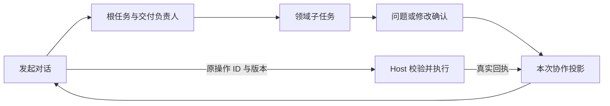

# OnO Bot 会话、协作与通信完整改造方案

2026-11-17 建立，2026-11-22 更新。原地协作、双方记录、持久发送与增量同步已接入。实际范围、81 项检查、六项隔离界面验证及剩余限制见[首批实施记录](qa.md)。第 5.5 节归并界面修订，第 12.7 节记录单主对话和历史分页的现行规则。协作回传分段、实际值回执和旧后台替换见[实施记录第 8 节](qa.md#8-2026-11-18-协作回传顺序与旧后台修复)。

实施状态：P1核心闭环通过，P2/P4基础能力通过专项验证；P3当前采用工具边界受控停止后续接，尚未接入Pi原生steer，不将二者混为一谈。P5已完成合成准备成本测量，本轮保持每轮释放实例。第3节保留改造前核对基线，第13/14节继续作为完整目标与待验收清单，不能全部视为已实现。

本轮解决一条完整的用户链路：在总 Bot 或领域 Bot 的对话里提出要求，后台把工作交给合适负责人，问题、修改确认和真实结果都回到发起对话。用户可以原地回答、确认、取消和查看结果，不必进入协作详情寻找子任务。

实施顺序为：P0 固定语义与测量基线，P1 原地协作及待确认补充，P2 可靠接纳与基本恢复，P3 运行中补充及轻量消息，P4 增量同步与合并写入，P5 根据测量引入有限会话缓存。先完成可独立验收的业务闭环，再扩展运行控制和性能；不把本次整理方案当作任意时刻抢占工具或自动撤销写入的授权。

2026-11-22 确认每个 Bot 使用一条持续主对话。P6 已接入历史按需加载和收起历史，下一步核对长对话交互与性能。旧版「开始新对话」及配套会话归档、切换和删除流程撤出计划。CMO 核心见[本仓实施记录](../../../../../../cmo_workbench/docs/requirements/shared/ai-assistant/bot-architecture/qa.md)。

最终体验是：在同一个 Bot 对话里持续交流；回答问题回到原工作，补充要求更新原建议，新事情正常排队。总 Bot 委派出去后，问题、确认和回执留在发起对话。聊天、读操作、业务修改的权限与确认分别判断，不要求用户选择 queue／steer 等技术模式。

本轮补充确认：Bot 之间以消息联系，按双方持续记录往来；消息可关联工作，工作不构成 Bot 间对话的分区。第 3.7 节为已确认语义，第 11.7 节落实读取和定位，第 14 节列出验收条件。

## 1 范围和基线

- 本文运行改造范围为 OnO。保留独立本地 Host、Pi 执行、领域工具和业务确认；模型连接继续使用现有设置。CMO 仅同步[对应实施方案](../../../../design/cmo-bot-workbench-implementation-2026-11-15.md)，本轮不开发、不修改其运行代码。
- 现有身份、主对话、任务、草稿、记忆、定时任务、历史和业务数据继续沿用原 ID 与关联关系。
- 固定、悬浮和灵动岛共用同一协作记录。主窗口和灵动岛各自保存未发送草稿，继续共享已发送消息、任务和结果。
- 通信改造不重做头像、导航外框和主题。用户后续单独确认的头像、紧凑侧栏、按钮及动效调整集中记录在第 5.5 节；以后改会话管理仍须保留这些结果。
- 方案最初核对版本为 `bot-workbench/v4`、数据库4；前置界面设计聊天结束时为v6、数据库4。首批实现后为 v7，2026-11-18 回传修复后 OnO 为 `bot-workbench/v8`、数据库6，早期版本仅用于说明迁移基线。
- 本方案中的完整接口、策略与验收条目仍是目标；已落地部分以首批实施记录为准。根目录 DESIGN.md、UX-CONTRACT.md 仅同步已实现行为，未验收项保持在方案中。

动态创建 Bot、各 Bot 工作目录和群聊继续暂缓。每 Bot 选择模型已落地，见第 5.6 节。

## 2 本轮反馈覆盖

| 反馈主题 | 已明确的决定 | 对应内容 |
| --- | --- | --- |
| 发起对话承接协作 | 已同意：补充、确认、结果回到原对话 | 第 4 至 6 节、P1 |
| 交接、澄清、确认、完成、受阻五阶段 | 已同意：紧凑显示，在当前对话处理 | 第 5 节、P1 |
| 一份状态、修改同一建议、两处确认同步 | 已同意：同源操作、旧建议失效、真实回执 | 第 6 节、第 10 节的待确认场景、P1 |
| 发送状态查询 | 已同意：稳定发送 ID、核对接收结果 | 第 7 节、P2 |
| 记录级增量同步 | 已同意：序号、版本、游标和完整历史 | 第 8 节、P4 |
| 排队与追加要求 | 已核对现状；本次形成 queue／steer／受控 redirect 的具体边界 | 第 3.2、10 节、P1／P3 |
| 合并写入 | 已同意：文字更新合并，关键状态及时持久化 | 第 8.4 节、P4 |
| 自动恢复与轻量消息 | 已同意：恢复显示和状态，交流与业务执行分开 | 第 9、11 节、P2／P3 |
| 优先解决原地协作 | 已同意：作为第一阶段交付目标 | 第 12、13 节 |
| chat／work 分类与连续会话 | 不把消息、工作、单次运行和模型会话混为一体；历史兼容、目标关系明确 | 第 3.3 至 3.6 节、P0／P1 |
| 参考 Hermes 复用运行实例 | 保留 Pi 执行核心，移植生命周期和失效规则；启用缓存前测量收益 | 第 12.5、12.6 节、P5 |
| 参考 Grok Bot 的自然协作 | 学习消息归属、投递回执、Widget 回答和记录流；不反推未知的云端实现 | 第 4 至 11、15.2 节 |
| DS-Bot 作为主要实现参考 | 学习常驻 Bot、消息／工作分离、now／queue、持久回执、资料和实时名录；在现有 Pi 上适配 | 第 11.4 至 11.6、15.3 至 15.4 节 |
| 不采用 DS-Bot 自己会话承接问题的限制 | 继续在 OnO 发起对话回答、确认和收回执，原执行负责人保持不变 | 第 4 至 6 节、P1 |
| Bot 间持续对话与工作追踪分开 | 已同意：有事可联系已有 Bot；按双方记录、按消息定位，工作关联可选；工作进度独立，确认回到发起主对话 | 第 3.7、5.4、11.2、11.7、12、14 节 |
| v4 整窗布局 | 已同意：在左侧原对话区查看双方连续往来，保留右侧工作区位置、宽度与图中比例；返回继续主对话，无第三列 | 第 5.4、14.1 节；CMO 按对应方案适配 |
| 后续消息与界面修订 | 双向交接提示同样可点击；回复按发生顺序分段、附日期时间；进度和交付件只切换对话卡片；语音卡与输入框居中 | 第 5.5 节 |
| 启动与持续卡顿 | 保留头像缓存；折叠详情按需挂载；完整长历史仍需独立优化，未确认持续卡顿的唯一根因 | 第 12.6 节 |
| 聊天越积越长 | 同一主对话按需加载近期消息，可收起并重新查看较早消息 | 第 12.7、14.7 节。分页与收起已接入，长历史性能待补验 |

## 3 改造前实现核对（历史基线）

### 3.1 已有能力与缺口

| 项目 | 当前代码实际行为 | 本轮缺口 |
| --- | --- | --- |
| 任务提交 | 每次发送创建一个新的根任务；`replyToTaskId` 当前用于引用回复内容 | 尚未形成通用的当前工作补充协议 |
| 执行顺序 | 普通执行同一 Bot 串行，全局最多 2 个执行槽位；资源等待有独立处理 | 新要求通常进入下一轮，不是自动修改当前轮次 |
| 协作 | `send_to_bot` 创建子任务、请求消息和依赖，父任务进入 `waiting_bot` | 主要是任务委派，缺少独立的轻量询问、通知接口 |
| 子任务结果 | 子任务终止后产生结果消息；依赖全部终止时父任务重新排队汇总 | 子任务尚未完成时的问题、确认卡没有聚合到发起对话 |
| 确认卡 | `BotChatActions` 读取当前任务的 actions；协作详情可继续进入子任务 | 用户必须深入详情，或进入负责人对话处理 |
| 状态展示 | 工具调用完成、父任务等待、协作通知可能同时显示 | 交接完成容易被看成工作完成，信息重复 |
| 提交去重 | `clientRequestId` 和输入 hash 持久去重；传输失败保留原请求 ID | 没有独立的发送状态查询，客户端未确认发送仅保存在控制器内存 |
| 聊天推送 | 流式回调修改条目后保存完整聊天，并广播完整 `ai:chat` | 缺少记录级更新及断连游标；成本随完整历史增大 |
| 断连 | Gateway 通知 Host 连接变化；界面提示重新读取 | 自动重连、自动重新加载和事件补齐未形成完整闭环 |
| 业务安全 | 原 operation ID、版本校验、写入前执行意图、结果不明核对已有实现 | 应复用这些能力，不能因卡片投影或恢复连接而重复写入 |
| Pi 运行控制 | 已安装 SDK 有 steer／followUp；当前 ai-core 每轮只调用 prompt，结束后 dispose | Host 尚未接入活跃运行句柄、明确补充与当前运行代际 |
| 会话实例复用 | chat 复用持久 Pi 会话文件，每轮仍构建运行实例与工具 | 没有闲置实例缓存；尚未测量本地初始化在总延迟中的占比 |

源码依据见第 15 节。这里是本次源码核对，不以早期方案或 Grok 客户端字段反推 OnO 已具备能力。

### 3.2 我们当前怎样处理追加要求

前面的“新要求排队”是调度层的概括，需要补上已经实现的局部合并保护：

1. 调度层每次提交仍创建新任务；同一 Bot 正在执行普通任务时，新任务等待执行。点击回复某任务也不会直接复用该任务。
2. 日程运行时会寻找同一 Bot、同一主对话里的旧建议。现有识别主要针对单项 `create` 待办计划，旧任务必须没有父任务和协作依赖。
3. 对“先新增事项，再补充日期”，新预览完整生成且校验成功后，可以保留原字段、合入新字段，废弃旧确认卡，并标记被新建议替代。
4. 如果原新增已经确认并生成事项，后续即使模型又调用新增工具，也可以依据已保存的事项 ID 转成更新，避免再次创建。明确要求另建时使用 `separate`；改名时可使用 `replacesProposalId` 明确目标。
5. 同名目标有歧义、原操作正在执行或结果不明时，不直接替换；保存新卡失败会回滚旧建议的退休操作。

这层保护已经存在，不应重做一套。但它不等于“所有补充都能修改当前工作”：它没有通用覆盖已有事项的更新计划、跨 Bot 委派子任务、正在执行时的改向，以及多份候选建议的任意自然语言关联。

因此，“把截止日期改到15号，随后改成20号”当前仍按新请求进入调度；能否接到原建议取决于具体计划与上下文，不能承诺自动改写正在执行的那一轮。第 10 节把这一点补成明确策略。

定向复核：`tests/bot-todo-followup.test.ts` 现有 9 项测试在本机合成模型和隔离数据库下通过。首轮沙箱内本地模型请求失败，宿主环境复跑退出码 0；该结果证明上述新增后补充保护，不代表跨 Bot 原地确认或通用抢占已经实现。

### 3.3 主对话、任务记录和模型会话的实际关系

一条主对话包含多轮消息和多个任务记录；不是一条对话只对应一个任务，也不是每条消息都重新创建完全隔离的模型上下文。

| 层次 | 当前关系 |
| --- | --- |
| Bot 与主对话 | 每个 Bot 有自己的持续主对话 |
| 用户消息与任务记录 | 每次发送创建新的根任务，任务状态和操作按任务记录关联 |
| kind 为 chat 的模型会话 | 复用主对话绑定的持久 Pi 会话，多个 chat 任务记录可以指向同一个会话文件 |
| work、delegated、routine 的模型会话 | 分别创建并持有任务自己的 Pi 会话；恢复该任务时继续其原会话 |
| 新执行会话的输入 | 根工作按范围带入有限的相关历史；委派子任务不直接复制整段父对话，通过任务要求与明确共享资料获得上下文 |

当前 kind 按提交时的引用、回复关系和页面范围等字段分类，不完全等于用户语义上的“闲聊或业务工作”。例如直接在日程主对话里要求修改待办，仍可能被归为 chat 并复用主会话。因此可以说当前有任务状态隔离和按种类选择的会话隔离，不能笼统说所有业务任务的模型上下文都完全隔离。

上述路径由 BotRuntime 的持久会话选择、BotStore 的主会话绑定和 ai-core 的 SessionManager 打开／创建逻辑共同决定。新会话也不代表丢弃所有相关信息，仍按现有上下文规则获得合法历史和引用。

“每条消息建立任务记录”是 OnO 已确认的实现，不能直接当作与 Grok 服务端一致的结论。Grok 客户端协议区分 message、session、可选 task 和 workflow 标识；官方行为允许用户新指令重定向当前工作。其云端是否每条消息创建内部任务、怎样排队，仅靠本机安装包不能确定。

本方案区分调度记录与业务工作：每轮调度可以保留可追踪记录，同一业务工作的补充必须关联原工作；持续对话承载多项工作，不能因为记录 ID 不同就把关联补充全部当作新业务。

### 3.4 当前分类规则与改造口径

目前普通 submit 按载荷字段决定 kind，没有使用模型判断用户是在闲聊还是办事：

| 当前条件 | kind |
| --- | --- |
| resources 非空，或 replyToTaskId 有值 | work |
| scope 为 copy／bazi／reading，或 workbench 的 browser／media-browser | work |
| 普通 submit 的其他情况 | chat |
| Host 创建领域委派 | delegated |
| 定时触发创建任务 | routine |

这些类别混合了上下文选择和任务来源。日程里修改待办可能归为 chat，阅读页的一句解释可能归为 work；不能据此决定是否允许写入，也不能将页面变化自动理解为另一项业务。

系统分别判断输入关联的工作、当前使用的模型上下文，以及可用的工具和业务操作。存量记录按原 kind 读取，旧独立聊天从「历史记录」只读查看。

### 3.5 消息、工作、运行与模型会话

| 对象 | 身份与生命周期 | 最小实现方式 |
| --- | --- | --- |
| 用户输入 | 一次发送或一次明确操作；需要持久接纳和去重 | 文本输入沿用来源 messageId 与 clientRequestId；按钮操作沿用 action ID／revision |
| Bot 间对话 | 稳定的两位 Bot 之间持续往来的查看视图，跨越不同工作 | 按双方 botId 读取现有 bot_messages，不为每项工作或每对 Bot 另建模型会话 |
| Bot 消息 | 一次询问、通知、委派或回复；可以关联具体工作 | 沿用消息 ID、发送／接收 Bot 和 replyTo；工作字段仅在存在相应关联时携带 |
| 工作 | 一项完整目标，可以经过澄清、补充和多 Bot 协作 | 沿用 rootTaskId；不另建一套 work 数据库 |
| 执行任务 | 某个 Bot 对这项目标负责的一段处理 | 沿用 taskId、parentTaskId 和依赖关系；必要的内部重拟仍在原根链内 |
| 单次运行 | 某个任务被调度后的一次 Pi 调用 | 活跃句柄记录 runGeneration 和本次要求版本，结束后退役 |
| 模型会话 | 保存模型输入、工具过程及上下文 | 沿用持久 Pi 文件及主对话／任务绑定；与 UI 主对话分别管理 |

改造后每条发送仍有记录，只有明确的新目标才新建独立根工作。回答、补充和取消关联既有工作；已完成工作的后续修改形成新的关联工作，保留原回执。不同 Bot 的私人历史和记忆不会因为协作而合并。

会话选择采用以下规则，并由 Host 根据授权和对象范围决定，不能接受客户端任意指定另一个 Pi 文件：

| 场景 | 目标会话 |
| --- | --- |
| Bot 主对话中的普通连续交流、同一授权范围内的日程请求 | 沿用主会话 |
| 回答或补充一项未结束的工作 | 回到该任务原绑定；不因发起入口或显示布局变化重建上下文 |
| 命例、书目、文章等有明确对象范围的处理 | 绑定当前工作及对象范围；对象变化时重新检查边界，不能串入其他对象的私有资料 |
| 委派和定时工作 | 独立任务会话，只加入任务要求、允许的资料和相关上下文 |
| 明确的新独立工作或需要不同授权范围 | 新工作及合适的会话绑定，不修改旧会话归属 |

携带引用和引用回复本身不等于必须隔离；是否复用取决于上述工作与授权边界。历史任务优先使用原 piSessionPath；旧记录缺少新绑定字段时按原规则恢复。持久文件缺失仍报告缺失，不静默创建空会话冒充继续。

首版保持同一 Bot 普通执行串行、全局 2 个槽位，不同时扩大并发。即使多个工作共用主 Pi 文件，也只有一个写入者。运行读取已准入的历史前缀及明确关联补充，不能提前把后面排队的无关用户消息混入当前任务。

### 3.6 运行中引用与闲置缓存分开

P3 为正在执行的 Pi 实例保留受控句柄，才能把 steer 送到正确运行；运行结束仍可立即释放实例，不依赖闲置缓存。P5 才决定是否为下一轮保留闲置实例。

已安装 Pi SDK 的 steer 会在当前工具调用结束、下一次模型请求之前交付补充；followUp 在当前 Agent 完成后处理。当前没有接入这些方法，也没有等价的现成 redirect 接线。不能把 abort 后再 prompt 宣称为已经具备 Hermes 同轮重定向语义。

本方案学习 Hermes 的运行代际、缓存失效和释放规则，在现有 TypeScript／Pi 上适配；不引入第二套 Python Agent 执行器。具体输入控制见第 10 节，闲置复用见第 12.5 节。

### 3.7 已确认：以消息联系 Bot，工作作为关联

Bot 是长期存在的负责人。有询问、通知、修正或工作要交接时，可以联系已有 Bot；不用先把双方交流划成一份新的工作对话。消息接纳、是否唤起模型和是否建立业务工作分别判断，需要模型处理的消息仍遵守原调度，不等于取消执行记录。

| 层面 | 当前 OnO 实现 | DS-Bot 参考与本项目目标 |
| --- | --- | --- |
| 联系另一个 Bot | send_to_bot 创建子任务，父任务等待结果 | 向已有 Bot 发送消息，回复稍后到达；正式委派继续记录依赖和真实结果 |
| 对方正在忙 | 新委派进入队列 | 参考 now 在安全步骤边界接收补充，queue 留作独立后续工作；Pi 适配及业务写入边界沿用第 10 节 |
| 查看双方往来 | 当前接口主要按任务链读取 | 按两位 Bot 查询实际消息，不按某个 rootTaskId 切成独立对话 |

DS-Bot 后台也登记工作交接，用来等待回复、汇总后续协作；它不是完全没有工作关系。Grok Bot 官方资料确认异步发送和稍后回复的产品行为，但不能据此断言其服务端没有任务关系。参考来源和核对版本见第 15.2、15.3 节。

本项目确认采用以下规则：

- Ono ⇄ 日程是一份持续往来视图。询问 DataFUN、稍后询问 DAMA，仍出现在同一对 Bot 的时间顺序记录里，不为不同事项新建一份 Bot 间对话。
- 消息可以带工作关联，用于追踪、补充、取消和结果回传；询问、通知不强制创建完整的委派子业务，也不伪造业务根任务满足旧字段。
- 点击某次交接，打开双方记录并定位到原消息，可以继续查看前后有权读取的往来。“本次工作 · 2 条消息”不再作为固定查看范围，顶部不加双方切换控件。
- 工作进度继续管理进行中、待确认、受阻及实际结果；问题和确认仍回到用户发起的主对话。消息已投递不代表工作已完成，也不代表用户已批准。
- Bot 间记录在原对话区内部临时查看，不增加第三列，不挤压工作区；具体呈现、返回行为和高保真见第 5.4 节。

## 4 统一的协作归属

### 4.1 三种身份分开

| 身份 | 含义 | 规则 |
| --- | --- | --- |
| 发起对话 | 用户最初提出这项要求的对话 | 本次澄清、确认和结果在这里可达 |
| 交付负责人 | 对这项完整请求负责汇总的 Bot | 跟进依赖、报告整体结果，不把交接当完成 |
| 执行负责人 | 实际读取或修改领域数据的 Bot | 保留工具权限、版本检查和业务回执 |

例：用户在总 Bot 对话里请求修改待办。发起对话和交付负责人属于总 Bot，执行负责人是日程。显示日程的确认卡不会把日程工具权限转给总 Bot。

沿用 `rootTaskId` 和 `parentTaskId`，由 Host 根据真实任务关系解析发起对话，不接受模型任意指定另一个私聊作为结果目的地。补充请求保留自己的用户消息 ID，并明确关联目标工作；终态工作的后续修改另建关联请求，保留原回执。

### 4.2 读取协作投影

新增只读的 `getCollaboration(rootTaskId)`，一次返回：

- 根任务及发起对话标识。
- 本链条参与者、当前执行者和派生的用户可见状态。
- 本链条需要用户处理的原始 action 引用、原负责人、原版本和呈现所需字段。
- 已完成的业务回执、受阻原因和本次交接记录。

这是基于现有任务与操作计算的视图，不建立第二份确认记录，不为每个窗口或 Bot 复制一套可执行 action，也不为投影单独建立业务数据库。

此接口聚合一项工作的状态和操作，不承担完整的双方消息历史。后者按第 11.7 节独立读取；不能把 getCollaboration 的 rootTaskId 条件复用为 Bot 间对话的固定边界。

### 4.3 权限与状态

- 主窗口沿用原有业务权限；灵动岛只允许读取和处理总 Bot 根任务链条内的操作，沿用当前 `rootTaskId` 校验，不因此获得其他 Bot 全部任务或私聊。
- 只带回本次协作所需的问题、预览、进度和回执；私人记忆、历史对话、密钥和完整内部推理不进入协作投影。
- 主任务后台可以继续处于 `waiting_bot`。如果子任务需要用户确认，界面派生为“日程需要你确认”；不要仅为改变文案把父任务强改成 `waiting_user`，以免破坏现有结果恢复条件。
- 参与任务或 action 变化时，Host 让相应根任务投影失效，并通知发起对话与原负责人。界面不能只监听当前 Bot 自己的变化。
- 投影版本用于刷新和缓存；执行始终检查原 action 的真实状态和 revision，不能拿投影版本代替业务版本。

## 5 原对话中的完整流程

### 5.1 默认呈现

同一根请求显示一份紧凑协作块：进行中是一行状态，出现问题或确认时在原位置展开，结束后收成简短回执。协作记录按需展开；不要求打开任务详情才能处理下一步。

沿用现有头像、字体、圆角矩形按钮和确认卡组件。来源显示领域 Bot 名称和头像；不增加永久的第二输入框或自动切换工作台。

| 阶段 | 发起对话显示 | 直接操作 |
| --- | --- | --- |
| 已交接 | 已发消息给 + 日程头像／名称；实际开始处理时才显示处理状态 | 点击看双方往来；补充要求或取消仍在原工作入口 |
| 等待排队或处理 | 日程正在排队／正在整理修改 | 保持原输入入口，显示实际状态 |
| 需要澄清 | 日程的问题和紧凑选项 | 选择、其他回答、跳过或取消 |
| 需要确认 | 日程提供的原始修改预览 | 确认修改、保留原内容 |
| 写入中 | 正在保存修改 | 禁止重复提交，保留卡片尺寸 |
| 已完成 | 对象名称、实际变更和成功回执 | 展开详情；沿用业务已有的查看或撤销入口 |
| 失败或受阻 | 明确原因及下一步 | 安全重试、重读、取消或直达必要的资源入口 |
| 结果不明 | 修改结果待核对 | 继续使用现有核对流程，禁止自动再写一次 |

一般问题和业务修改在原对话办完。系统文件选择、账号登录、浏览器站点授权等必须由对应资源界面完成的操作，提供直接入口并保持当前工作关联；完成后回到原协作继续，不要求用户自行查找子任务。

### 5.2 截止日期示例

用户：把 DAMABOOK 学习的截止日期改成12月中。

建议的确认内容为：日程、待确认、当前事项名称、截止日期 `当前实际值 → 2026-12-15 23:59`，底部“保留原日期／确认修改”。这里的日期是本例的拟定值，不是已经读取到的用户数据。

- “12月中”可以建议为15日，但确认卡必须明确具体日期；不能把“中旬”偷偷固定为一个日期后直接写入。
- 年份、日期和时间使用请求时的日期上下文与应用现有时区规则；本例按 2026-11-17、Asia/Shanghai 解释，不用模型服务器的当前时间。
- 修改已有事项只列真正变化的字段，能同排则同排；新增事项继续使用建议值，不伪造旧值。
- 只修改用户指定的截止日期；计划日期、提醒和其他字段只有在明确要求或另行确认后才改变。

### 5.3 去掉重复信息

- 委派工具调用完成表示“已交给日程”，不能代替整项工作的完成状态。
- 已有协作块承载状态时，隐藏同轮重复的“等待日程结果”占位气泡和大通知卡。已有实际回答、问题和业务回执保留。
- 新流程对系统占位使用结构化呈现标记；不按中文字符串批量过滤历史消息。旧记录没有明确标记时优先保留，避免把真实回答或用户内容误当占位。
- 多个并行子任务归到同一协作块。需要处理的操作清楚标明负责人和对象；不把不同对象的确认合成一次模糊的总批准。
- 技术状态如投递、连接、游标默认留在详情或诊断；正常对话用“正在处理、需要确认、已完成”等用户可理解的文字。

### 5.4 参考 DS-Bot 的呈现层级与交付件

本节记录源码比较后确定的呈现方式；已落地范围见首批实施记录及第 5.5 节。工作进度和交付件的目录／预览沿用已确认内容，但其切换范围以第 5.5 节为准，旧版自动占用工作区的规则已被后续要求替代。

本次[整窗高保真 v4（已确认）](../../../../../design/bot-collaboration-ui-2026-11-17/pair-conversation-full-window-v4.png)及[画面状态说明](../../../../../design/bot-collaboration-ui-2026-11-17/README.md)展示在原对话区内查看 Ono ⇄ 日程的持续往来，同时保留完整工作区。用户已认可此前主对话内容，并确认 v4 的左侧阅读宽度、右侧工作区比例和原区内返回方式；实施沿用该布局，并保留原有宽度偏好及窄窗适配，不因打开记录改动工作区。v1–v3 保留供对照，但旧稿的独立右侧抽屉与“仅当前工作”固定查看范围不再采用。图内消息、日期、数量和工作区数据仅为设计样例；DataFUN 日期修改仍待用户确认，不代表运行代码或业务写入已完成。

截图中的“已创建写手／程序员／群聊”属于创建成功事件。DS-Bot 的 Bot 间消息也使用类似 EventLine，但点击打开双方交流记录；普通回复、问题表单和交付文件并非全部渲染成同样的小字。读取的版本里还会合并部分往来事件，内部交流的正文不默认全部占满用户主对话。

| 内容 | 本项目建议呈现 | 保留的行为 |
| --- | --- | --- |
| 创建、交接、收到回复等事件 | 一行辅助文字、现有 Bot 头像／名称；有真实记录时可查看 | 从结构化记录和回执生成，不解析模型自称“已完成”当作成功 |
| 普通回答和最终结果 | 正常可读的消息正文 | 不因内部任务状态再附一张重复“已完成”大卡 |
| 工作进行中 | 同一根工作的紧凑状态，详细过程按需展开 | 工具结束、已交接与业务完成分别表达 |
| 需要用户回答／确认 | 在发起对话展开原问题或修改卡 | 保留原 action、对象版本、要求版本及真实执行负责人 |
| Bot 间完整交流 | 点击交接事件，在原对话区打开双方持续消息并定位对应记录，展示有权查看的原正文、发送者和时间，不按工作切成独立对话 | 不用摘要替代实际消息，不增加第三列或挤压工作区；查看可选，流程不依赖打开它或跳到另一个 Bot 才能继续 |
| 本轮交付件 | 消息附近展示紧凑成果／文件卡，并进入既有交付件目录 | 共享同一 artifact ID、来源 Bot、来源工作和正文／原件引用，不复制另一份成果身份 |
| 文件修改过程 | 有真实文件变更依据时展示摘要和详情入口 | 文件被修改不自动等于已经生成一份可下载交付件 |

DS-Bot 的交流界面按两个 Bot 查询已投递的实际消息，长内容按需展开；后台仍保留工作交接关系。本项目同样把双方消息与工作追踪分开：消息可关联具体工作，但工作不构成 Bot 间对话的分区，取消此前“只显示本次工作”的固定范围。点击具体交接事件直接定位双方及该消息；主对话的协作记录总入口默认定位最近一次往来。顶部保留返回与双方身份，不加对象切换。用户与各 Bot 的个人私聊、内部思考及工具日志不混入，实际可读记录仍受各入口授权限制。

固定模式下在原对话区内临时查看，工作区宽度和位置不变，不新增右侧抽屉；工作进度、交付件也只替换原对话卡片，不能自动收起工作区。悬浮模式下在原悬浮面板内部查看。记录只读，补充和确认回到原主对话，返回恢复草稿及原阅读位置。按双方读取消息与第 4.2 节按根工作聚合问题、确认和回执分别设计；后者继续服务原地处理同一工作，不代替双方消息历史，也不因此扩大灵动岛等入口现有的根链授权。

DS-Bot 的文件卡主要承接 DSH 的 deliverables 槽位，插件增加 Save 动作；不能只复制 file-save.js 就认为本项目已有全部文件预览、生成和导出能力。本项目先接已有 Markdown 交付件、真实原件引用与既有预览，文件保存／打开依据授权读取和实际可用性。不可读或缺失时保留说明与恢复入口，不显示虚构的下载成功。

既有交付件目录继续承担按日期、名称、来源及工作查看的功能；新增消息内成果卡与目录使用同源记录。生成、消息推送或重连重复到达不重复登记；交付件事件不能替代本轮完整业务回执。卡片的头像、文字、圆角和操作沿用现有共享组件与主题，既有导航悬停外框保持。

DS-Bot 的主对话区分消息正文、协作事件、工具过程、交互卡和文件成果；群聊详情另外有由 group_task 登记的任务板。它并非要求每句输入先选“聊天／工作”，也不是将所有私聊自动拆成两种对话界面。本项目继续在同一对话完成交流，工作进度收录明确工作、待确认、受阻和实际产出；普通问候不额外生成占位任务卡。收录依据工作目的、action 和真实回执，不仅按 chat／work 会话分类枚举过滤。

### 5.5 2026-11-18 归并的界面与消息修订

本节汇总已确认的界面决定。下表所列功能已接入，第 12.7 节记录当前主对话、分页和收起历史。早期截图和设计稿留作历史参考。

| 区域 | 最终要求 | 当前依据／边界 |
| --- | --- | --- |
| 发出／收到消息 | 单条提示居中显示「已发消息给」或「消息来自」，随后是对方头像、名称和箭头。合并后的「消息往来」以当前对话区为准水平居中，展开或收起工作台时随对话区宽度重新居中。使用透明底、22px 头像、13px 文字、6px 间距和至少 32px 高的点击区。悬停使用 8px 圆角浅色底。点击或按 Enter 打开双方往来 | `BotCollaboration.tsx`、`bot-collaboration.css` |
| 回复顺序 | 发消息前已输出的正文保留；交接事件按实际发生位置出现；协作结果到达后，OnO 的后续汇总作为新回复。不能把结果倒灌进交接前的旧气泡，也不在汇总后再贴一整份内部报告 | `bot-runtime.ts`、`BotPanel.tsx`；内部原文保留在双方记录，正文由真实来源决定 |
| 日期时间 | 每个 Bot 回复的名称旁显示日期＋时间；新回复记录自己的时间，旧回复无单独时间时说明使用关联请求时间，完全无时间则显示未记录 | `BotPanel.tsx`；不能按刷新时间伪造历史时间 |
| 对话卡片边界 | 工作进度、交付件、双方往来均只切换对话卡片；右侧工作区位置、宽度、表单、浏览器实例不变；返回恢复草稿与滚动。工作区仅由显式开关控制 | `App.tsx`、`BotPanel.tsx`；覆盖此前进入工作记录自动收起工作区的规则 |
| 导航与入口 | 展开／折叠保持同一头像尺寸、行位和圆角；同步压紧行距，当前共用 58px 行距、4px 间隙。移除头像旁资料信息角标，展开和折叠均通过右键／Shift+F10 菜单的「编辑 Bot」进入；设置图标与文字在展开态左对齐 | `bot.css`、`App.tsx`；保持已有悬停外框，不因头像换型重画外框 |
| 按钮和页头 | 主聊天顶部居中显示当前 Bot 名片，点击进入卡内侧栏。资料库和工作进度入口见第 5.6 节 | 工作区沿用自己的页头 |
| Bot 资料面板 | 采用已选“资料／记忆／定时任务”三页签，顶部身份及编辑／关闭固定；列表和表单在同一面板内切换，保留未保存输入，定时任务不跳工作区 | 已选稿与原接入方案第 3 节；右键打开、资料编辑、记忆及计划仍使用真实版本接口 |
| 问题与修改卡 | 问题原地选择；选项扁平紧凑，说明有空间时一行；“其他＋输入框”直接可见。新增显示建议值，修改显示实际旧值→新值；未设置／未变字段默认收起，必要长文完整展开 | 既有同源 action；DataFUN 补日期继续原建议，避免重复卡片和待办 |
| 悬浮与模式 | 小输入入口相对整个应用视口横向居中；点击有限时长流光／冲击波后展开。答复有高度上限，优先当前轮；固定和悬浮切换时对话卡沿当前位置缩放至目标位置，工作区同步调整宽度 | `BotPanel.tsx`、`bot-floating-motion.ts`；收起不取消工作，不在每次流式更新重放全屏动效 |
| 语音听写 | 听写卡中心对齐下方当前输入框中心，宽窄栏、侧栏开合、悬浮及缩放均跟随；控件菜单保留卡片边界约束 | `SpeechInput.tsx`；取消、预览、确认插入及不自动发送的流程保持 |
| 头像与小窗 | 使用已确认的独立形状／颜色系统及稳定缓存；小窗对话／消息页签双向可切；深色气泡与文字使用匹配的主题颜色 | 头像规范及现有组件；性能修复不能恢复旧头像或删掉已确认悬停效果 |
| OnO 业务组织 | 命理、阅读各自工作台和 Bot；每日签到在总台，应用连接／账号及自动签到配置在设置；命理选择器不被后层遮挡，移除分布概览入口 | OnO 专属映射，不作为 CMO 的默认 Bot 或业务入口 |

后续局部验证已有独立证据，不能累计成新的全仓通过数：双向事件的点击／键盘及布局 6 组、语音居中 7 个几何场景、折叠思考与工具详情的相关回归 9 项。证据分别在本机 `bot-message-events-unified/report.json`、`speech-card-centering/report.json`、`performance-regression/verification.md`，共同根目录为 `C:/Users/henry/.codex/visualizations/2026/11/13/01a1d374-1476-71a3-b6f1-45afb2903318/`。本次文档刷新未重跑这些测试；源码存在、局部验证、真实持续使用和正式发布分别记录。

### 5.6 Bot 名片、资料库和工作台（已实施）

主窗口固定模式先显示当前 Bot 的对话。顶部悬浮名片始终在对话正文这一列居中。名片右侧的箭头朝右时可展开资料侧栏，展开后箭头朝左，再点一次即可收起。侧栏与对话共用一张卡片，中间以细线分隔。侧栏沿卡片右缘滑入、滑出，和对话平移共用 240ms 的缓动。连续点击时从当前位置折返。系统开启「减少动态效果」时立即切换。点击左侧联系人切换对话，右键、菜单键或 Shift+F10 打开只有「编辑 Bot」的菜单，选择后进入该 Bot 的详情。

Bot 回复靠左，用户消息靠右。短消息随内容收宽，主对话长气泡最宽 560px。开合左侧联系人或右侧资料栏时，两侧气泡随留白水平移动，同一条消息保持原来的断行和阅读位置。宽表格和代码在气泡内横向滚动。

在主窗口的「详情」或「资料库」中，单击头像下方的名称或简介即可原位编辑。按 Enter 或点击文字下方的「保存修改」提交当前资料草稿，简介用 Shift+Enter 换行。Esc 撤销本次聚焦以来的编辑，「取消修改」撤销整份资料草稿。保存后同步更新联系人与对话名片。如果另一窗口已更新资料，侧栏显示最新版本，用户确认后只合并本地改过的字段。点击顶部头像，在头像正下方的浮层切换角色、图形和颜色。「重置」恢复当前 Bot 的默认头像预览，「保存修改」提交资料草稿。点击浮层外或按 Esc 可收起并继续浏览当前页。「详情」可以选择模型。记忆、工作进度、定时任务和历史对话均从详情进入。「资料库」在原侧栏切换为当前 Bot 的交付件，支持预览、查看来源任务和打开可用原件。

点击「工作台」收起资料侧栏，并在对话卡片外的右侧展开这个 Bot 对应的业务工作区。之后仍可从名片查看资料库或进度。关闭工作台后继续原对话。侧栏在宽窗中占 280–340px，卡片宽度不超过 800px 时，资料栏在卡片内覆盖正文，顶部名片仍可收起侧栏并返回原来的阅读位置。草稿和已打开的工作区继续可用。

各 Bot 从共用的供应商和模型列表中选择自己的模型。侧栏显示模型名和供应商，展开分组后用勾号标记已选模型。底部的「模型配置」直达设置里的对应页面。普通对话、委派、只读询问和后台执行使用执行 Bot 保存的模型。未选择模型或已选模型被删除时，Bot 等待选择。升级时，原来跟随默认的 Bot 会一次性保存此前所用的模型。旧版遗漏的绑定会重新补齐，读取不到有效旧模型时等待下次启动重试。已有选模和全新安装的选模由各 Bot 管理。Host 通信版本为 v9，AI 数据库版本为 6。

## 6 同源确认与结果回传

### 6.1 操作身份

卡片绑定原 action ID、action revision、执行负责人和根任务。原负责人对话和发起对话只是同一操作的两个呈现入口。

1. 用户确认时发送原 action ID、revision 和本次明确选择。
2. Host 验证任务链条归属、操作仍待确认、目标对象版本和用户选择。
3. 原执行负责人通过原业务工具修改数据，并保存真实回执。
4. 原负责人和发起对话同步为已应用、已保留、失败或结果待核对。
5. 全部必要依赖得到明确结果后，交付负责人汇总本轮结果。

单次确认只能有一个执行者获得提交资格。多窗口同时点击、迟到的旧按钮、重复网络请求均返回已有状态或版本冲突，不能生成另一笔写入。

### 6.2 补充后的卡片

待确认阶段收到明确补充时，生成并完整校验新建议后再替换旧建议；复用现有新增待办后补充保护，并扩展到已有事项更新和跨 Bot 子任务。

- 界面使用稳定的本次交互标识保持卡片位置；各版本指向同一条原始操作，或指向明确 `supersedes` 关联的新 action。
- 跨入口始终读取同一版本的原 action，不能把同一版本复制出两份执行身份。
- 接纳明确补充时，先递增本工作的要求版本并冻结旧确认入口；实际生成新预览与退休旧建议仍在完整校验后事务提交。确认与补充竞争时按同一权威提交顺序处理，不能一边接受20号要求，一边继续允许15号旧卡写入。
- 生成失败保留旧预览内容供查看，但不静默恢复旧要求的批准资格；原位置提供重试或明确采用原建议的操作。后者重新校验对象和当前要求版本，再形成可批准版本。
- 旧版卡片明确显示正在更新或已被替代；执行同时检查 action revision 与工作要求版本，迟到旧确认不得继续写入。
- 生成新预览期间旧操作如果已经执行，读取真实业务结果后生成下一次修改预览，不能假定旧操作仍未写入。

### 6.3 取消和失败

- “保留原日期”拒绝当前修改，回执说明未应用这次建议；不把它显示成修改成功。
- 回答问题只恢复原执行链条，不另外创建一份业务修改。
- “取消本次协作”作用于当前根请求和尚未结束的后代，不取消同一 Bot 的其他独立工作。已产生的实际业务效果在回执中说明，并沿用原有撤销能力。
- 已有操作处于 executing 时，取消先阻止后续步骤，继续跟踪该操作的真实回执；结果不明进入核对，不能把“用户要求停止”记成“从未写入”。迟到回执仍更新原操作事实，不重启已取消链条。
- 明确未产生业务效果的失败才提供直接重试；执行中断且结果不明继续进入核对状态。
- 子任务的失败、拒绝、取消都需要回到交付负责人，形成清楚的本轮结论；不能一直显示等待，也不能在依赖失败后报告整体成功。

## 7 发送接受状态与客户端发件记录

### 7.1 三层状态分开

| 状态层 | 要回答的问题 | 不代表什么 |
| --- | --- | --- |
| 用户发送接纳 | Host 是否已保存这次用户消息和任务 | 不代表 Bot 已经执行 |
| Bot 消息投递 | 目标负责人是否已接纳这条协作消息 | 不代表业务已完成 |
| 业务结果 | 用户确认的修改是否真实成功 | 以业务回执为准 |

已有 `clientRequestId` 与输入 hash 去重继续保留。发送 ID 由一次发送意图生成，重试、查状态和重连恢复沿用同一 ID；用户更改内容形成新的发送意图。

### 7.2 查询接口

新增 `getSubmissionStatus({ clientRequestId, chatId, inputHash, dataEpoch })`，先检查调用者、对话归属和存储代际，再返回：

| 返回 | 含义 | 界面处理 |
| --- | --- | --- |
| accepted | 已事务保存用户消息与新任务或已有工作关联，带原 messageId、taskId、接纳时间 | 接上原记录，消除临时发送状态，不再新建任务 |
| rejected | 该发送意图已得到明确拒绝，带业务错误码和原因 | 保留内容，显示可纠正原因 |
| not_found | 当前可达的 Host 权威存储里未发现该 ID | 可以用原 ID 继续投递；不换 ID 抢跑 |

Host 不可达、查询超时等属于客户端的“仍在核对／连接中”，不伪装成 `not_found` 或明确发送失败。`not_found` 也不证明另一条尚在处理的请求永远不会提交，因此原 ID 去重始终生效。

接纳成功之后，后续模型失败或用户拒绝修改属于工作结果，不把已接纳消息改回发送失败。未确认接纳的发送可以核对或保留输入；在后台状态未知时，不提供会让用户误以为保证撤回成功的按钮。

代际不一致返回明确的 `DATA_EPOCH_CHANGED` 核对状态，不降级成 not_found。存储代际由 Host 持久管理，正常重启不改变，正式数据恢复或实例重建时更新。

接纳记录和用户消息、新建任务或已有工作关联在同一 SQLite 事务中保存。建议增加独立的接纳回执记录，支持明确拒绝、关联补充及轻量消息；已有任务的请求 ID 与 hash 用于回填历史成功映射，避免只识别升级后的请求。

扩展后的输入 hash 必须覆盖正文、受控引用、意图、目标工作／操作及预期版本，不能让同一发送 ID 在重试时悄悄改投另一项工作。accepted 返回实际 messageId、rootTaskId、目标 taskId 及接纳方式；关联补充不为满足旧回执形状而伪造一个新根任务。

### 7.3 本地待确认发件记录

当前未确认发送只存在 `BotDraftController.pendingSubmit` 内存。P2 增加由 Electron 主进程单写的原子发件记录，在发送给 Host 之前保存原 ID、原载荷、hash、对话、入口和创建时间。

- 发件文件单独命名，与 Host 独占的数据库写入路径分开；主窗口和灵动岛通过主进程访问，不直接竞争文件写入。
- 原子保存失败时不继续投递，输入仍保留；原载荷包含文本和受控引用，不包含供应商密钥或认证头。
- Host 已接纳但回执丢失时，重连先查询，恢复原任务和消息，不再次执行。
- 重新打开应用可以恢复未核对意图；明确接纳并由界面接上原消息后清理待发载荷。
- 待发记录绑定产品数据实例和 Host 存储代际。查询与补发一并核对该标识；检测到新建数据实例、恢复旧备份或已知数据回退时先进入核对，不把回退后查不到的旧请求自动重新投递。正式数据恢复流程必须切换存储代际并处理残留发件记录。
- 提交期间新输入的文字不被旧回执清空；清理草稿前核对原发送快照及入口。
- 重复失败不会无限建立新发送 ID。正常界面只保留一处发送状态，详细核对信息可按需查看。

P2 不引入新的用户配置页，也不恢复跨窗口共享草稿或编辑权租约。

## 8 记录级增量同步与合并写入

### 8.1 同步单位

先按变化的记录同步，不要求第一版实现逐字符追加协议：一条回复增加文字时，只发送这条回复的新版本，不重发全部历史。任务、确认操作和协作摘要分别发送各自变化。

| 事件 | 内容 | 界面行为 |
| --- | --- | --- |
| entry.upsert | 原 entryId、版本、更新后的单条消息 | 按 ID 插入或替换，保留未变化的其他消息对象 |
| entry.delete | entryId 和删除版本 | 删除对应记录，迟到旧版本不能恢复它 |
| action.changed | 原 action ID、版本和操作状态 | 同步原地卡片和负责人处的同一操作 |
| task.changed | 任务 ID、版本和实际状态 | 更新进度，不重新发送整段聊天 |
| collaboration.changed | 根任务 ID 和投影失效标识 | 刷新本次协作的阻塞项、回执和简短状态 |

正文、工具过程、思考展示、引用和已有消息字段均完整保留。增量同步不改变发送给模型的上下文规则，也不缩减聊天历史。

### 8.2 序号、版本与游标

建议的事件批次包含 `streamId`、`generation`、`fromSeq`、`toSeq` 和事件列表；单个事件包含 seq、类型、记录 ID、记录版本及载荷。

- `streamId` 对应一个有明确访问范围的对话数据流。序号在这个流内连续递增，不使用全产品全局序号后再过滤，否则其他私聊的更新会被误判成丢包。
- `generation` 标识流的代际；正常 Host 重启沿用持久代际。恢复旧备份、重置或清空时更换代际，使旧游标失效。
- seq 表示已持久提交的事件顺序；同一事务内同时提交业务状态、聊天变更、流头和相关事件，提交后才广播。
- 消息记录版本用于拒绝迟到的旧更新，可使用该记录最后提交的流序号。action 和 task 的业务 revision 继续使用现有版本。
- 游标记录界面已经完整应用到哪一个提交点。重复事件忽略；发现缺口先补齐，不直接把更晚事件当作完整状态。
- 发起对话中的跨 Bot 投影属于发起对话的可见数据；原 action ID 和 revision 不因投影到另一个流而改变。

### 8.3 初始快照与恢复

新增 `getChatSnapshot` 和 `subscribeChat`，遵循以下读写顺序：

1. Host 在一致的读取边界取得聊天快照及对应水位游标。
2. 界面载入快照，再订阅该水位之后的事件。快照读取与订阅之间发生的提交从日志补回，避免漏掉中间一段。
3. 连接恢复、且界面仍持有对应缓存时，使用最后已应用游标补齐。
4. 首次打开、缓存已丢失、代际变化或游标早于日志保留范围时，重新取快照后接事件。
5. 不在空聊天缓存上直接使用上次持久游标；缓存与游标必须匹配。页面重载的首版实现可以直接重取快照，降低恢复复杂度。

初始快照和单条超大记录支持分片传输及完整重组，不能静默截断。现有命名管道每帧上限为 4 MiB，建议新批次控制在 1 MiB 内，为封装留余量；分片重组后校验内容，覆盖中文、表情和代码块。

事件日志只服务短期断连恢复，完整历史仍以聊天权威记录为准。初始压测默认可取每流 2000 个事件或 8 MiB 的双上限，先达到者触发裁剪；数值须在 P4 压测中确认。裁剪必须提供快照回退，不能要求日志永久保留，也不增加用户设置项。

### 8.4 合并写入的提交边界

当前每次流式回调保存完整会话。改为 Host 内按对话维护最新缓存和 dirty entry 集合；同一对话的不同任务更新按 entryId 合并，不能用较旧的整会话覆盖新条目。

第一版建议文字更新使用不重置截止时间的 100ms 批次，同时提交聊天状态和该批增量事件，再推送界面。持续输出时也必须按周期提交，不能用每次重置的 debounce 让保存一直推迟。100ms 是待测默认值，不是本次已经测得的最佳参数。

以下节点立即 flush，不等待文字批次：

- 用户消息成功接纳、用户确认、拒绝或回答问题。
- 形成待确认建议、替换旧建议、任务转入等待或结束状态。
- 业务写入前的执行意图、写入后回执、失败与结果不明。
- 正常退出、暂停、休眠通知，以及对外读取一致快照之前。

已提交的批次才推进可恢复游标。突然终止进程时，最多可能丢失当前批次内尚未提交的少量输出文字；关键业务状态不使用这一延迟保存策略。恢复时以权威状态说明中断，不能为了补文字自动再执行修改。

初期继续使用现有聊天权威存储，先减少保存频率与传输规模。没有测量依据时不同时重构全部历史存储、替换 SQLite 或引入外部消息中间件。

### 8.5 旧通道兼容

新的 Bot 订阅使用受控事件通道。现有其他 AI 页面若仍依赖 `ai:chat`，保留其兼容行为；不能全局移除旧事件。

对已启用增量的 Bot 会话避免同时消费完整快照广播和增量事件，否则仍会承担重复成本并出现覆盖竞态。按握手能力选择一条权威同步路径，初始读取和错误恢复才使用快照。

## 9 自动重连和状态补齐

Gateway 负责重连本地 Host，各窗口不分别启动后台实例。保留现有单实例、管道认证、Windows 托管及版本升级保护。

| 场景 | 恢复动作 | 不自动执行的操作 |
| --- | --- | --- |
| 窗口连接短暂断开 | 退避重连、核对未确认发送、恢复当前聊天 | 不新建同一请求，不再次批准操作 |
| 界面隐藏后回来 | 核对连接和当前投影，补齐遗漏事件 | 不重跑期间已完成的任务 |
| 电脑唤醒 | 重新确认 Host、发送回执和订阅水位 | 不自动唤醒电脑，也不把所有任务重发 |
| Host 意外退出 | 沿用现有托管恢复和数据库恢复规则 | 结果不明写入不自动重放 |
| 游标过旧或代际变化 | 一致快照替换缓存，再接增量 | 不拼接不匹配的旧缓存 |
| 浏览器或账号资源离线 | 在原协作块显示资源原因和直接入口 | 不自动重放网站点击、登录或授权 |
| 后台版本不一致 | 按既有空闲升级保护处理，展示可理解的连接状态 | 不强制结束运行中的旧版工作 |
| 数据实例或存储代际变化 | 暂停旧发件记录，核对实际业务状态 | 不把旧备份中缺失的请求直接当作从未执行 |

初始重连退避可使用 250ms、500ms、1s、2s，逐步到 10s 上限，并在窗口恢复或系统唤醒时及时重试；避免重复弹提示或高频轮询。连接恢复后按顺序处理发送核对、聊天恢复、待确认操作和协作摘要。

P2 先使用现有快照做到基本自动恢复；P4 在此基础上改为优先游标补齐。界面始终保留未发送草稿、当前输入和用户滚动位置。重连是恢复观察与控制能力，不改变已经得到的批准，也不扩大资源权限。

## 10 追加要求与当前执行的关系

### 10.1 目标关联

扩展现有 submit，使用 new／amend／answer／cancel 表达新工作、补充原工作、回答问题和取消。普通界面不暴露这些技术枚举。补充需关联根任务、执行任务和适用的 action／对象 ID，Host 校验归属与版本；不能仅靠相邻文字或同名标题覆盖另一项工作。

当前对话只有一份明确待确认建议时，可以提示这次输入关联到该建议，并允许发起独立新请求。自动判断不能安全确定目标时，在原对话询问“补充当前修改，还是新建一项工作”。多个同名事项、有多项待确认或跨领域上下文时优先澄清。

显式选中的工作／问题关联随当前入口草稿保存为可选元数据；旧草稿默认沿用原语义，主窗口和灵动岛不共享未发送文字。发送前若目标已经结束或版本改变，先校验关系，不能静默把该草稿变成新建事项。回执只清理对应发送快照，保留其后输入。

模型可以理解意图并提出结构化补充目标，但不能自行伪造来源、跳过确认或宣布业务已经执行。新预览完整通过校验后事务提交替代关系；接纳明确补充时，旧建议的批准资格先由要求版本冻结，不能在生成期间继续写旧值。

目标解析优先使用卡片、引用回复和当前明确的问题身份，再考虑同一工作内的文本补充。多个候选时用原地问题澄清，不默认选最近一张同名卡。普通“就按20号吧”可以补充日期，但不能经由模型解释变成未经现有明确批准入口的业务授权。

不为每次发送额外调用一个分类模型；优先使用已经明确的结构化关系。存在一张待确认卡不表示后续所有输入都是补充，不相关问题仍进入正常对话；不能安全确定语言关系时由当前 Bot 原地澄清。

补充消息保存在发起对话，另以用户消息 ID 关联原操作。Host 把重拟预览安排给原执行负责人，保留原根请求、权限和资源范围；不能因为输入来自总 Bot 就改由总 Bot 写入。若使用内部执行任务承载重拟，也必须保持协作链关联，不能再次形成一项无关的新根工作。

### 10.2 按实际阶段处理

| 当前阶段 | 建议处理 | 本轮范围 |
| --- | --- | --- |
| 待确认，尚未写入 | 关联原工作生成新预览，原卡更新，旧确认失效 | P1 必须覆盖，含已有事项更新和跨 Bot 子任务 |
| 排队中，尚未开始 | 合入明确关联的要求，保留全部用户消息与来源 | P3；同一字段按输入顺序采用最后一次明确要求 |
| 模型生成或只读检查中 | 在安全检查点接受关联补充，使旧版本输出不能形成可执行确认 | P3；优先使用 Pi steer，不强行中断已经开始的工具 |
| 已开始业务写入 | 等待真实回执；若仍需改动，生成下一次修改预览 | 作为安全边界固定，不做任意抢占 |
| 写入结果不明 | 先核对实际状态 | 禁止直接替换或重发修改 |
| 已完成 | 建立关联的新修改，引用真实旧值，保留原回执 | 不把已完成工作伪装成从未发生 |
| 与当前工作无关 | 新建独立请求，遵守原执行顺序 | 不挪用当前确认卡 |

P1 复用现有新增后补充合并逻辑，补齐待确认更新的目标身份、要求版本和协作关联。P3 接入运行控制；普通执行仍按 Bot 串行，不把运行中补充当作启动第二个并发执行器。

### 10.3 15号改成20号的验收语义

- 如果15号只是建议：最终仅有20号这一份有效确认；点击旧15号版本不会写入。
- 如果15号已经真实写入：新卡展示 `15号 → 20号`，这是一次明确的新修改。
- 如果正在写15号且回执尚未到达：显示正在核对本次写入，不能承诺15号未写入，也不能并发写20号。
- 如果无法确定“20号”对应哪项建议：先在原对话澄清，不自动修改其他待办。

### 10.4 queue、steer 与 redirect 的落地边界

| 内部方式 | 适用情形 | 实现边界 |
| --- | --- | --- |
| queue／followup | 无关新工作、当前运行不能接收补充、需要等待业务回执 | 继续使用 Host 持久队列；Pi followUp 只是运行能力，不能替代持久接纳、全局调度和去重 |
| steer | 同一工作、同一授权边界、模型生成或可确认的只读阶段 | Host 将已接纳补充送到当前 Pi session.steer，在下一次模型决策前生效；已开始工具按其真实结果结束 |
| redirect | 用户明确调整同一工作的方向，当前处于可取消的模型请求阶段 | 保留原任务、会话和已完成工具回执，受控取消旧模型请求后继续；先通过代际和建议失效验证，再启用该路径 |

不引入一个任意消息合并的 collect 模式。尚未消费、属于同一工作和同一权限边界的兼容补充可以合并准备模型输入，但每条来源消息仍保留；独立工作、确认批准和不同问题答案不能合并。

无关的新工作进入 Host 队列，不直接塞入 Pi followUp 绕过全局槽位和工作归属。只有明确尚未派送、明确拒绝或不支持控制时才能转入另一条安全路径；调用超时或派送结果不明时先核对，不能再排一份而导致补充被消费两次。

Host 按真实执行者派送控制。父任务等待日程时，补充定位到原日程子任务；不能只把文字 steer 给正在汇总的总 Bot，也不能再次创建一份日程委派。多子任务目标不明确时原地询问。

第一版运行句柄包含 botId、chatId、rootTaskId、taskId、持久会话标识、runGeneration 和要求版本，仅由 Host／ai-core 注册与退役。使用现有类内少量生命周期接口即可，不单独搭建通用会话中台。控制前重新核对句柄所有权、任务阶段和目标要求版本，不按 Bot 名称或仅按会话文件定位。

活跃实例接收新要求和本轮结束之间存在竞争：如果在权威检查时已经退出运行，重新按任务当前状态处理；转为待确认补充、原链排队或终态后的新修改，不调用已经 dispose 的实例。相同输入只能被一种路径消费。

### 10.5 持久接纳、运行代际和旧输出

1. 先事务保存来源消息、发送去重、工作关联和要求版本，再投递到 Pi。未保存成功不先调用 steer；运行队列不能成为唯一输入存储。
2. 接纳表示 Host 已保存；运行派送表示活跃实例已接收；并入某次模型请求和最终结果另行记录。SDK 未提供可靠消费证据时保留待核对状态，不把函数返回直接显示为“已采用修改”。
3. 每次运行／重定向的代际和要求版本随模型请求及其产物绑定。旧代际的迟到输出不更新当前回复，不创建有效确认卡；原过程可保留为只读记录。
4. 同一工作在新要求被接纳后，旧要求版本的预览即失去提交资格。形成预览、用户确认和业务写入前均校验权威版本，不能只在前端禁用按钮。
5. 补充与实际写入竞争时，事务决定先后。若执行意图已经提交，则等待原写入回执，再按真实状态安排后续修改，不宣称旧修改已被拦截。
6. 连接丢失后按原发送 ID 查询。Host 重启导致的已派送但消费不明，结合持久 Pi 记录和业务回执核对；不盲目重发修正、不自动重跑副作用。

当前工具闭包绑定 task、对象快照和等待入口。运行控制与会话复用都必须重新核对这些绑定；用户补充不能隐式扩大资源引用或修改其他对象。

### 10.6 redirect 的渐进启用

P3 先交付 queue、待确认补充和 steer。只有只读／模型请求阶段的取消续接、代际隔离、迟到工具和退出竞争测试全部通过后，才启用受控 redirect；其未启用或不适用时，明确显示已记录补充、等待当前步骤结束，不假装已经抢占成功。

不直接把 session.abort 与新 prompt 拼接当作同轮重定向：需要明确保留原工作归属、未消费输入、完成的工具结果及唯一最终回复。外部浏览器动作、执行中的业务写入和无法证明只读的工具不进入强制重定向；取消不作为数据回滚。

界面只呈现“已收到补充／正在更新建议／当前步骤结束后继续”等必要反馈。不增加 queue／steer／redirect 选择器、常驻技术提示或第二个输入框。

DS-Bot 的 now 表示在合适的下一步骤接收；其私聊模型阶段还会取消旧模型请求并把用户补充放到前面，前台命令可能转为后台继续。本方案分别处理“正在生成建议”“已提交业务写入”“后台命令仍在运行”，不将它们全部解释为已经停止或撤销。向 Pi 适配后，取消生成仍不能代替业务回执或命令停止确认。

## 11 轻量消息与执行任务

### 11.1 消息类别

| 语义 | 示例 | 后台处理 | 用户看到的内容 |
| --- | --- | --- | --- |
| 询问 | 问日程这项待办的截止日期 | 带原请求关联的只读询问，可稍后回复 | 简短交接与来源明确的答案 |
| 通知 | 告知负责人本次确认已经完成 | 记录事实，按需加入后续上下文 | 必要的状态更新，避免互发感谢形成循环 |
| 工作委派 | 让日程提出新的截止日期修改 | 现有领域任务、确认、执行与回执 | 当前协作块和原地确认 |
| 回复 | 日程回答询问或返回工作结果 | 按 replyTo 关联原请求 | 回到发起对话，不开启另一轮无关工作 |
| 取消 | 用户取消这一轮协作 | 传播到本链条尚未结束的处理 | 明确取消和已产生效果的说明 |

轻量表示交流与用户呈现更轻，不表示绕过后台调度。需要模型的询问仍使用受控执行槽位，同一 Bot 保持串行；纯状态通知不必每条都唤起一次模型。

只读询问不能调用写入工具。需要修改时转入可追踪工作和明确确认，不能把询问消息的投递回执当成用户批准。

### 11.2 消息信封

在现有 `bot_messages` 逻辑记录上扩展语义，不给每个 Bot 另建一套数据库。信封至少包含：

- messageId、fromBotId、toBotId、replyTo。
- 来源与授权关联，以及适用时的发起对话、来源用户消息。
- 可选的根请求和执行任务关联；实际属于业务工作时填写，工作所需的发起对话与返回关联必须完整，无业务工作时不伪造根任务。
- 询问／通知／工作／回复用途、正文、受控资源引用、是否需要回复。
- 接纳、投递、拒绝等投递结果及时间。

实际发送方和授权来源由 Host 填写。现有 request／question／result／cancel 记录提供兼容映射；旧 kind 不因增加新用途而失去可读性。

接纳表示已持久保存，投递表示目标已接纳处理，回复由另一条关联消息表示。工作完成仍看任务和业务回执，不能用消息投递时间替代。双方归属由稳定 botId 判断；工作字段用于关联和定位，不充当双方对话标识。

### 11.3 调度和限制

- 需要目标结果才能继续时，继续保留依赖关系并释放等待方执行槽位；可以先通知后继续的交流不强制等待。
- 现有深度、根请求预算和循环检查继续适用；具体阈值按当前代码语义核对，不在本次改造顺手放宽。
- 按 messageId 去重，同一回复只被原请求消费一次；启动和周期核对补查持久待投递记录。
- 无需回复的通知不自动生成对方的确认消息，防止自动互答和无意义模型消耗。
- 取消后的迟到消息可进入审计记录，但不能恢复已取消工作或再次发起业务写入。

### 11.4 对话传递与最小上下文包

参考 DS-Bot 的 message_bot／delivery／handoffs，将工作交接所需的信息作为有来源的结构化消息传递，而不是复制目标以外的整段私人对话。

| 内容 | 传递方式与约束 |
| --- | --- |
| 本次目标 | 用户当前明确要求及最新修正；带来源用户消息 ID，不能只转发一个失去上下文的“明天完成” |
| 工作关联 | 原根工作、目标执行任务、原问题／操作和要求版本；由 Host 校验真实关系 |
| 资料与对象 | 明确选择的引用、对象 ID／版本和完成这一步需要的事实快照；私有说明与私人记忆不随消息打包 |
| 已完成事实 | 有真实回执的操作、未完成依赖和仍待回答的问题；不把模型自述当作已写入 |
| 返回目的地 | 发起对话、原请求消息及交付负责人；由 Host 根据实际链条填写 |
| 长内容 | 保留完整正文或可授权读取的交付件引用；可提供标明的摘要，不静默截断后冒充完整结果 |

同一事项的后续修正使用同一工作和新要求版本传给原负责人。若该负责人需要另一个 Bot，继续沿原关联链交接，结果自动返回；不靠 Bot 循环轮询或再发“结果好了吗”。所有共享继续通过现有资源权限，引用不是复制全部私聊或授予额外工具权限。

稳定规则和当前 Bot 身份放在可复用的提示词部分；时间、当前任务、对象快照与实时名录按本轮需要提供。参考 DS-Bot prompt.js 的名录按需读取思路，不把每个 Bot 的全部资料、状态或其他私人说明反复塞入所有模型请求。服务商缓存是否命中仍单独测量。

### 11.5 既有消息接口的适配

沿用 list_bots 与 send_to_bot 的已有入口和稳定 botId。模型可读名称用于展示，实际接纳和路由以 ID 为准；改名不改变消息目的地、历史身份或等待关系。不同时维护一套行为不同的 message_bot 实现。

| 扩展语义 | 行为 |
| --- | --- |
| purpose | 区分询问、通知、工作、修正和回复；询问只读，正式工作继续关联现有任务和 action |
| when | now 在目标工作的安全边界接收，queue 用于独立后续工作；都遵守 Host 调度和权限 |
| replyTo | 关联原消息及必要的工作链；无须回复的通知不触发自动感谢或确认循环 |
| 发起对话归属 | 需要用户回答、确认或查看的本轮结果归到发起对话，不采用 DS-Bot 把用户操作留在接收 Bot 自己私聊的默认路径 |
| 稳定请求 ID | 由 Host／工具调用身份生成并持久去重，不要求模型必须主动填写才有保护；hash 包含用途、when、replyTo 和实际载荷，冲突或未知结果不重发成另一条请求 |

旧调用不带新字段时继续解释为现有工作委派，走原关联、权限和安全排队，不因升级改变旧工具行为。新增的询问／通知不强制创建完整的委派子业务；若需要模型处理，仍有可追踪的调度记录。原 BotMessage 已有的 ID、来源／目标、replyTo、资源和时间继续复用；没有业务工作关联的轻量消息可省略该关联，不伪造根任务满足旧类型。

联系已有 Bot 不自动等于开放其整个私人主会话。属于同一协作的消息送回原执行会话；新领域委派继续按授权边界选择独立任务会话；只读询问只加入这次允许的资料。其他私聊仅在用户明确选择合法引用后共享，不为追求 DS-Bot 的外观或连续感合并私人上下文。DS-Bot 自己也保留交办 work 记录，学习消息层不表示取消本项目的任务追踪。双方消息在界面上持续接续，不要求模型读取全部双方历史，也不改变原有工作会话隔离。

纯消息的先持久化再派送、接纳／投递／结果分层、指纹去重和 uncertain 处理可以参考 DS-Bot requests.js 与 delivery.js。权威状态仍落在本项目 SQLite 事务里，不复制 state.json 加多份消息文件作为第二套业务存储。

### 11.6 Bot 资料、公开名录与实际权限

当前已有 BotProfile、BotCard、list_bots、私人／共享记忆和资料修改。BotCard 排除了私人 instructions，但能力主要按 seedKey 生成标签；模型连接由当前共用连接提供。应在这些基础上扩展，不为学习 DS-Bot 再造一套 Bot 身份。

| 信息 | 本方案取舍 |
| --- | --- |
| 稳定身份、名称、头像、职责、工作台 | 沿用现有身份与头像系统；公开职责与私人工作说明分开 |
| 能力与资源状态 | 公开能力从 Host 实际工具和授权范围派生，配合资源是否在线；不把提示词自称能力当作工具权限 |
| 当前状态 | 提供空闲、处理、待确认、等待协作、资源受阻及队列概况；不暴露另一段私聊正文或私人任务细节 |
| 模型及思考设置 | 当前显示有效配置；后续按现有供应商配置引用增加每 Bot 可选覆盖，未设置时继续继承当前配置，不复制密钥 |
| 工作范围与权限 | 优先使用当前工作台、对象和资源边界；任意文件夹、终端全权限等不因职责文案或 Main Bot 标记自动获得 |
| 记忆与工作说明 | 用户资料页可以管理本人的 Bot 设置；其他 Bot 只能读取公开名录，私有 instructions、记忆和聊天内容仍按原边界隔离 |

list_bots 使用单独的公开字段白名单，返回角色、能力、可见状态与稳定 ID；不直接返回完整用户资料页数据。公开能力保留“待办管理／文章辅助／网页操作”等已有大类粒度，不拆成大量微标签。名称、职责和有效模型可借鉴 DS-Bot 的资料结构；其普通 Bot 名录引用 instructions 首行的做法不在本项目照搬。

名录按资料、相关任务或资源状态变化更新，避免每段流式文字、鼠标悬停或头像变化都重扫全部历史、重建所有 Bot 或重发整份提示词。资料生效区分运行相关与展示相关：头像和主题不重建模型；工具、指令或有效模型变化按安全边界刷新／失效，不能让旧闭包延续过期配置。

P0／P1 固定已有身份和公开字段口径，P3 补齐实时状态与消息路由；每 Bot 模型选择与执行路由已由第 5.6 节单独验收，不阻塞原地协作。Main Bot 协调工作不自动等于修改所有设置的权限；对话建 Bot、群聊及扩展电脑操控不作为本次消息改造的隐含交付。

### 11.7 双方消息历史与交接定位

双方消息读取与工作投影分开。P1 先接入既有 Bot 消息，P3 纳入新增询问、通知和修正语义，复用同一批权威记录：

1. 按稳定的两位 Bot ID 查询双向消息，结果中保留原 messageId、发送／接收方、正文、时间、replyTo、实际投递状态和适用的工作关联。按稳定时间顺序分页，不默认附加 rootTaskId 筛选。
2. 点击交接事件时携带对应 messageId，加载其附近的记录并定位到原消息；用户可继续翻看前后往来。总入口默认定位最近一次有权查看的往来，不要求先选择某项工作。
3. 重复投递、重新连接和恢复读取按原消息 ID 合并，同一条消息不因关联多个视图被复制。历史消息的既有工作关联保留；无工作关联的消息也能出现在双方记录中。
4. 记录仅供查看，不创建第二个发送入口或批准入口。返回主对话恢复原草稿、阅读位置和确认状态；打开记录不新建用户会话、不启动模型、不改动工作区宽度或位置。
5. Host 校验双方身份、锚点归属和入口权限。用户与各 Bot 的个人私聊、私有记忆、内部思考和工具日志不混入；对按根链授权的入口继续过滤其可读记录，不借双方查询扩大权限。

例如，Ono 先询问 DAMA 的截止日期，稍后让日程提出 DataFUN 日期修改，两段往来在 Ono ⇄ 日程的同一消息流中。后者仍关联自身的原操作和确认回执，不因显示在同一消息流而与前者合并成一项业务工作。

## 12 接口、存储与兼容

### 12.1 建议接口清单

| 接口 | 用途 | 阶段 |
| --- | --- | --- |
| getCollaboration(rootTaskId) | 聚合本链条状态、原始操作和回执 | P1 |
| getBotExchange(botAId, botBId, anchorMessageId?, cursor?) | 按双方读取有权查看的持续消息、分页及原消息定位，不以工作 ID 作为固定边界 | P1 既有消息，P3 扩展语义 |
| answerAction(actionId, revision, answer) | 原地回答与确认，继续复用原执行接口 | P1 |
| submit 的关联补充字段 | 表达用户消息与目标待确认建议的关系 | P1 |
| getSubmissionStatus(requestId, chatId, inputHash, dataEpoch) | 核对用户消息接纳状态 | P2 |
| getChatSnapshot(chatId) | 取得一致内容与水位，必要时分片 | P2 基本恢复，P4 带水位 |
| subscribeChat(chatId, cursor) | 重放并订阅受控记录增量 | P4 |
| sendBotMessage | 内部受控的询问、通知与工作消息，不是任意页面的跨 Bot 通道 | P3 |
| 活跃运行注册／输入派送／退役 | Host 与 ai-core 内部接口，按任务、会话和代际接入 Pi steer | P3 |
| 运行实例复用与释放 | Host 内部生命周期，不向页面暴露原始 Pi 对象 | P5 |

P1 的待确认补充采用扩展 `submit` 作为唯一入口：原有新请求参数保持兼容，新增 intent、目标根任务、目标 action 与 expectedActionRevision。原 `replyToTaskId` 的引用语义保留，不偷偷改变旧客户端行为。

目标执行任务、工作要求版本和对象标识由 Host 解析／校验；P3 的活跃控制再核对 runGeneration。submit 回执区分新建工作、接到原工作、待澄清和待核对，不强制每种输入都返回一个全新根任务。回答／批准按钮仍沿用原 answerAction，不重复建立另一条可批准身份。

### 12.2 最小存储变化

| 数据 | 建议存放位置 | 约束 |
| --- | --- | --- |
| 原 action、任务、消息及业务回执 | 现有 Host SQLite 权威记录 | 原 ID 不变，新增关联字段向后读取兼容 |
| Bot 双方消息视图 | 按双方 ID 查询现有 bot_messages | 不复制正文、不另建每工作对话；工作字段可选，保留原关联与入口权限 |
| 协作投影 | 由权威记录计算 | 不建立第二份可批准数据 |
| 用户发送接纳回执 | Host 数据库中的接纳记录 | 请求 ID 唯一，hash 不变，成功与消息／任务同事务 |
| 输入归属与工作要求版本 | 接纳记录及现有任务／action 元数据 | 关联来源消息、目标根／任务／操作；接纳补充与冻结旧批准资格同事务 |
| 模型会话绑定 | 主对话链接及任务的现有 Pi 绑定，按需增加模式与对象范围 | 原 piSessionPath 优先恢复；旧记录回退到原规则，不迁移合并私人历史 |
| 活跃运行与闲置实例缓存 | Host 进程内 | 单写者、受限生命周期；丢失后从持久会话恢复，不作为业务权威状态 |
| 客户端未核对发送 | 主进程单写的独立原子文件 | 不让窗口成为 Host 数据库的第二个写入者 |
| 数据实例和存储代际 | Host 现有数据库元数据／设置 | 重启保持，正式恢复流程更新，与发件记录共同核对 |
| 流头和短期事件 | 同一 Host SQLite 中的 stream heads／events | 每流序号唯一、事务提交、受权限控制和保留上限 |
| 完整聊天历史与 Pi 会话 | 沿用现有权威存储和会话目录 | 事件日志不替代完整历史 |

表名、迁移版本和索引在阶段开工前以迁移脚本固定；不得只写接口而遗漏唯一约束和回填测试。必要约束包括发送 ID 唯一、同一 ID 内容 hash 校验、流代际和 seq 唯一，以及按对话、根任务、双方消息顺序和未投递状态的查询索引。旧消息保留已有工作关联，新消息允许没有业务工作关联，不为适配新类型改写历史身份。

### 12.3 版本与迁移

- 建议通信大版本进入 `bot-workbench/v5`，并声明协作投影、发送查询、记录流等独立能力。缺少某项能力时使用明确的阶段降级，不把完整快照和增量同时作为同一会话的权威来源。
- 输入关联、运行控制分别声明能力。旧 Host 不支持关联补充时，不把新输入静默降级成另一项新工作；保留原操作入口和草稿，按空闲升级规则处理。旧 kind、引用回复和已有持久会话绑定继续兼容。
- 通信版本与数据库 schema 分开管理。现有 schema 4 仅在实际引入新存储时升级；P1 的纯读取投影不要求先迁移完整历史。
- 运行代际与数据流 generation 分开：运行重新开始／重定向会更换运行代际；正常 Host 重启不改变持久数据流代际。两者不能共用游标或被用于互相证明输入是否执行。
- 保留稳定 Bot、chat、task、action、message、artifact、资源引用和草稿身份。已有待确认 action 可直接出现在新投影，不因升级生成新批准。
- 迁移前创建一致性备份；回填已有成功发送 ID 映射，新流可从当前快照建立起点，不必伪造历史事件序列。
- 主窗口、preload、Gateway、Host 和共享类型一同发布。沿用后台空闲升级保护，禁止为了切协议强制杀掉运行中的任务。
- 回退先停止当前实例 Host，再使用兼容程序和一致性备份；不同版本不能并发写同一份数据库。聊天库回退不能撤销已经实际发生的待办或外部业务修改。

### 12.4 主要文件归属

| 文件或模块 | 拟改动 |
| --- | --- |
| shared/bot-contracts.ts、shared/todo-contracts.ts | 协作投影、发送状态、关联补充与记录流 DTO |
| shared/bot-contracts.ts、electron/bot-store.ts、electron/bot-runtime.ts | 公开 Bot 名录白名单、有效能力与状态摘要、消息 purpose／when／replyTo 及旧调用兼容 |
| electron/bot-host.ts、electron/bot-runtime.ts | 根请求关联、问题回传、待确认补充、消息调度和提交边界 |
| electron/ai-core.ts、modules/workbench-ai.ts 及直接相关领域贡献 | 活跃 Pi 句柄、运行代际、工具绑定刷新、会话复用和精确释放 |
| electron/bot-store.ts、electron/ai-store.ts | 接纳查询、事件日志、批次保存、迁移与恢复 |
| electron/bot-service.ts | 按根任务校验读取与操作权限，包含灵动岛 |
| electron/bot-transport.ts、electron/bot-gateway.ts、electron/bot-host-entry.ts | 能力握手、重连、订阅、分片、提交后通知 |
| electron/preload.ts、src/bot-draft.ts | 受控桥接、原发送 ID 恢复、入口草稿保护 |
| src/views/BotPanel.tsx、src/views/BotTasks.tsx、相关灵动岛对话 | 原地协作块、来源、操作、回执和增量合并 |
| tests/bot-*.test.ts、隔离 Electron 验收脚本 | 领域一致性、通信故障、竞争和真实交互验收 |

开工时按实际依赖补齐具体文件，保持阶段内改动聚焦；不重构无关页面或外观。

### 12.5 会话实例复用与缓存

#### 12.5.1 分清三种保留

| 内容 | 当前情况 | 改造目标 |
| --- | --- | --- |
| 持久 Pi 历史 | 已保留，chat 可继续主会话 | 继续作为恢复依据，不因缓存淘汰而清空 |
| 正在执行的实例引用 | ai-core 内部持有，Host 无通用控制句柄 | P3 在运行期间注册；不等同于闲置常驻 |
| 下一轮可复用的闲置实例 | 当前每轮 dispose，没有该缓存 | P5 根据性能证据有限保留，可随时重建 |

本地实例缓存和模型服务商的提示词／KV 缓存分别计量。复用本地对象不保证模型端命中缓存、减少 Token 或降低生成耗时，不将没有返回的服务商命中数据估算成事实。

#### 12.5.2 最小生命周期

1. 由 Host 按真实会话绑定查找候选实例，校验执行相关配置、对象范围和单写者状态。
2. 命中后先刷新本轮任务身份、可用工具、对象快照、授权记忆、提示词和事件回调；仅可在空闲边界完成。Pi 接口不能可靠刷新某项绑定时重建实例，并打开原持久会话。
3. 开始运行后租给唯一任务，活动期间不被闲置淘汰。P3 的运行句柄与缓存条目共享同一所有权，不能产生两个实例同时写一个 Pi 文件。
4. 本轮结束保存末态、移除本轮订阅和取消监听、清理回复缓存及临时回调，再决定释放或转为空闲。保留历史不保留指向旧 task 的可执行闭包。
5. 淘汰时只释放实例自身持有的客户端和临时目录；不删除持久会话、Bot 工作目录或其他任务拥有的浏览器、终端资源。

当前 ai-core 在 finally 中 dispose 并删除本轮临时目录，实施时必须同步调整资源所有权；不能一边缓存 session，一边删掉它仍依赖的运行资源。资源转为空闲前必须确认持久输出已提交。

#### 12.5.3 失效条件与上限

| 变化 | 处理 |
| --- | --- |
| 模型、协议、端点、凭据版本变化 | 重建相关运行实例，保留合法历史；不记录密钥或认证头 |
| Bot 指令、工具集合、允许的记忆或权限变化 | 刷新并校验；不能可靠更新就重建，撤销权限仍在下一步执行前生效 |
| 本轮 task、确认入口、对象版本变化 | 刷新本轮绑定和业务快照；禁止旧闭包把问题或结果写给上一轮 |
| 对象／授权范围改变 | 重新选择会话绑定，不跨命例、书目或私聊复用错误上下文 |
| 数据实例恢复、会话重置、文件被替换或删除 | 使相关内存条目失效，按既有恢复或缺失路径处理 |
| 头像、颜色、主题、缩放、悬停状态变化 | 不属于模型运行失效条件；不因整个配置对象／资料 revision 变化而全部重建 |

第一版候选参数为最多 2 个闲置会话、闲置 5 分钟释放，作为待测起点，不照搬 Hermes 的服务器缓存数量。活动实例另受原执行槽位限制；内存压力优先释放闲置条目，禁止无上限常驻。具体内存预算在 P0 基线上确定，不增加用户配置页或后台高频扫描。

淘汰、普通重启和主动禁用闲置缓存后，都应能从同一持久 Pi 文件恢复。缓存缺失只影响准备成本，不改变工作归属、权限、确认资格和已保存内容。

#### 12.5.4 收益门槛

先比较相同历史、模型配置和工具集合下的冷启动／复用准备时间，再比较端到端首字时间和 Host 内存。记录 p50／p95、样本数及基线，不用单次网络快慢证明缓存有效。

只有在本地准备耗时有可重复的降低、端到端体验不退化、内存保持上限且绑定隔离全部通过时启用闲置缓存。若收益不明显，保持运行结束释放，交付测量结果和已完成的活跃运行控制；不为满足“加了缓存”而增加持续负载。

### 12.6 性能测量与故障定位

P0 先建立以下统一口径，开发阶段按需要启用诊断，不记录聊天正文、私人记忆、密钥或完整工具载荷：

| 指标 | 起止范围 | 用途 |
| --- | --- | --- |
| 接纳耗时 | 用户发送至 Host 持久接纳 | 区分传输／落库与模型等待 |
| 排队耗时 | 接纳至实际获得执行槽位 | 不把其他任务占用误算成初始化 |
| 本地准备 | 获取绑定、读取历史、构建资源／工具、创建或复用 Pi | 判断 P5 是否值得做 |
| 模型首字 | 实际发出模型请求至首个可见字符 | 若适配层只能测 prompt 开始须注明包含内部准备，不能伪造纯网络指标 |
| 总响应／结束 | 接纳至首字、最终回复或明确等待状态 | 比较用户实际感受，并区分失败和取消 |
| 同步和存储 | 事件／IPC 字节、保存次数、提交延迟 | 验证 P4 的传输和写入收益 |
| 资源与交互 | Host／renderer CPU、内存、长任务及悬停反馈 | 防止后台优化造成整个应用卡顿 |

诊断关联 requestId、rootTaskId、taskId、运行代际、入口和缓存命中等非正文标识。先用本地合成模型、固定历史和可重复流量排除网络噪声，再做受控真实模型演示。冷启动、连续问答、跨 Bot 等待、长历史、断线恢复分别记录；性能目标是待验收标准，不是当前实测结论。

2026-11-18 复核：头像已使用稳定几何缓存和 memo；思考、工具详情已改为展开时才挂载正文，折叠时卸载。合成样本中的隐藏详情和 Markdown 工作量明显减少，但悬停延迟未测得同等幅度的改善；窗口遮挡与后台限帧也会干扰测量。不能据此宣布长期卡顿已经消除，或把强玻璃认定为唯一原因。固定聊天当前仍渲染完整消息正文，流式增量传输也不等于界面已有历史分页。

下一轮固定前台可见性、缩放和相同数据，分别测冷启动、长对话静止、流式输出、悬停／侧栏及主窗口／灵动岛。记录 CPU、长任务、挂载消息数、Markdown 解析量和响应 p50／p95；折叠详情优化、历史分页、Pi 压缩及缓存收益独立报告。历史再长也不应要求用户定期清空来维持基本交互。

### 12.7 聊天历史管理与长对话

每个 Bot 有唯一、长期使用的主对话和主 Agent 上下文。普通发送、引用事项后的追问和记忆请求都在这里续接。执行记录跟踪进度、确认和回执，协作及定时执行按各自运行记录恢复。旧版按工作保存的用户问答接入主对话上下文，长对话沿用模型会话的压缩和现有消息分页。

#### 用户入口与语义

从对话入口收起历史或查看更早消息。迁移前已存在的旧聊天可在 Bot 详情的「历史记录」只读查看和引用。单项工作从原消息、操作卡或交付件来源进入。

| 操作 | 显示与模型行为 | 保留内容 |
| --- | --- | --- |
| 收起历史消息 | 收起操作时点之前的普通消息，显示「已收起之前的消息 · 查看」。后续消息继续出现在原对话 | 原 chatId、上下文、历史原文、草稿及业务工作 |
| 查看更早消息 | 在当前主对话按页查阅消息，保留上翻与返回位置 | 原消息 ID、时间和工作关联 |
| 上下文压缩 | 由执行层管理模型输入，优先核对 Pi 既有能力 | 主对话及可查阅的原始记录 |

#### 关联、并发与草稿

1. 收起边界使用稳定消息／提交水位，不使用数组下标；按产品、Bot、chat 与显示入口保存。主窗口固定／悬浮共用视图偏好，小窗可保留自己的阅读位置。收起不调用模型、不删库、不重置同步游标；流式中的消息和未处理操作不能只因早于边界被隐藏。
2. 每项工作保留发起 chat、rootTask 和原 action。待确认和待核对入口始终可达，迟到回执归回原工作。
3. 草稿按聊天及显示入口保存。固定与悬浮共用主窗口草稿，灵动岛保留独立草稿。确认、结果、发送回执及录音文字各按原入口和对象回填。
4. 双方 Bot 消息按参与双方查阅。工作与产物可定位来源消息，访问范围沿用原权限。

#### 按需读取与渲染

- 默认只读取／挂载最近一段消息，向上翻再分页；跨页围绕稳定 entry ID 保持滚动锚点，返回历史／双方往来后恢复原位置。具体批量按测量定，不把示例条数当协议上限。
- 初始快照分页与增量订阅使用一致水位；流式更新未加载的旧消息时只更新权威记录和页版本，打开后再读最新状态。分页不会截断保存的历史，也不改变模型可用上下文。
- 思考和工具详情延续已落地的按需挂载。单条特别长的工具报告／详细表格另设可展开区，摘要和用户需要处理的操作始终可见；不裁掉用户要求的完整内容。主答复长度、全历史消息数与隐藏工具日志分别优化。
- 未完成确认必须独立于虚拟列表可达；焦点、输入法、朗读顺序、查找定位及键盘展开不能因节点回收失效。正常分页或收起显示不触发模型压缩、重新执行工具或删除文件。

## 13 分阶段实施和交付

| 阶段 | 交付内容 | 通过条件 | 主要依赖 |
| --- | --- | --- | --- |
| P0 语义与测量基线 | 固定输入／工作／运行／模型会话口径、会话选择和兼容字段；增加分段计时及可重复样本 | 当前连续对话与旧任务恢复不变；能分别测接纳、排队、准备、首字、同步和资源 | 本文件已整理；埋点和基线测量待实施 |
| P1 原地协作闭环 | 协作投影、问题和确认回到原对话、同源操作、紧凑状态、待确认补充覆盖已有事项与委派子任务；既有双方消息读取及交接定位 | 从总 Bot 发起到最终回执，普通问题和确认无需进入子任务详情；两个入口确认最多产生一次写入；不同工作消息在同一双方记录中可达 | 现有父子任务、action、Bot 消息和领域工具 |
| P2 发送核对与基本恢复 | 发送状态查询、主进程发件记录、稳定 ID 恢复、退避重连和快照重读 | 丢失发送回执、短断线、重开应用不重复入队；已完成操作不再执行 | P1 契约与现有提交去重 |
| P3 运行中补充与轻量消息 | 活跃句柄、要求版本与运行代际；Pi steer、持久队列、受控 redirect；询问／通知／回复、可选工作关联、公开名录和最小上下文包 | 同一工作接受补充，旧产物不能批准；只读询问不写入，无互答循环；无业务工作关联的消息可正常传递、回复及查看，不泄漏其他私聊 | P1 工作关联、双方消息读取与同源操作，P2 持久接纳和恢复 |
| P4 增量与合并保存 | 记录级事件、流内游标、一致快照水位、分片、批次提交、缺口与过期恢复 | 完整历史和末态一致，IPC 与写入次数达到压测目标，断连补齐无需人工刷新 | P2 连接恢复；P3 的输入／运行事件和 Host 提交边界 |
| P5 有限会话复用 | 当前轮绑定刷新、空闲实例上限、失效与释放、配置变更与持久恢复 | 可重复降低本地准备成本，不串任务或对象，内存受限；无明确收益时保持每轮释放并交付测量 | P0 性能基线、P3 生命周期与所有权，结合 P4 结果测量 |
| P6 长对话显示（已接入，待补验） | 历史分页、有限挂载、收起与恢复显示。单独核对 Pi 上下文压缩 | 同一主对话可查早期消息。核对待处理入口、各入口草稿、回执与前台长历史表现 | 既有 P1/P2/P4 基础 |

P1 可以先交付，不等待 P2 至 P5 全部完成。每阶段单独给出代码范围、回归结果和隔离窗口演示，验证通过后再进入依赖阶段；不在一轮里同时替换所有通信和调度实现。P3 内先验收 queue／steer，再验收受控 redirect；P5 的成功包括有证据地决定是否启用缓存，不承诺未经测量的提速倍数。

原第一轮开发顺序（核心已落地，保留作为回归依据）：

1. 完成 P0 的字段口径和最小计时，再固定 getCollaboration 与关联补充 DTO、权限和状态派生规则。
2. 编写能复现“总 Bot 委派日程后待确认操作留在子任务”的领域与组件回归。
3. 接通 Host 聚合、子任务变化通知、原地 action 操作和回执。
4. 清理同轮重复的等待呈现，补齐待确认更新的建议替换与竞争保护。
5. 在隔离 Electron 中从总 Bot 修改 DAMABOOK 截止日期，原地完成确认和回执，再检查日程入口同步状态。

本方案不接入云端 Bot 服务，不照搬 Grok 安装包代码。Hermes 用作公开源码和生命周期参考，Pi 承担执行；已有领域工具、业务回执和本地 Host 继续作为实施基础。

## 14 验收标准

### 14.1 P1 交互与业务一致性

| 编号 | 场景 | 必须得到的结果 |
| --- | --- | --- |
| C01 | 总 Bot 委派日程，日程需要选择对象 | 问题和选项直接在总 Bot 原对话出现，回答回到原子任务 |
| C02 | 已有待办的截止日期更新 | 原对话展示真实旧值和建议新值，确认后只修改指定字段 |
| C03 | 总 Bot 与日程两个入口同时确认 | 只有一次真实写入，两个入口得到同一回执 |
| C04 | 用户保留原日期 | 不产生这次修改，回执明确已保留，父任务不永久等待 |
| C05 | 待确认15号后补充20号 | 原卡更新为20号，旧版本点击不能写入，不产生两份有效待办／确认 |
| C06 | 旧建议在新预览生成期间已被确认 | 读取真实已写入值，下一次修改明确展示旧值，不重复新增 |
| C07 | 新预览生成或保存失败 | 旧内容仍可查看；新要求已接纳时旧批准资格保持冻结，明确重试／采用原建议后重新校验；不出现两份有效执行身份 |
| C08 | 对象被用户人工修改 | 旧版本拒绝覆盖，原对话可重新读取并生成预览 |
| C09 | 多子任务或嵌套协作 | 操作有明确负责人和对象，阻塞项回到发起对话，整体成功只依据全部必要结果 |
| C10 | 子任务失败、取消或资源离线 | 原对话说明具体原因并提供对应操作，不只显示等待 |
| C11 | 取消一条协作链 | 不影响同一 Bot 的其他独立请求，迟到结果不重启取消任务 |
| C12 | 固定模式／悬浮模式／灵动岛切换 | 同一操作与回执保持一致，未发送草稿仍按入口独立保存 |
| C13 | 访问别人的根任务或其他 Bot 私聊 | 按原权限拒绝；只投影本次明确授权的协作内容 |
| C14 | 长标题、长说明、多个选择与窄窗口 | 能同排时保持紧凑；需要换行和滚动时操作仍可达，按钮尺寸稳定 |
| C15 | 先记录 DataFUN 汇报事项，再补充“明天完成” | 关联同一目标，只留下最新有效建议，批准后只有一个待办；已应用时更新原事项 ID |
| C16 | 用户明确说另外新增一个同名事项 | 创建新的独立工作，不被补充合并误吞 |
| C17 | 在发起对话回答日程的问题 | 原 question 只消费一次并恢复原子任务，不另起一项无关根工作 |
| C18 | 新补充与旧卡确认并发到达 | 权威事务顺序决定先后；先接纳补充则旧批准失败，先提交写入意图则等待真实回执再继续修改 |
| C19 | Ono 与日程分别处理 DAMA 询问和 DataFUN 修改 | 双方记录按时间展示两段实际往来，不强制只看一个根工作，也不把两件事合成一项业务工作 |
| C20 | 从较早的交接消息打开记录，继续查看前后消息 | 定位到原 messageId，分页和重连不重复消息；不同 Bot 对和未授权的个人私聊不会串入 |
| C21 | 固定／悬浮模式打开并返回双方记录 | 只在原对话区域切换；无对象切换条、第三列或“本次工作”固定范围；工作区几何、原草稿和原阅读位置保持 |

### 14.2 P2 发送和连接

- Host 已提交但回复前管道断开：查询恢复同一 messageId 和 taskId，任务只创建一次。
- 原请求还未提交时查询返回 not_found，随后原请求和重试先后到达：仍沿用同一 ID，仅一笔接纳。
- Host 不可达：显示仍在核对，保留发送载荷和新输入，不误报明确拒绝。
- 同一 ID 不同 hash：明确报冲突，不覆盖旧请求。
- 发送中输入新文字、窗口隐藏、进程重开：原回执不清空后续草稿。
- 切换数据目录或恢复旧备份：旧发件记录进入核对，不自动补发可能已真实执行的业务要求。
- 新版 UI 连接旧版或仍执行中的 Host：不强制杀任务，不静默调用未知接口。
- 同一补充在断线、重开和重复发送后恢复：只关联一次原工作；同 ID 改目标或改版本按 hash 冲突处理，不重复重拟或再次委派。

### 14.3 P3 消息和追加策略

- 查询、通知和实际委派分别路由；纯通知不导致两个 Bot 反复自动回复。
- 无业务工作关联的询问／通知无需伪造根任务，仍可持久接纳、投递、去重及按 replyTo 回应，并纳入双方记录；正式委派继续保留工作依赖及真实回执。
- 有无工作关联不改变双方对话归属，读取双方记录不把全部历史自动注入某次模型运行；同一消息在主对话、工作详情和双方记录共享原身份。
- 只读询问不具备领域写入能力；修改要求进入预览与明确批准。
- 明确关联的排队／只读处理补充只能影响目标请求，歧义时原地澄清。
- 已开始写入、结果不明、已完成和无关新要求分别遵循第 10 节，不用中断信号代替业务回执。
- 同一 Bot 的普通执行继续串行，等待协作释放名额；消息去重、循环限制、取消和启动核对保持有效。
- 当前 Pi 接受20号补充后，下一次有效预览只能来自最新要求版本；旧模型请求的迟到输出和旧工具预览不能取得批准资格。
- 工具已经开始时，steer 不使其结果消失；当前步骤结束前不启动竞争写入。redirect 不可用时明确等待，不伪报已重定向。
- 同一主会话有两个不同根工作：新工作的输入不能被 steer 到上一项工作，也不能在排队期间提前进入上一项工作的模型历史。
- 补充到父任务、子任务等待、多个候选、任务恰好完成／dispose、Host 重启等边界：每条输入最多被一种路径消费，未知状态先核对。
- 已派送但消费不明的修正不自动重放；采用原 ID 查询与持久会话核对，不因恢复而重新执行业务操作。
- 受控 redirect 保留已完成的工具记录与原工作归属，退役运行不能再写当前回复；模型取消和业务撤销分别验证。
- 消息带上原用户要求、最新补充、对象引用／版本和返回关联：接收方能继续原事项，不因只收到“明天完成”而另建目标；也不能读取未共享的私人历史和说明。
- 原名录读取和 send_to_bot 旧调用保持兼容；新增 now／queue、询问／通知行为明确，同一请求 ID 改用途或目的地报冲突。
- Bot 在消息投递前后改名，仍按稳定 ID 到达原负责人；公开名录能反映实际状态，但不返回私人 instructions、记忆或凭据。
- 长交接和长结果完整可读或带可授权读取的交付件引用；摘要与完整正文区分，不静默截断后当作完整回执。

### 14.4 P4 同步和性能

- 快照与订阅交界处发生更新，断线期间有新回复和确认：内容、状态与操作全部补齐。
- 重复、迟到、缺口事件、过旧游标和代际变化：无重复消息、无旧内容覆盖，必要时自动重取快照。
- 不同私聊流有不同事件：不会因不可见事件的序号而错误报告缺口，也不会泄漏载荷。
- 超过旧单帧容量的历史、单条超大回复、中文和表情分片：完整重组，无静默截断。
- 流式结束时，聊天正文、工具状态、思考展示、任务和回执与权威存储一致；正常退出 flush，异常退出只承担尚未提交文字批次的已说明边界。
- 使用同一合成样本做前后对照：100 条历史、1000 次流式回调，记录 IPC 总字节、完整聊天保存次数、最终内容 hash、长任务和悬停延迟。初始目标为 IPC 字节减少至少 80%、文字阶段完整聊天保存次数减少至少 70%；这是验收目标，不是已测收益。
- 在 100%／200% 缩放、普通／强玻璃／纯色，以及宽／窄窗口检查。按钮悬停和侧栏动效的 p95 延迟不得比同样负载的基线多一帧；不修改头像 memo、导航外框或已有光效来掩盖通信问题。
- 保留连接模型正常输出的最终一致性测试；性能结论先用合成流量重现，再做受控真实模型演示，不依赖不稳定的模型网络耗时作为通信收益。

### 14.5 P0／P5 会话和资源

- 普通连续聊天仍能根据上文理解后续问题；旧 chat／work／delegated／routine 和原 Pi 文件可继续读取，恢复不会变成空白会话。
- 每个持久会话只允许一个活动写入者；执行槽位和 Bot 串行约束不因缓存而放宽。
- 复用后修改本轮 task、问题入口和对象快照：结果、确认和回调只属于当前任务，旧 task 不被修改。
- 切换命例、书目、文章、Bot 或权限范围：不带入未授权的历史／对象；配置与凭据变更触发正确失效。
- 只改头像、颜色、主题、悬停或布局：模型运行实例不因此重建，已完成的头像性能修复不回退。
- 连续多轮、超时、取消、重定向、空闲淘汰和正常关闭：监听器、取消回调及本轮临时资源均释放，无持续增长；活动运行不被闲置淘汰中断。
- 达到闲置上限、TTL 或内存压力后，能从原持久会话继续；模型和业务结果与无闲置缓存路径一致。
- 相同合成样本至少重复 30 轮，报告准备耗时、首字时间 p50／p95、内存和样本数；真实模型表现单独记录，不将网络差异算作缓存收益。
- 缓存未达到收益门槛时可单独停用闲置复用，P1 至 P4 和活跃 steer 仍可正常使用。

### 14.6 开发检查与交付证据

每阶段运行与修改直接相关的单元和集成回归、前后端类型检查、字阶及构建。界面阶段使用隔离数据验证原生 Electron 的真实点击路径、键盘操作、错误状态、滚动和窗口切换，检查 Vite 覆盖层、渲染异常及重复提交。

未来验收报告记录实际测量值和失败限制，不能把本方案目标写成已经通过。现有日程追加保护的 9 项测试结果来自此前定向复核；本次更新方案没有重跑应用测试，也没有执行本方案尚不存在的新功能测试。

### 14.7 P6 历史管理和后续界面回归

- 收起前有历史、流式回复和待确认卡：历史可恢复，流式持续，待操作始终可达；模型仍能理解上文。重开窗口后显示偏好正确，不产生模型请求或数据库删除。
- 主窗口与灵动岛各有草稿或一边正在听写时，核对视图切换后的草稿、语音插入和发送回执归属。
- 数百或上千条合成消息中含长表格、中文和表情时，检查跨页更新、来源定位、上翻和返回。记录原文、顺序、滚动锚点、节点挂载及性能。
- 双向交接提示可鼠标／键盘进入同一双方记录；日期时间正确；工作进度、交付件、历史页切换均不改变工作区。语音卡在宽窄栏、导航开合、悬浮和缩放下与输入框中心对齐。

## 15 依据与下一步

### 15.1 当前源码与既有方案

- [共享 Bot 契约](../../../../../shared/bot-contracts.ts)：v4、提交、任务、消息、操作和入口定义。
- [Host 调度与协作](../../../../../electron/bot-host.ts)：提交、父子关系、结果恢复、确认与取消。
- [领域运行时](../../../../../electron/bot-runtime.ts)：新增后补充保护、业务工具、流式回调和实际写入。
- [Pi 会话接线](../../../../../electron/ai-core.ts)：SessionManager 打开／创建、当前 prompt 调用、事件订阅及每轮 dispose／临时目录释放。
- [Bot 存储](../../../../../electron/bot-store.ts)与[聊天存储](../../../../../electron/ai-store.ts)：提交去重、事务、迁移和当前完整会话保存。
- [服务权限](../../../../../electron/bot-service.ts)、[本地传输](../../../../../electron/bot-transport.ts)、[Gateway](../../../../../electron/bot-gateway.ts)：根任务访问、4 MiB 帧上限和断连处理。
- [草稿控制器](../../../../../src/bot-draft.ts)、[主对话](../../../../../src/views/BotPanel.tsx)、[操作与详情](../../../../../src/views/BotTasks.tsx)：未确认发送、任务筛选和当前操作读取范围。
- [现有新增后补充回归](../../../../../tests/bot-todo-followup.test.ts)：9 项定向复核通过；包括同名歧义、改名、独立新增、保存失败回滚、结果不明和确认竞争。
- [通用架构](../rel002-bot-runtime-architecture-and-workspace-isolation/spec.md)与[既有实施记录](../rel002-bot-runtime-architecture-and-workspace-isolation/qa.md)：本方案在现有独立 Host 和领域模型上细化，不重置 M0–M5。

### 15.2 Grok Bot 参考范围

本机 Grok Bot 1.2.0 安装包的静态检查确认了独立协调进程、Bot 消息信封、发送状态查询，以及带游标的记录流等客户端机制。客户端材料不能证明它的云端事务、并发上限或当前账号实际启用的全部传输路径。

官方[协作说明](https://docs.x.ai/grok-bot/chat-and-collaboration)说明 Bot 可异步发消息、接收方稍后回复，交接也可能出现在各 Bot 对话中；文档还描述了用户新指令可改变进行中的工作。把本次问题和业务确认集中到 OnO 的发起对话，是针对本产品单入口体验的方案，不声称 Grok 已以相同方式实现。

静态解析及本次既有测试日志位于本机 `C:/Users/henry/.codex/visualizations/2026/11/13/01a1d374-1476-71a3-b6f1-45afb2903318/grokbot-communication-audit-2026-11-17/`，包含 comparison.json、protocol-summary.json、current-followup-tests.log 和 current-followup-tests-host.log；这些本机证据不作为发布依赖，也不复制进生产资源。

### 15.3 DS-Bot／Hermes／OpenClaw 参考与适配

外部资料按 2026-11-17 本次核对解释；文档能力和本机 SDK 声明不是已在 OnO 接通的功能。

DS-Bot 的核对基线固定为 v0.3.8、提交 `5e9b7da8882da3b68d8a0624342708c2150a9156`。已读取资料、消息、工作交接、去重、插话与会话续接的关键源码；没有运行其应用或测试，也不据此声称它与 Grok 服务端同源或行为完全相同。

| 来源 | 本方案采用的部分 | 实施边界 |
| --- | --- | --- |
| [DS-Bot 产品与会话说明](https://github.com/Fei2411/DS-Bot/blob/5e9b7da8882da3b68d8a0624342708c2150a9156/ds-bot/README.md)、[Bot 工具](https://github.com/Fei2411/DS-Bot/blob/5e9b7da8882da3b68d8a0624342708c2150a9156/ds-bot/src/host/tools.js)及[资料管理](https://github.com/Fei2411/DS-Bot/blob/5e9b7da8882da3b68d8a0624342708c2150a9156/ds-bot/src/host/roster.js) | 常驻 Bot、消息用途、now／queue、按需名录、资料与实际运行信息分层 | 保留本项目稳定身份和工具边界；其 ask_user 自己会话限制、reply_to=user 的跨私聊默认不采用，继续原地确认 |
| [DS-Bot 投递](https://github.com/Fei2411/DS-Bot/blob/5e9b7da8882da3b68d8a0624342708c2150a9156/ds-bot/src/host/delivery.js)、[请求回执](https://github.com/Fei2411/DS-Bot/blob/5e9b7da8882da3b68d8a0624342708c2150a9156/ds-bot/src/host/requests.js)及[工作交接](https://github.com/Fei2411/DS-Bot/blob/5e9b7da8882da3b68d8a0624342708c2150a9156/ds-bot/src/host/handoffs.js) | 先记录再派送、指纹去重、未知结果不重发、回复归属和后代结果汇总 | 映射到本项目 SQLite 与任务／操作事务，不搬 state.json 和多套消息文件；稳定 ID 保护由 Host 保证 |
| [DS-Bot 插话](https://github.com/Fei2411/DS-Bot/blob/5e9b7da8882da3b68d8a0624342708c2150a9156/ds-bot/src/host/steer.js)及[提示词](https://github.com/Fei2411/DS-Bot/blob/5e9b7da8882da3b68d8a0624342708c2150a9156/ds-bot/src/host/prompt.js) | 区分模型、工具与边界；输入来源、稳定团队规则和名录按需读取 | 适配 Pi 生命周期；不取消已经提交的业务效果，不把后台命令转移误报为命令停止 |
| [DS-Bot 消息渲染](https://github.com/Fei2411/DS-Bot/blob/5e9b7da8882da3b68d8a0624342708c2150a9156/ds-bot/src/client/cells.js)、[双方交流](https://github.com/Fei2411/DS-Bot/blob/5e9b7da8882da3b68d8a0624342708c2150a9156/ds-bot/src/client/exchange.js)、[文件保存](https://github.com/Fei2411/DS-Bot/blob/5e9b7da8882da3b68d8a0624342708c2150a9156/ds-bot/src/client/file-save.js)及[群聊任务板](https://github.com/Fei2411/DS-Bot/blob/5e9b7da8882da3b68d8a0624342708c2150a9156/ds-bot/src/client/task-board.js) | 一行事件、按需交流详情、文件成果卡和独立任务状态 | 采用信息层级并适配现有组件；保留发起对话确认与已确认的交付件库，不把 DSH 文件能力视为已经接入 |
| [Hermes 会话生命周期](https://hermes-agent.nousresearch.com/docs/developer-guide/gateway-session-lifecycle)及[缓存源码](https://github.com/NousResearch/hermes-agent/blob/main/gateway/run_agent_cache.py) | 运行实例复用、配置签名失效、闲置和内存压力释放、从持久历史重建 | 移植到 Pi；不照搬服务器缓存规模，不引入 Python 执行核心 |
| [Hermes Gateway 控制](https://hermes-agent.nousresearch.com/docs/developer-guide/gateway-internals)及[忙碌输入源码](https://github.com/NousResearch/hermes-agent/blob/main/gateway/run_busy.py) | queue／steer／redirect、当前运行代际、明确问题身份、迟到控制处理 | 接收控制不等于业务完成，也不自动具有崩溃后可靠交付；OnO 使用自身持久接纳与业务回执 |
| [Hermes MIT 许可](https://github.com/NousResearch/hermes-agent/blob/main/LICENSE) | 允许复用和适配源码 | 实际复制片段时保留相应版权与许可声明；记录来源及基准提交，不复制无关依赖 |
| [OpenClaw 会话](https://docs.openclaw.ai/concepts/session)、[队列](https://docs.openclaw.ai/concepts/queue)及[会话工具](https://docs.openclaw.ai/concepts/session-tool) | 会话与运行分离、不同输入模式、联系已有会话与新建隔离会话分别处理 | 不为采用框架而替换已有 Host，不在本轮扩大 Bot 并发；独立新工作和补充不混用 |
| 本机 Pi AgentSession 声明和实现 | prompt、steer、followUp、abort、订阅和 dispose 生命周期 | 先使用安装版本已有接口；Host 负责输入归属、持久化、原地确认、执行代际及副作用核对 |

Pi 依据位于 `node_modules/@earendil-works/pi-coding-agent/dist/core/agent-session.d.ts` 与同目录 agent-session.js，项目依赖声明在 package.json。开工记录安装版本和外部参考的固定提交；不因浏览到更新文档而自动升级 SDK。

DS-Bot 采用 [Apache-2.0](https://github.com/Fei2411/DS-Bot/blob/5e9b7da8882da3b68d8a0624342708c2150a9156/LICENSE)，并附有 [NOTICE](https://github.com/Fei2411/DS-Bot/blob/5e9b7da8882da3b68d8a0624342708c2150a9156/NOTICE)。后续实际复制或改写代码时，记录来源文件与固定提交，保留相应许可、适用归属声明并标注修改；不把未采用的依赖、头像、界面或平台脚本一起迁入。

### 15.4 相比原 P0–P5 方案的收益和代价

| 方面 | 加入 DS-Bot 参考后的收益 | 代价与保留边界 |
| --- | --- | --- |
| 方案落实 | 既有常驻 Bot 和消息／工作分层有具体 JavaScript 实现可对照，减少从抽象概念自行推演 | DS-Bot 是 DSH 插件，sessionController、inbox、事件、取消和落盘接口要适配 Pi／Host；不是即插即用 |
| 对话传递 | 询问、通知和修正不必全部转成新委派子业务，回复与原要求关联更明确 | 需要持久输入、版本和目标范围；消息投递不等于工作完成，性能和 Token 收益需实测 |
| Bot 资料 | 名录可提供职责、有效能力和可见状态，负责人选择更有依据 | 公开／私有字段、更新频率和配置生效要明确，不照搬私人说明首行披露或任意权限 |
| 存储和恢复 | 可参考回执指纹与 uncertain 的具体处理，补强当前缺口 | 保留已有 SQLite 事务、原 action 和实际业务回执，避免第二份文件状态与数据库竞争 |
| 用户确认 | 继续采用发起对话的同源卡片，满足本产品原地处理 | DS-Bot 的自己会话问题卡不能直接替代协作投影，P1 仍需本项目实现 |
| 插话与续接 | 有模型取消、排队、工具边界的实际代码可参考 | 必须覆盖运行代际、迟到输出及业务写入竞争；保留 Pi 压缩与持久历史，额外上下文管家另行评估成本 |

结论是提升 DS-Bot 为会话、Bot 名录与协作消息层的主要实现参考，Grok Bot 提供产品和已确认协议参考，Hermes 补充运行生命周期与缓存，Pi 继续承担执行。原 P0–P5 目标与顺序不推翻；本轮明确的适配方向是新决定，不表明任何运行代码已经移植。

### 15.5 推荐的下一步

1. 以首批实施记录与第 5.5 节为现状，不重做已完成的原地协作、双方记录、可靠发送、增量同步及界面修订；保留原 DAMABOOK／DataFUN 场景作回归。
2. 对已接入的历史分页、有限挂载和「收起历史消息」补跑固定前台的启动、悬停、输入与侧栏检查。用单独用例核对 Pi 上下文压缩。
3. P3 的 Pi 原生 steer、完整异常恢复和 P4/P5 性能矩阵继续按缺口推进。有限闲置缓存按测量决定，动态建 Bot 和独立工作目录见 [REL006 的待定范围](../rel006-ai-native-workspace-and-human-bot-handoff/plan.md#六待做功能清单)，群聊暂缓。CMO 对应增量见其方案 M9。

### 15.6 长对话管理的参考核对（2026-11-18）

| 参考 | 本次确认的实际行为 | 本项目取舍 |
| --- | --- | --- |
| [Grok Bot 聊天](https://docs.x.ai/grok-bot/chat-and-collaboration)及[Bot 记忆与重置](https://docs.x.ai/grok-bot/bots) | 持续对话、旧消息搜索和线程；官方说明消息受阻时可提供 Reset，重新开始历史但保留记忆、文件、计划和设置。未据此确认所有版本有常驻清空入口或旧记录恢复方式 | 学习整理会话与长期身份分开；不把消费者 Grok 的清空功能或客户端字段当作 Grok Bot 后台删除事实 |
| [DS-Bot v0.3.8 长对话](https://github.com/Fei2411/DS-Bot/blob/5e9b7da8882da3b68d8a0624342708c2150a9156/ds-bot/README.md#features)、[会话入口](https://github.com/Fei2411/DS-Bot/blob/5e9b7da8882da3b68d8a0624342708c2150a9156/ds-bot/src/client/details-drawer.js#L239)及[分段实现](https://github.com/Fei2411/DS-Bot/blob/5e9b7da8882da3b68d8a0624342708c2150a9156/ds-bot/src/host/parts.js#L2016) | 自动检查上下文，原段压缩或新段续接，显示仍连续，旧记录可检索；详情有 Sessions／New session。空闲时手动新段携带交接资料和近期消息，忙时旧段可继续后台工作；不是永久删除或一律清空模型记忆 | 参考历史保存、分页和长期 Bot。界面采用一条持续主对话，执行上下文由 Pi 管理 |
| [Hermes Sessions](https://hermes-agent.nousresearch.com/docs/user-guide/sessions) | `/new`／`/reset` 新会话，`/compress` 压缩活跃上下文；归档与删除另行处理。新会话不等于抹除旧记录；多入口及在途执行有独立规则 | 学习显示、上下文、存储分层；保留本项目同源确认、Bot 串行、独立草稿及原工作回执 |

本次读取官方资料与固定版本源码，未运行上述产品执行清空或删除，也未修改用户聊天数据。比较只作为方案依据，不代表已移植第三方实现。
